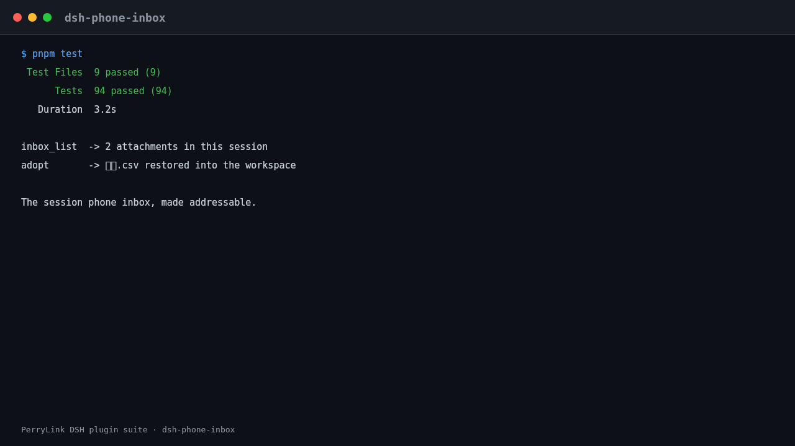
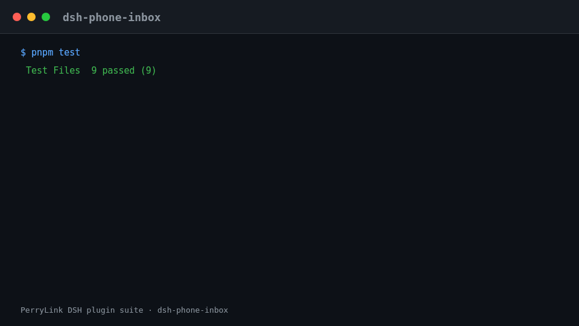

# dsh-phone-inbox

[English](README.md) · [简体中文](README-zh.md) · [Español](README-es.md) · [Português](README-pt.md) · [हिन्दी](README-hi.md)

La bandeja de entrada de adjuntos del teléfono (puente de WeChat) de esta sesión: enumera los adjuntos que **esta conversación** recibió realmente y adopta uno en el espacio de trabajo cuando se pida.





## Install & uninstall

```sh
dsh plugin --profile <name> add dsh-phone-inbox
dsh plugin --profile <name> remove dsh-phone-inbox
```

El plugin **no tiene dependencias en tiempo de ejecución** (`dependencies` está vacío). Sus únicas dependencias entre pares son los paquetes anfitriones contra los que se compila; véase el bloque `peerDependencies` en `package.json`.

## The problem this closes

`dsh-wechat` guarda los medios entrantes del teléfono en `~/.dsh-wechat/tempfile/` — fuera del espacio de trabajo de la sesión — y escribe la ruta absoluta en un bloque de texto plano. Se siguen dos consecuencias, y ninguna es visible para el usuario:

1. **Las herramientas confinadas al espacio de trabajo no pueden leerlo.** `dsh-data-quality` rechaza cualquier ruta que escape del espacio de trabajo de la sesión (`path-escape`), así que «te envié un CSV, perfílalo» falla aunque el archivo esté ahí mismo.
2. **El nombre del archivo queda destruido.** El puente lo nombra `${Date.now()}-${rand4hex}-${name.replace(/[^\w.-]/g, "_")}`, así que `材料.csv` acaba en disco como `__.csv`. El usuario no reconoce su propio archivo.

`dsh-phone-inbox` no añade ningún canal nuevo y no copia nada por defecto. Hace direccionable la lista entrante de la propia sesión y recupera el nombre que el puente destrozó — a partir del marcador `[收到文件: <name>]` que el puente ya escribe.

## What you get

| Herramienta | Pregunta que responde |
|---|---|
| `inbox_list` | «¿Dónde está el archivo que acabo de enviarte desde el teléfono?» |
| `inbox_adopt` | «Ponlo donde mis herramientas confinadas al espacio de trabajo puedan leerlo.» |

Ambas herramientas las registra el plugin funcional, así que aparecen en la lista de herramientas del modelo en cuanto se monta la fila del bundle.

## Quick start

```sh
# 1. Montar el plugin (una fila de bundle en el perfil destino)
dsh plugin --profile <name> add dsh-phone-inbox
```

Después, en una sesión que recibió un adjunto del teléfono:

```text
inbox_list                                   # las rutas que recibió esta sesión
inbox_adopt { "path": "<the path from inbox_list>" }
```

`inbox_adopt` devuelve `relativePath` (por ejemplo `phone-inbox/材料.csv`). Pasa **esa** ruta a una herramienta confinada al espacio de trabajo como `data_profile`; pasa la ruta anfitriona original solo a consumidores que aceptan cualquier ruta absoluta.

## Compatibility

| Engine | Range |
|---|---|
| Node.js | `^22.19.0 \|\| >=24.0.0` |
| DSH | `>=0.2.1-alpha.1` |

El rango de pares del anfitrión es el rango OR canónico de seis cláusulas del ecosistema (véase `dsh-plugin-kit/data/peer-range.json`). El anfitrión evalúa `peerDependencies` en el preflight y **desactiva silenciosamente** una fila de plugin cuyo rango no admita la versión en ejecución, así que un rango equivocado parece «el plugin se montó y no hace nada». El anfitrión también evalúa `engines.dsh` de forma independiente; una discrepancia ahí puede desactivar la fila aunque el rango de pares admita la versión.

## Configuration

Todos los campos son opcionales; la tabla indica el valor por defecto. `cordis.patch.yml` contiene los mismos valores con comentarios en línea.

| Key | Por defecto | Significado |
|---|---|---|
| `enabled` | `true` | Interruptor maestro; `false` no monta servicio ni herramientas. |
| `inboxDir` | `""` → `~/.dsh-wechat/tempfile` | Directorio donde el puente deja los medios entrantes. Vacío deriva el valor por defecto del puente; se fija cuando se movió su `storageDir`. |
| `maxItems` | `5` | Tope de entradas que devuelve `inbox_list`. El contrato del MVP es «los últimos adjuntos de la sesión». |
| `provider` | `session` | Qué proveedor registrado responde: `session` (los mensajes de esta conversación) o `tempdir` (`session` más un escaneo de `inboxDir`). |
| `allowTempdirScan` | `false` | Habilita el escaneo del directorio. Desactivado porque `inboxDir` es global. |
| `tempdirScanMaxItems` | `5` | Tope de entradas que puede aportar un escaneo. |
| `tempdirScanMaxAgeMs` | `3600000` | Límite de antigüedad de un archivo escaneado; `0` desactiva el filtro. |
| `markers` | véase abajo | Redacción del marcador por tipo de medio, como fuentes `RegExp`. |
| `defaultSubdir` | `phone-inbox` | Subdirectorio del espacio de trabajo donde escribe `inbox_adopt`. |
| `restoreOriginalName` | `true` | Usar el nombre original recuperado del remitente como nombre adoptado. |
| `writeChannel` | `auto` | `auto` (servicio fs para texto, node:fs en caso contrario) · `fs` (solo el servicio fs del anfitrión) · `node` (bytes directamente). |
| `registerAttachment` | `false` | Registrar también los bytes adoptados como adjunto duradero del anfitrión. Los objetos de adjunto nunca se recolectan. |

La redacción por defecto de `markers`, por tipo de medio — cada valor es una fuente `RegExp` cuyo **primer grupo de captura es la ruta**:

- `image.path` — `` 文件已保存到:\s*(\S+) ``
- `file.path` — `` (?:文件已保存到|文件路径):\s*(\S+) ``
- `file.name` — `` \[收到文件:\s*([^\]\r\n]+)\] ``
- `video.path` — `` 文件已保存到:\s*(\S+) ``

La redacción del marcador es un **contrato blando** con el puente: escribe la ruta en prosa y la prosa puede cambiar entre versiones del puente sin aviso. Los patrones son configuración precisamente para que un cambio de redacción sea una edición de configuración y no una publicación del plugin.

## Tools & surfaces

```ts
inbox_list({
  limit?: number,            // por defecto: config.maxItems
  includeTempdir?: boolean,  // solo se honra cuando allowTempdirScan es true
})
```

Devuelve `{ ok: true, source, inboxDir, items[], attachments, deriveMessages, emptyReason?, emptyDetail?, tempdirScan, unresolvedAttachmentBlocks }`, o `{ ok: false, reason, detail }`.

```ts
inbox_adopt({
  path: string,              // obligatorio: exactamente lo que informó inbox_list
  name?: string,             // por defecto: el nombre original recuperado
  subdir?: string,           // por defecto: config.defaultSubdir
  channel?: 'auto' | 'fs' | 'node',
  overwrite?: boolean,       // por defecto false: un duplicado recibe sufijo -1
  register?: boolean,        // por defecto: config.registerAttachment
})
```

Devuelve `{ ok: true, item }` con `hostPath`, `workspacePath`, `relativePath`, `bytes`, `sha256`, `copyMethod`, `nameRestored`, `sourceLeafName`, y `attachmentId`/`attachmentHostPath` cuando se registra; o `{ ok: false, reason, detail }`.

El plugin también añade una sección al prompt del sistema (`phone-inbox`, orden 320) para que el modelo sepa que la capacidad existe, y se suscribe a `session/event` para observar `user/message`. Ninguna de las dos es necesaria para la corrección: la lectura del historial es autoritativa en cada llamada.

## Permissions & data

- **Lee** `inboxDir` y los mensajes de la propia sesión llamante. Nada más.
- **Escribe** solo dentro del espacio de trabajo de la sesión (`path.resolve` más una comprobación de contención consciente del separador), y solo cuando se llama a `inbox_adopt`.
- **Rechaza** una ruta de origen que no esté bajo `inboxDir`, un `subdir` que escape del espacio de trabajo y un nombre que pudiera atravesar directorios. El argumento `path` viene del modelo y nunca se confía en él.
- **No escanea** el directorio de bandeja compartido salvo que `allowTempdirScan` esté habilitado explícitamente; cuando lo hace, cada entrada que aporta lleva `source: "tempdir"`.
- **Nunca sobrescribe** en silencio. Un destino duplicado recibe un sufijo `-1`, `-2`, … salvo `overwrite: true`.
- **No registra nada** como adjunto duradero salvo que se pida; el registro copia bytes al almacén de adjuntos del anfitrión, que no tiene recolección de basura.

## Security boundaries

- Las lecturas no están cercadas por el sandbox fs del anfitrión (la cerca solo envuelve `writeText`/`editText`), así que este plugin aplica su propia contención en **ambos** extremos de la copia.
- El canal de escritura `fs` pasa por `ctx.fs.writeText` con la política de sandbox del ámbito de sesión, así que un backend restrictivo lo cerca exactamente igual que cerca la herramienta `write`. `node` omite esa cerca por construcción; existe porque `ctx.fs` no tiene API de escritura de bytes. El `copyMethod` devuelto siempre dice cuál se ejecutó.
- `auto` prefiere el servicio fs para texto y recurre a `node:fs`; el motivo del repliegue se registra y el canal se informa, nunca se insinúa.
- El escaneo del directorio temporal no puede demostrar a qué conversación pertenece un archivo. Por eso está desactivado por defecto y por eso sus entradas llevan su propio `source`.
- No se garantiza que el directorio de bandeja del puente sea privado (una refactorización del puente eliminó el manejo explícito de `0o700`/`0o600`). Este plugin no supone lo contrario.

## Known limitations

- **Una ruta con un espacio literal se trunca** en el espacio. La captura es `(\S+)` porque eso es lo que impide que se trague la frase que el puente escribe tras la ruta; los nombres temporales del propio puente nunca contienen un espacio.
- **Los tipos imagen y vídeo se informan como `file`.** El puente usa la misma redacción para ambos, así que el tipo no es recuperable del texto; el nombre de hoja (`image.png`, `video.mp4`) los distingue.
- **Una imagen o un vídeo no tienen nombre original recuperable.** El puente los guarda como `image.<ext>` / `video.mp4` y la redacción no lleva nombre original. El plugin informa el nombre en disco y lo dice, en lugar de inventarlo.
- **Una ruta de Windows solo es utilizable en Windows** (y una de POSIX solo en POSIX). El plugin normaliza los separadores como lo hace la plataforma en ejecución.
- **`inbox_adopt` necesita que el archivo siga existiendo.** El puente nunca limpia `tempfile/`, pero nada garantiza que permanezca.
- **No se ha ejercitado tráfico real de WeChat.** El script de aceptación muestra qué *sí* está verificado, y su salida indica la frontera entre lo scriptado y lo real.

## Development

```sh
pnpm install
pnpm run typecheck && pnpm test && pnpm run build \
  && pnpm run verify:self-contained && pnpm run verify:artifacts \
  && pnpm run check:readmes && pnpm run check:lockfile
pnpm run acceptance          # de extremo a extremo: sonda -> lista -> adopción -> dsh-data-quality
```

`prepublishOnly` vuelve a ejecutar la compuerta, así que una publicación no puede enviar un árbol sin construir o desviado.

## Topics

`dsh` · `dsh-plugin` · `deepseek-harness` · `cordis` · `wechat` · `inbox` · `attachment` · `phone`

## Contributors

PerryLink.

## Familia de plugins DSH de PerryLink

Este proyecto forma parte de la familia de plugins de DeepSeek Harness de [PerryLink](https://github.com/PerryLink). El registro permanece plegado abajo para que cada README conserve una primera pantalla corta; expándelo para ver cada fila y su estado.

<details>
<summary>Expandir todos los plugins</summary>

| Plugin | Estado |
|---|---|
| **[dsh-aqua-input-check](https://github.com/PerryLink/dsh-aqua-input-check)** |  |
| **[dsh-archive-check](https://github.com/PerryLink/dsh-archive-check)** |  |
| **[dsh-auto-review](https://github.com/PerryLink/dsh-auto-review)** |  |
| **[dsh-autotier](https://github.com/PerryLink/dsh-autotier)** |  |
| **[dsh-bid-ca-precheck](https://github.com/PerryLink/dsh-bid-ca-precheck)** |  |
| **[dsh-bid-qual-check](https://github.com/PerryLink/dsh-bid-qual-check)** |  |
| **[dsh-cert-mcp](https://github.com/PerryLink/dsh-cert-mcp)** |  |
| **[dsh-checkpoint-rewind](https://github.com/PerryLink/dsh-checkpoint-rewind)** |  |
| **[dsh-click](https://github.com/PerryLink/dsh-click)** |  |
| **[dsh-composer-history](https://github.com/PerryLink/dsh-composer-history)** |  |
| **[dsh-contract-stance](https://github.com/PerryLink/dsh-contract-stance)** |  |
| **[dsh-customs-doc-check](https://github.com/PerryLink/dsh-customs-doc-check)** |  |
| **[dsh-data-quality](https://github.com/PerryLink/dsh-data-quality)** |  |
| **[dsh-demurrage-ledger](https://github.com/PerryLink/dsh-demurrage-ledger)** |  |
| **[dsh-doublecheck](https://github.com/PerryLink/dsh-doublecheck)** |  |
| **[dsh-drill-script-check](https://github.com/PerryLink/dsh-drill-script-check)** |  |
| **[dsh-eia-guide-check](https://github.com/PerryLink/dsh-eia-guide-check)** |  |
| **[dsh-emergency-plan](https://github.com/PerryLink/dsh-emergency-plan)** |  |
| **[dsh-essay-rubric-check](https://github.com/PerryLink/dsh-essay-rubric-check)** |  |
| **[dsh-evidence-check](https://github.com/PerryLink/dsh-evidence-check)** |  |
| **[dsh-export-ctl-check](https://github.com/PerryLink/dsh-export-ctl-check)** |  |
| **[dsh-fast](https://github.com/PerryLink/dsh-fast)** |  |
| **[dsh-fmea-table-check](https://github.com/PerryLink/dsh-fmea-table-check)** |  |
| **[dsh-forecast-penalty](https://github.com/PerryLink/dsh-forecast-penalty)** |  |
| **[dsh-fund-research](https://github.com/PerryLink/dsh-fund-research)** |  |
| **[dsh-github](https://github.com/PerryLink/dsh-github)** |  |
| **[dsh-gongwen-flow-check](https://github.com/PerryLink/dsh-gongwen-flow-check)** |  |
| **[dsh-gongwen-word-check](https://github.com/PerryLink/dsh-gongwen-word-check)** |  |
| **[dsh-guard-plan-qc](https://github.com/PerryLink/dsh-guard-plan-qc)** |  |
| **[dsh-hazchem-check](https://github.com/PerryLink/dsh-hazchem-check)** |  |
| **[dsh-hazplan-check](https://github.com/PerryLink/dsh-hazplan-check)** |  |
| **[dsh-hidden-risk-map](https://github.com/PerryLink/dsh-hidden-risk-map)** |  |
| **[dsh-hs-classify](https://github.com/PerryLink/dsh-hs-classify)** |  |
| **[dsh-icd-rule-check](https://github.com/PerryLink/dsh-icd-rule-check)** |  |
| **[dsh-industry-research](https://github.com/PerryLink/dsh-industry-research)** |  |
| **[dsh-lawcite-adapter](https://github.com/PerryLink/dsh-lawcite-adapter)** |  |
| **[dsh-laya](https://github.com/PerryLink/dsh-laya)** |  |
| **[dsh-lc-doc-check](https://github.com/PerryLink/dsh-lc-doc-check)** |  |
| **[dsh-learning-gap-check](https://github.com/PerryLink/dsh-learning-gap-check)** |  |
| **[dsh-library](https://github.com/PerryLink/dsh-library)** |  |
| **[dsh-local-ai](https://github.com/PerryLink/dsh-local-ai)** |  |
| **[dsh-lsp-actions](https://github.com/PerryLink/dsh-lsp-actions)** |  |
| **[dsh-mask](https://github.com/PerryLink/dsh-mask)** |  |
| **[dsh-mcp-panel](https://github.com/PerryLink/dsh-mcp-panel)** |  |
| **[dsh-medrec-qc](https://github.com/PerryLink/dsh-medrec-qc)** |  |
| **[dsh-memento](https://github.com/PerryLink/dsh-memento)** |  |
| **[dsh-nsfc-form-check](https://github.com/PerryLink/dsh-nsfc-form-check)** |  |
| **[dsh-nurse-record-check](https://github.com/PerryLink/dsh-nurse-record-check)** |  |
| **[dsh-observe](https://github.com/PerryLink/dsh-observe)** |  |
| **[dsh-origin-rvc-check](https://github.com/PerryLink/dsh-origin-rvc-check)** |  |
| **[dsh-ota-review-check](https://github.com/PerryLink/dsh-ota-review-check)** |  |
| **[dsh-output-styles](https://github.com/PerryLink/dsh-output-styles)** |  |
| **[dsh-paper-doc-adapter](https://github.com/PerryLink/dsh-paper-doc-adapter)** |  |
| **[dsh-permission-rules](https://github.com/PerryLink/dsh-permission-rules)** |  |
| **[dsh-permit-report-check](https://github.com/PerryLink/dsh-permit-report-check)** |  |
| **[dsh-pipeline-check](https://github.com/PerryLink/dsh-pipeline-check)** |  |
| **[dsh-pleading-draft](https://github.com/PerryLink/dsh-pleading-draft)** |  |
| **[dsh-plugin-doctor](https://github.com/PerryLink/dsh-plugin-doctor)** |  |
| **[dsh-plugin-guide](https://github.com/PerryLink/dsh-plugin-guide)** |  |
| **[dsh-plugin-kit](https://github.com/PerryLink/dsh-plugin-kit)** |  |
| **[dsh-plugin-upgrade](https://github.com/PerryLink/dsh-plugin-upgrade)** |  |
| **[dsh-policy-brief-draft](https://github.com/PerryLink/dsh-policy-brief-draft)** |  |
| **[dsh-power-loss-split](https://github.com/PerryLink/dsh-power-loss-split)** |  |
| **[dsh-power-ticket-check](https://github.com/PerryLink/dsh-power-ticket-check)** |  |
| **[dsh-ppap-check](https://github.com/PerryLink/dsh-ppap-check)** |  |
| **[dsh-protest-deadline](https://github.com/PerryLink/dsh-protest-deadline)** |  |
| **[dsh-railway-window](https://github.com/PerryLink/dsh-railway-window)** |  |
| **[dsh-repair-order-qc](https://github.com/PerryLink/dsh-repair-order-qc)** |  |
| **[dsh-research-report](https://github.com/PerryLink/dsh-research-report)** |  |
| **[dsh-review-reply-check](https://github.com/PerryLink/dsh-review-reply-check)** |  |
| **[dsh-rulefile-check](https://github.com/PerryLink/dsh-rulefile-check)** |  |
| **[dsh-safety-brief-check](https://github.com/PerryLink/dsh-safety-brief-check)** |  |
| **[dsh-score](https://github.com/PerryLink/dsh-score)** |  |
| **[dsh-session-sync](https://github.com/PerryLink/dsh-session-sync)** |  |
| **[dsh-site-log-check](https://github.com/PerryLink/dsh-site-log-check)** |  |
| **[dsh-skill-pack-security](https://github.com/PerryLink/dsh-skill-pack-security)** |  |
| **[dsh-soe-decision-check](https://github.com/PerryLink/dsh-soe-decision-check)** |  |
| **[dsh-soilwater-check](https://github.com/PerryLink/dsh-soilwater-check)** |  |
| **[dsh-sop-sync-check](https://github.com/PerryLink/dsh-sop-sync-check)** |  |
| **[dsh-spc-gbt-adapter](https://github.com/PerryLink/dsh-spc-gbt-adapter)** |  |
| **[dsh-talk](https://github.com/PerryLink/dsh-talk)** |  |
| **[dsh-tender-extract](https://github.com/PerryLink/dsh-tender-extract)** |  |
| **[dsh-tender-matrix](https://github.com/PerryLink/dsh-tender-matrix)** |  |
| **[dsh-test-drive](https://github.com/PerryLink/dsh-test-drive)** |  |
| **[dsh-ticktick](https://github.com/PerryLink/dsh-ticktick)** |  |
| **[dsh-translate](https://github.com/PerryLink/dsh-translate)** |  |
| **[dsh-warranty-calc](https://github.com/PerryLink/dsh-warranty-calc)** |  |
| **[dsh-budget](https://github.com/PerryLink/dsh-budget)** | 🧊 CONGELADO — ver el README del repositorio |
| **[dsh-claude-move](https://github.com/PerryLink/dsh-claude-move)** | 🧊 CONGELADO — ver el README del repositorio |
| **[dsh-defend](https://github.com/PerryLink/dsh-defend)** | 🧊 CONGELADO — ver el README del repositorio |
| **[dsh-draw](https://github.com/PerryLink/dsh-draw)** | 🧊 CONGELADO — ver el README del repositorio |
| **[dsh-reach](https://github.com/PerryLink/dsh-reach)** | 🧊 CONGELADO — ver el README del repositorio |
| **[dsh-background-agents](https://github.com/PerryLink/dsh-background-agents)** | 🚫 RETIRADO — ver el README del repositorio |
| **[dsh-session-pin](https://github.com/PerryLink/dsh-session-pin)** | 🚫 RETIRADO — ver el README del repositorio |
| **[dsh-team-rooms](https://github.com/PerryLink/dsh-team-rooms)** | 🚫 RETIRADO — ver el README del repositorio |

</details>## License

Apache-2.0. Todos los archivos de este repositorio están cubiertos por ella.
