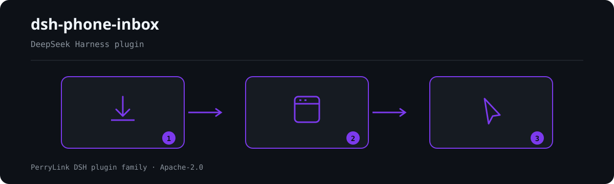

# dsh-phone-inbox

[English](README.md) · [简体中文](README-zh.md) · [Español](README-es.md) · [Português](README-pt.md) · [हिन्दी](README-hi.md)

本会话的「手机（微信桥）入站附件」收件箱：列出**这次对话**真正收到的附件，并按需把某一条取进工作区。



*工作流概览：安装 → 打开面板 → 操作。下面的示例使用实际命令面。*


## Install & uninstall

```sh
dsh plugin --profile <name> add dsh-phone-inbox
dsh plugin --profile <name> remove dsh-phone-inbox
```

本插件**没有任何运行时依赖**（`dependencies` 为空）。它唯一的 peer 是编译所依赖的宿主包，见 `package.json` 的 `peerDependencies`。

## The problem this closes

`dsh-wechat` 把手机发来的媒体存到 `~/.dsh-wechat/tempfile/` —— 在会话工作区**之外** —— 并把绝对路径写进一个纯文本块。由此产生两个后果，而用户都看不见：

1. **强制工作区的工具读不到它。** `dsh-data-quality` 会拒绝任何逃出会话工作区的路径（`path-escape`），所以「我发了个 CSV，帮我画像」会失败，尽管文件就在那儿。
2. **文件名被摧毁。** 桥的命名是 `${Date.now()}-${rand4hex}-${name.replace(/[^\w.-]/g, "_")}`，于是 `材料.csv` 落到磁盘上变成 `__.csv`，用户认不出自己的文件。

`dsh-phone-inbox` 不新开通道、默认也不复制任何东西。它把本会话自己的入站清单变成可寻址的，并从桥**本来就写好的** `[收到文件: <name>]` 标记里把被压坏的文件名恢复出来。

## What you get

| 工具 | 它回答的问题 |
|---|---|
| `inbox_list` | 「我刚从手机发给你的文件在哪？」 |
| `inbox_adopt` | 「把它放到我那些强制工作区的工具能读的地方。」 |

两个工具都由函数式插件注册，bundle 行一挂载就出现在模型的工具列表里。

## Quick start

```sh
# 1. 把插件挂到目标 profile（作为 bundle 行）
dsh plugin --profile <name> add dsh-phone-inbox
```

然后，在收到过手机附件的那个会话里：

```text
inbox_list                                   # 本会话收到的路径
inbox_adopt { "path": "<inbox_list 给出的路径>" }
```

`inbox_adopt` 会返回 `relativePath`（例如 `phone-inbox/材料.csv`）。把它交给强制工作区的工具（例如 `data_profile`）；原始宿主路径只交给那些接受任意绝对路径的消费方。

## Compatibility

| Engine | Range |
|---|---|
| Node.js | `^22.19.0 \|\| >=24.0.0` |
| DSH | `>=0.2.1-alpha.1` |

宿主 peer 区间是生态规范的六段 OR 区间（见 `dsh-plugin-kit/data/peer-range.json`）。宿主会在 preflight 时评估 `peerDependencies`，并把区间不接受的插件行**静默 disabled** —— 所以错误的区间看起来就像「插件挂上了但什么都不做」。宿主也会单独裁决 `engines.dsh`；即使 peer 区间接受该版本，这里的区间不匹配同样可能让插件行被禁用。

### 示例

以下为插件真实入口；安装后调用一个即可。

#### 详细示例

**命令**

~~~sh
inbox_adopt
~~~

**输入**

~~~json
{
  "path": "/tmp/dsh-test-phone-inbox-acceptance-5AoMHy/.dsh-wechat/tempfile/1792414010975-0a67121b-__.csv"
}
~~~

**输出**

~~~text
{
  "relativePath": "phone-inbox/材料.csv",
  "copyMethod": "node-fs"
}
~~~

*来源 `plugins/dsh-phone-inbox/scripts/acceptance.mjs:134-147`*

#### 失败分支

**输入**

~~~text
{"path":"/tmp/dsh-phone-inbox-example/workspace/local.csv"}
~~~

**输出**

~~~text
phone-inbox could not adopt that attachment.
reason: not-in-inbox
/tmp/dsh-phone-inbox-example/workspace/local.csv is not inside the inbox directory /tmp/dsh-phone-inbox-example/inbox; this plugin only adopts files the bridge saved there
~~~

*来源 `plugins/dsh-phone-inbox/src/provider-base.ts:443-449; plugins/dsh-phone-inbox/src/render.ts:108-115; plugins/dsh-phone-inbox/tests/integration.test.ts:359-368`*

#### 简短示例

- `inbox_adopt`

## Configuration

每个字段都可选；表里给的是默认值。`cordis.patch.yml` 里有同样取值并带行内注释。

| Key | 默认 | 含义 |
|---|---|---|
| `enabled` | `true` | 总开关；`false` 时既不挂服务也不注册工具。 |
| `inboxDir` | `""` → `~/.dsh-wechat/tempfile` | 桥落入站媒体的目录。留空则推导桥自己的默认值；桥的 `storageDir` 被挪动时显式设置。 |
| `maxItems` | `5` | `inbox_list` 返回条数上限。MVP 约定是「本会话最近几条」。 |
| `provider` | `session` | 由哪个已注册 provider 回答：`session`（本对话自己的消息）或 `tempdir`（`session` 加对 `inboxDir` 的扫描）。 |
| `allowTempdirScan` | `false` | 是否启用目录扫描。默认关，因为 `inboxDir` 是全局的。 |
| `tempdirScanMaxItems` | `5` | 扫描最多贡献的条数。 |
| `tempdirScanMaxAgeMs` | `3600000` | 扫描文件的年龄上限；`0` 表示不过滤。 |
| `markers` | 见下 | 各媒体类型的标记文案，取值为 `RegExp` source。 |
| `defaultSubdir` | `phone-inbox` | `inbox_adopt` 写入的工作区子目录。 |
| `restoreOriginalName` | `true` | 用恢复出的发件人原始名作为取用后的文件名。 |
| `writeChannel` | `auto` | `auto`（文本走 fs 服务，其余走 node:fs）· `fs`（只走宿主 fs 服务）· `node`（直接写字节）。 |
| `registerAttachment` | `false` | 同时把取用的字节登记为宿主持久附件。附件对象永不被 GC。 |

`markers` 的默认文案，按媒体类型 —— 每个值都是 `RegExp` source，其**第一个捕获组是路径**：

- `image.path` — `` 文件已保存到:\s*(\S+) ``
- `file.path` — `` (?:文件已保存到|文件路径):\s*(\S+) ``
- `file.name` — `` \[收到文件:\s*([^\]\r\n]+)\] ``
- `video.path` — `` 文件已保存到:\s*(\S+) ``

标记文案是与桥的**软契约**：桥把路径写进散文，而散文可能随桥的版本无声变化。这些模式做成配置项，正是为了让文案变化成为一次配置修改，而不是一次插件发版。

## Tools & surfaces

```ts
inbox_list({
  limit?: number,            // 默认 config.maxItems
  includeTempdir?: boolean,  // 仅当 allowTempdirScan 为真才生效
})
```

返回 `{ ok: true, source, inboxDir, items[], attachments, deriveMessages, emptyReason?, emptyDetail?, tempdirScan, unresolvedAttachmentBlocks }`，或 `{ ok: false, reason, detail }`。

```ts
inbox_adopt({
  path: string,              // 必填：原样使用 inbox_list 给出的值
  name?: string,             // 默认：恢复出的原始文件名
  subdir?: string,           // 默认：config.defaultSubdir
  channel?: 'auto' | 'fs' | 'node',
  overwrite?: boolean,       // 默认 false：重名会加 -1 后缀
  register?: boolean,        // 默认：config.registerAttachment
})
```

成功返回 `{ ok: true, item }`，含 `hostPath`、`workspacePath`、`relativePath`、`bytes`、`sha256`、`copyMethod`、`nameRestored`、`sourceLeafName`，登记时另有 `attachmentId`/`attachmentHostPath`；失败返回 `{ ok: false, reason, detail }`。

插件还会追加一段系统提示词小节（`phone-inbox`，order 320），让模型知道这个能力存在；并订阅 `session/event` 观察 `user/message`。两者都不是正确性的前提：历史读取在每次调用时都是权威来源。

## Permissions & data

- **读** `inboxDir` 与调用会话自己的消息，别的都不读。
- **只在会话工作区内写**（`path.resolve` + 分隔符感知的包含判定），且只在调用 `inbox_adopt` 时写。
- **拒绝**不在 `inboxDir` 下的源路径、逃出工作区的 `subdir`、以及可能穿越的文件名。`path` 参数来自模型，永不被信任。
- **默认不扫描**共享的 inbox 目录，除非显式打开 `allowTempdirScan`；开启后它贡献的每一条都带 `source: "tempdir"`。
- **永不静默覆盖**。重名目标会得到 `-1`、`-2`…… 后缀，除非 `overwrite: true`。
- **默认不登记**持久附件；登记会把字节复制进宿主的附件库，而那里没有垃圾回收。

## Security boundaries

- 读不受宿主 fs 沙箱围栏（围栏只包 `writeText`/`editText`），因此本插件在复制的**两端**都自己做包含判定。
- `fs` 写通道走 `ctx.fs.writeText` 并带会话作用域的沙箱策略，所以限制型后端会像围栏 `write` 工具一样围栏它。`node` 通道按构造绕过该围栏；它存在的原因是 `ctx.fs` 没有字节写 API。返回的 `copyMethod` 永远说明到底哪条通道写了。
- `auto` 对文本优先走 fs 服务、失败回退 `node:fs`；回退原因被记录、通道被上报，绝不靠暗示。
- 目录扫描无法证明某个文件属于哪次对话。这正是它默认关闭、且其条目自带 `source` 的原因。
- 桥的 inbox 目录不保证是私有的（一次桥重构移除了显式的 `0o700`/`0o600` 处理）。本插件不假设它私有。

## Known limitations

- **路径里含字面空格会被截断**在空格处。捕获用 `(\S+)`，因为正是它阻止捕获吞掉桥写在路径后面的那句话；桥自己的临时文件名从不含空格。
- **图片与视频的 kind 都报成 `file`。** 桥对两者用同一句文案，kind 无法从文本恢复；靠叶名（`image.png`、`video.mp4`）区分。
- **图片/视频没有可恢复的原始名。** 桥把它们存成 `image.<ext>` / `video.mp4`，文案里不带原始名。插件如实报告磁盘名并说明，而不是编一个。
- **Windows 路径只在 Windows 上可用**（POSIX 路径同理）。插件按运行平台归一化分隔符。
- **`inbox_adopt` 要求文件仍然存在。** 桥从不清理 `tempfile/`，但没有任何东西保证它留着。
- **没有跑过真实微信流量。** 验收脚本说明了什么是被脚本化验证的，其输出说明了脚本化与真机的边界。

## Development

```sh
pnpm install
pnpm run typecheck && pnpm test && pnpm run build \
  && pnpm run verify:self-contained && pnpm run verify:artifacts \
  && pnpm run check:readmes && pnpm run check:lockfile
pnpm run acceptance          # 端到端：探测 -> 列表 -> 取用 -> dsh-data-quality
```

`prepublishOnly` 会重跑整条闸门链，所以发布不可能发出未构建或已漂移的树。

## Topics

`dsh` · `dsh-plugin` · `deepseek-harness` · `cordis` · `wechat` · `inbox` · `attachment` · `phone`

## Contributors

PerryLink。

## PerryLink DSH Plugin Family

本项目是 [PerryLink](https://github.com/PerryLink) 维护的 DeepSeek Harness 插件家族成员。完整名单默认折叠，避免每个 README 的首屏被长表淹没；点击展开可查看每一行及其状态。

<details>
<summary>展开全部插件</summary>

| 插件 | 状态 |
|---|---|
| **[dsh-aqua-input-check](https://github.com/PerryLink/dsh-aqua-input-check)** |  |
| **[dsh-archive-check](https://github.com/PerryLink/dsh-archive-check)** |  |
| **[dsh-auto-review](https://github.com/PerryLink/dsh-auto-review)** |  |
| **[dsh-autotier](https://github.com/PerryLink/dsh-autotier)** |  |
| **[dsh-bid-ca-precheck](https://github.com/PerryLink/dsh-bid-ca-precheck)** |  |
| **[dsh-bid-qual-check](https://github.com/PerryLink/dsh-bid-qual-check)** |  |
| **[dsh-cert-mcp](https://github.com/PerryLink/dsh-cert-mcp)** |  |
| **[dsh-checkpoint-rewind](https://github.com/PerryLink/dsh-checkpoint-rewind)** |  |
| **[dsh-click](https://github.com/PerryLink/dsh-click)** |  |
| **[dsh-composer-history](https://github.com/PerryLink/dsh-composer-history)** |  |
| **[dsh-contract-stance](https://github.com/PerryLink/dsh-contract-stance)** |  |
| **[dsh-customs-doc-check](https://github.com/PerryLink/dsh-customs-doc-check)** |  |
| **[dsh-data-quality](https://github.com/PerryLink/dsh-data-quality)** |  |
| **[dsh-demurrage-ledger](https://github.com/PerryLink/dsh-demurrage-ledger)** |  |
| **[dsh-doublecheck](https://github.com/PerryLink/dsh-doublecheck)** |  |
| **[dsh-drill-script-check](https://github.com/PerryLink/dsh-drill-script-check)** |  |
| **[dsh-eia-guide-check](https://github.com/PerryLink/dsh-eia-guide-check)** |  |
| **[dsh-emergency-plan](https://github.com/PerryLink/dsh-emergency-plan)** |  |
| **[dsh-essay-rubric-check](https://github.com/PerryLink/dsh-essay-rubric-check)** |  |
| **[dsh-evidence-check](https://github.com/PerryLink/dsh-evidence-check)** |  |
| **[dsh-export-ctl-check](https://github.com/PerryLink/dsh-export-ctl-check)** |  |
| **[dsh-fast](https://github.com/PerryLink/dsh-fast)** |  |
| **[dsh-fmea-table-check](https://github.com/PerryLink/dsh-fmea-table-check)** |  |
| **[dsh-forecast-penalty](https://github.com/PerryLink/dsh-forecast-penalty)** |  |
| **[dsh-fund-research](https://github.com/PerryLink/dsh-fund-research)** |  |
| **[dsh-github](https://github.com/PerryLink/dsh-github)** |  |
| **[dsh-gongwen-flow-check](https://github.com/PerryLink/dsh-gongwen-flow-check)** |  |
| **[dsh-gongwen-word-check](https://github.com/PerryLink/dsh-gongwen-word-check)** |  |
| **[dsh-guard-plan-qc](https://github.com/PerryLink/dsh-guard-plan-qc)** |  |
| **[dsh-hazchem-check](https://github.com/PerryLink/dsh-hazchem-check)** |  |
| **[dsh-hazplan-check](https://github.com/PerryLink/dsh-hazplan-check)** |  |
| **[dsh-hidden-risk-map](https://github.com/PerryLink/dsh-hidden-risk-map)** |  |
| **[dsh-hs-classify](https://github.com/PerryLink/dsh-hs-classify)** |  |
| **[dsh-icd-rule-check](https://github.com/PerryLink/dsh-icd-rule-check)** |  |
| **[dsh-industry-research](https://github.com/PerryLink/dsh-industry-research)** |  |
| **[dsh-lawcite-adapter](https://github.com/PerryLink/dsh-lawcite-adapter)** |  |
| **[dsh-laya](https://github.com/PerryLink/dsh-laya)** |  |
| **[dsh-lc-doc-check](https://github.com/PerryLink/dsh-lc-doc-check)** |  |
| **[dsh-learning-gap-check](https://github.com/PerryLink/dsh-learning-gap-check)** |  |
| **[dsh-library](https://github.com/PerryLink/dsh-library)** |  |
| **[dsh-local-ai](https://github.com/PerryLink/dsh-local-ai)** |  |
| **[dsh-lsp-actions](https://github.com/PerryLink/dsh-lsp-actions)** |  |
| **[dsh-mask](https://github.com/PerryLink/dsh-mask)** |  |
| **[dsh-mcp-panel](https://github.com/PerryLink/dsh-mcp-panel)** |  |
| **[dsh-medrec-qc](https://github.com/PerryLink/dsh-medrec-qc)** |  |
| **[dsh-memento](https://github.com/PerryLink/dsh-memento)** |  |
| **[dsh-nsfc-form-check](https://github.com/PerryLink/dsh-nsfc-form-check)** |  |
| **[dsh-nurse-record-check](https://github.com/PerryLink/dsh-nurse-record-check)** |  |
| **[dsh-observe](https://github.com/PerryLink/dsh-observe)** |  |
| **[dsh-origin-rvc-check](https://github.com/PerryLink/dsh-origin-rvc-check)** |  |
| **[dsh-ota-review-check](https://github.com/PerryLink/dsh-ota-review-check)** |  |
| **[dsh-output-styles](https://github.com/PerryLink/dsh-output-styles)** |  |
| **[dsh-paper-doc-adapter](https://github.com/PerryLink/dsh-paper-doc-adapter)** |  |
| **[dsh-permission-rules](https://github.com/PerryLink/dsh-permission-rules)** |  |
| **[dsh-permit-report-check](https://github.com/PerryLink/dsh-permit-report-check)** |  |
| **[dsh-pipeline-check](https://github.com/PerryLink/dsh-pipeline-check)** |  |
| **[dsh-pleading-draft](https://github.com/PerryLink/dsh-pleading-draft)** |  |
| **[dsh-plugin-doctor](https://github.com/PerryLink/dsh-plugin-doctor)** |  |
| **[dsh-plugin-guide](https://github.com/PerryLink/dsh-plugin-guide)** |  |
| **[dsh-plugin-kit](https://github.com/PerryLink/dsh-plugin-kit)** |  |
| **[dsh-plugin-upgrade](https://github.com/PerryLink/dsh-plugin-upgrade)** |  |
| **[dsh-policy-brief-draft](https://github.com/PerryLink/dsh-policy-brief-draft)** |  |
| **[dsh-power-loss-split](https://github.com/PerryLink/dsh-power-loss-split)** |  |
| **[dsh-power-ticket-check](https://github.com/PerryLink/dsh-power-ticket-check)** |  |
| **[dsh-ppap-check](https://github.com/PerryLink/dsh-ppap-check)** |  |
| **[dsh-protest-deadline](https://github.com/PerryLink/dsh-protest-deadline)** |  |
| **[dsh-railway-window](https://github.com/PerryLink/dsh-railway-window)** |  |
| **[dsh-repair-order-qc](https://github.com/PerryLink/dsh-repair-order-qc)** |  |
| **[dsh-research-report](https://github.com/PerryLink/dsh-research-report)** |  |
| **[dsh-review-reply-check](https://github.com/PerryLink/dsh-review-reply-check)** |  |
| **[dsh-rulefile-check](https://github.com/PerryLink/dsh-rulefile-check)** |  |
| **[dsh-safety-brief-check](https://github.com/PerryLink/dsh-safety-brief-check)** |  |
| **[dsh-score](https://github.com/PerryLink/dsh-score)** |  |
| **[dsh-session-sync](https://github.com/PerryLink/dsh-session-sync)** |  |
| **[dsh-site-log-check](https://github.com/PerryLink/dsh-site-log-check)** |  |
| **[dsh-skill-pack-security](https://github.com/PerryLink/dsh-skill-pack-security)** |  |
| **[dsh-soe-decision-check](https://github.com/PerryLink/dsh-soe-decision-check)** |  |
| **[dsh-soilwater-check](https://github.com/PerryLink/dsh-soilwater-check)** |  |
| **[dsh-sop-sync-check](https://github.com/PerryLink/dsh-sop-sync-check)** |  |
| **[dsh-spc-gbt-adapter](https://github.com/PerryLink/dsh-spc-gbt-adapter)** |  |
| **[dsh-talk](https://github.com/PerryLink/dsh-talk)** |  |
| **[dsh-tender-extract](https://github.com/PerryLink/dsh-tender-extract)** |  |
| **[dsh-tender-matrix](https://github.com/PerryLink/dsh-tender-matrix)** |  |
| **[dsh-test-drive](https://github.com/PerryLink/dsh-test-drive)** |  |
| **[dsh-ticktick](https://github.com/PerryLink/dsh-ticktick)** |  |
| **[dsh-translate](https://github.com/PerryLink/dsh-translate)** |  |
| **[dsh-warranty-calc](https://github.com/PerryLink/dsh-warranty-calc)** |  |
| **[dsh-budget](https://github.com/PerryLink/dsh-budget)** | 🧊 已冻结 — 见仓库 README |
| **[dsh-claude-move](https://github.com/PerryLink/dsh-claude-move)** | 🧊 已冻结 — 见仓库 README |
| **[dsh-defend](https://github.com/PerryLink/dsh-defend)** | 🧊 已冻结 — 见仓库 README |
| **[dsh-draw](https://github.com/PerryLink/dsh-draw)** | 🧊 已冻结 — 见仓库 README |
| **[dsh-reach](https://github.com/PerryLink/dsh-reach)** | 🧊 已冻结 — 见仓库 README |
| **[dsh-background-agents](https://github.com/PerryLink/dsh-background-agents)** | 🚫 已退役 — 见仓库 README |
| **[dsh-session-pin](https://github.com/PerryLink/dsh-session-pin)** | 🚫 已退役 — 见仓库 README |
| **[dsh-team-rooms](https://github.com/PerryLink/dsh-team-rooms)** | 🚫 已退役 — 见仓库 README |

</details>

## License

Apache-2.0。本仓每个文件都受其覆盖。
