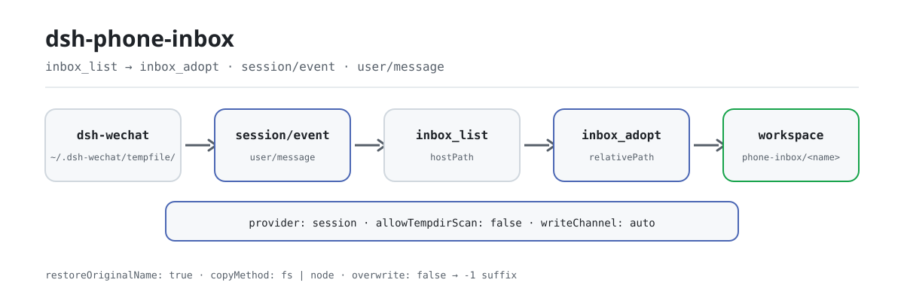

<div align="center">

<picture>
  <source media="(prefers-color-scheme: dark)" srcset="docs/assets/dsh-phone-inbox-flow-dark.svg">
  
</picture>

# dsh-phone-inbox

**Turn a phone attachment into an addressable workspace file — no new channel, no needless copy.**

The session's inbound attachment inbox for DeepSeek Harness: list the phone (WeChat bridge) attachments this conversation actually received, adopt one into the workspace on demand, and restore the file name the bridge mangled.

[Install](#three-step-setup) · [Configuration](#configuration) · [FAQ](#faq) · [简体中文](README.md) · [English](README.en.md) · [Español](README.es.md) · [Português](README.pt.md) · [हिन्दी](README.hi.md)

[](LICENSE)
[](#compatibility)
[](https://www.npmjs.com/package/dsh-phone-inbox)
[](https://github.com/PerryLink/dsh-phone-inbox/actions/workflows/ci.yml)
[](#compatibility)

[](https://github.com/PerryLink/dsh-phone-inbox/stargazers)
[](https://www.npmjs.com/package/dsh-phone-inbox)
[](https://dshfind.com/plugins/PerryLink/dsh-phone-inbox?ref=badge)
[](https://gitee.com/perrylink/dsh-phone-inbox)

```sh
dsh plugin --profile <name> add dsh-phone-inbox
```

</div>

<sub>Community plugin, not affiliated with DeepSeek. Canonical repository: <https://github.com/PerryLink/dsh-phone-inbox> (Gitee is a mirror).</sub>

## What it is

`dsh-wechat` saves inbound phone media under `~/.dsh-wechat/tempfile/` — outside the session workspace — and writes the absolute path into a plain-text message. `dsh-phone-inbox` recovers the list of attachments this conversation actually received (`inbox_list`), copies one into the workspace on demand (`inbox_adopt`), and restores the file name the bridge mangled along the way. It closes two gaps the user never sees: workspace-confined tools such as `dsh-data-quality` reject any path that escapes the session workspace (`path-escape`), and the bridge replaces every non-ASCII character in the file name with `_`, so a Chinese name lands on disk as `__.csv`. It adds no new channel and does not change the bridge: by default it reads only this session's own messages and never scans the shared directory. The source is decoupled from the provider: the default adapter reads `dsh-wechat`'s temp directory, a custom provider can supply another source, and `dsh-wechat` is optional, not a package dependency.

## Three-step setup

1. **Install** (pick one channel):

   ```sh
   # npm channel (published releases)
   dsh plugin --profile web add dsh-phone-inbox
   # tarball channel: pnpm pack in this repo, then
   dsh plugin --profile web add ./dsh-phone-inbox-<version>.tgz
   ```

   The plugin has **no runtime dependencies** (`dependencies` is empty). Its only peers are the host packages it is built against; see the `peerDependencies` block in `package.json`.

2. **Minimal config** (every field is optional; these are the defaults):

   ```yaml
   - insert:
       - id: dsh-phone-inbox
         name: dsh-phone-inbox
         config:
           provider: session
           maxItems: 5
   ```

   An empty `inboxDir` derives the bridge's own `~/.dsh-wechat/tempfile`; set it explicitly when the bridge's `storageDir` was moved.

3. **Verify it mounts**:

   ```sh
   dsh --profile web --dump-config | grep -A2 'id: dsh-phone-inbox'
   ```

   ```
   > inbox_list
   ```

   In a session that received a phone attachment, `inbox_list` returns the paths this session received; pass one of them to `inbox_adopt`.

**Uninstall**: `dsh plugin --profile web remove dsh-phone-inbox` (or remove the row from the profile patch).

## Core capabilities

Both tools are registered by the function plugin, so they appear in the model's tool list as soon as the bundle row is mounted:

- **Session list** — `inbox_list` takes the session-history read as its authoritative source and lists only the attachments this conversation actually received; it re-reads on every call instead of relying on a cache.
- **Adopt on demand** — `inbox_adopt` copies one attachment into the session workspace (the `phone-inbox/` subdirectory by default) and returns `relativePath` for workspace-confined tools such as `dsh-data-quality`.
- **Original-name recovery** — the bridge replaces every non-ASCII character with `_` (a Chinese file name lands on disk mangled); `inbox_adopt` uses the original name carried by the bridge's marker as the adopted file name.
- **Two providers** — `provider: session` (default, this session's own messages) or `tempdir` (`session` plus a scan of `inboxDir`); the scan is off by default because `inboxDir` is global and shared.
- **Explicit write channel** — `writeChannel` is `auto`, `fs`, or `node`, and the result's `copyMethod` always names the channel that actually ran; `fs` goes through the session sandbox policy.
- **Distinguishable failures** — an unreachable inbox returns `{ ok: false, reason, detail }` instead of an empty list; an empty result carries its own `emptyReason`, so the model never confuses "nothing arrived" with "it broke".
- **Prompt section and event** — the plugin appends one system-prompt section (`phone-inbox`, order 320) so the model knows the capability exists, and subscribes to `session/event` for `user/message` observation; neither is required for correctness.

### Tool surface

```ts
inbox_list({
  limit?: number,            // default: config.maxItems
  includeTempdir?: boolean,  // only honoured when allowTempdirScan is true
})
```

Returns `{ ok: true, source, inboxDir, items[], attachments, deriveMessages, emptyReason?, emptyDetail?, tempdirScan, unresolvedAttachmentBlocks }`, or `{ ok: false, reason, detail }`.

```ts
inbox_adopt({
  path: string,              // required: exactly what inbox_list reported
  name?: string,             // default: the recovered original name
  subdir?: string,           // default: config.defaultSubdir
  channel?: 'auto' | 'fs' | 'node',
  overwrite?: boolean,       // default false: a duplicate gets a -1 suffix
  register?: boolean,        // default: config.registerAttachment
})
```

Returns `{ ok: true, item }` with `hostPath`, `workspacePath`, `relativePath`, `bytes`, `sha256`, `copyMethod`, `nameRestored`, `sourceLeafName`, and `attachmentId`/`attachmentHostPath` when registered; or `{ ok: false, reason, detail }`.

### Examples

These are the plugin's real entry points; install once, then call one.

**Detailed example** — command `inbox_adopt`, input:

```json
{
  "path": "/tmp/dsh-test-phone-inbox-acceptance-5AoMHy/.dsh-wechat/tempfile/1792414010975-0a67121b-__.csv"
}
```

Output:

```text
{
  "relativePath": "phone-inbox/材料.csv",
  "copyMethod": "node-fs"
}
```

*Observed from `plugins/dsh-phone-inbox/scripts/acceptance.mjs:134-147`*

**Failure branch** — input:

```text
{"path":"/tmp/dsh-phone-inbox-example/workspace/local.csv"}
```

Output:

```text
phone-inbox could not adopt that attachment.
reason: not-in-inbox
/tmp/dsh-phone-inbox-example/workspace/local.csv is not inside the inbox directory /tmp/dsh-phone-inbox-example/inbox; this plugin only adopts files the bridge saved there
```

*Observed from `plugins/dsh-phone-inbox/src/provider-base.ts:443-449; plugins/dsh-phone-inbox/src/render.ts:108-115; plugins/dsh-phone-inbox/tests/integration.test.ts:359-368`*

**Brief example**: `inbox_adopt`

## Configuration

Every field is optional; the table lists the default. See `cordis.patch.yml` for the same values with inline comments.

Most-used keys:

| Key | Default | Meaning |
|---|---|---|
| `enabled` | `true` | Master switch; `false` mounts no service and registers no tools. |
| `inboxDir` | `""` → `~/.dsh-wechat/tempfile` | Directory the bridge drops inbound media into. Empty derives the bridge's own default; set it when the bridge's `storageDir` was moved. |
| `maxItems` | `5` | Cap on entries `inbox_list` returns. The MVP contract is "the session's most recent few". |
| `provider` | `session` | Which registered provider answers: `session` (this conversation's own messages) or `tempdir` (`session` plus a scan of `inboxDir`). |
| `allowTempdirScan` | `false` | Enables the directory scan at all. Off because `inboxDir` is global. |
| `defaultSubdir` | `phone-inbox` | Workspace subdirectory `inbox_adopt` writes into. |
| `writeChannel` | `auto` | `auto` (fs service for text, node:fs otherwise) · `fs` (host fs service only) · `node` (bytes directly). |

<details>
<summary>Full configuration table (12 keys)</summary>

| Key | Default | Meaning |
|---|---|---|
| `enabled` | `true` | Master switch; `false` mounts no service and registers no tools. |
| `inboxDir` | `""` → `~/.dsh-wechat/tempfile` | Directory the bridge drops inbound media into. Empty derives the bridge's own default; set it when the bridge's `storageDir` was moved. |
| `maxItems` | `5` | Cap on entries `inbox_list` returns. The MVP contract is "the session's most recent few". |
| `provider` | `session` | Which registered provider answers: `session` (this conversation's own messages) or `tempdir` (`session` plus a scan of `inboxDir`). |
| `allowTempdirScan` | `false` | Enables the directory scan at all. Off because `inboxDir` is global. |
| `tempdirScanMaxItems` | `5` | Cap on entries a scan may contribute. |
| `tempdirScanMaxAgeMs` | `3600000` | Age ceiling for a scanned file; `0` disables the filter. |
| `markers` | see below | Marker wording per media kind, as `RegExp` sources. |
| `defaultSubdir` | `phone-inbox` | Workspace subdirectory `inbox_adopt` writes into. |
| `restoreOriginalName` | `true` | Use the sender's recovered original name as the adopted file name. |
| `writeChannel` | `auto` | `auto` (fs service for text, node:fs otherwise) · `fs` (host fs service only) · `node` (bytes directly). |
| `registerAttachment` | `false` | Also register adopted bytes as a durable host attachment. Attachment objects are never garbage-collected. |

</details>

The `markers` default wording, per media kind — each value is a `RegExp` source whose **first capture group is the path**:

```yaml
markers:
  image:
    path: "文件已保存到:\\s*(\\S+)"
  file:
    path: "(?:文件已保存到|文件路径):\\s*(\\S+)"
    name: "\\[收到文件:\\s*([^\\]\\r\\n]+)\\]"
  video:
    path: "文件已保存到:\\s*(\\S+)"
```

Marker wording is a **soft contract** with the bridge: it writes the path into prose, and the prose can change between bridge releases without notice. The patterns are configuration precisely so a wording change is a config edit rather than a plugin release.

Profile-patch override example:

```yaml
- insert:
    - id: dsh-phone-inbox
      name: dsh-phone-inbox
      config:
        provider: tempdir
        allowTempdirScan: true
        writeChannel: fs
```

## FAQ

<details>
<summary>Are attachments copied anywhere else or uploaded?</summary>

No. A copy happens only when `inbox_adopt` is called, and the destination is confined to the session workspace; the plugin makes no network requests and has no runtime dependencies. `inbox_list` only reads this session's messages and `inboxDir`.

</details>

<details>
<summary>Where do the files and paths live?</summary>

The plugin keeps no persistent store: the list is recomputed from session history on every call; the adopted copy lives in the workspace `phone-inbox/` subdirectory, and the source file stays in the bridge's `tempfile/`.

</details>

<details>
<summary>Can it show another session's or another person's attachments?</summary>

Not by default: `provider: session` reads only this session's own messages. The `tempdir` scan can see files in the global directory that no message claimed, and cannot prove ownership, so it is off by default; when enabled, every scanned entry carries `source: "tempdir"`.

</details>

<details>
<summary>Will it overwrite an existing file in my workspace?</summary>

Not by default: a duplicate destination gets a `-1`, `-2`, … suffix; only an explicit `overwrite: true` overwrites.

</details>

<details>
<summary>Does it depend on dsh-wechat? What if the bridge changes its wording?</summary>

No: `dsh-wechat` is an optional source, not a package dependency. The plugin depends only on the marker wording, and `markers` is configurable — a wording change is one config edit, not a plugin release.

</details>

## Security boundaries

- Reads are not fenced by the host's fs sandbox (the fence wraps only `writeText`/`editText`), so this plugin enforces its own containment on **both** ends of the copy.
- The `fs` write channel goes through `ctx.fs.writeText` with the session-scoped sandbox policy, so a confining backend fences it exactly as it fences the `write` tool. `node` bypasses that fence by construction; it exists because `ctx.fs` has no byte-write API. The returned `copyMethod` always says which one ran.
- `auto` prefers the fs service for text and falls back to `node:fs`; the fallback reason is recorded and the channel is reported, never implied.
- The tempdir scan cannot prove which conversation a file belongs to. That is why it is off by default and why its items carry their own `source`.
- The bridge's inbox directory is not guaranteed to be private (a bridge refactor removed the explicit `0o700`/`0o600` handling). This plugin does not assume otherwise.
- Load-time validation fails loud: an invalid `writeChannel`, out-of-bounds numbers, and malformed marker regexes throw at mount instead of turning into a silently empty inbox.

## Permissions & data

- **Reads** `inboxDir` and the calling session's own messages. Nothing else.
- **Writes** only inside the session workspace (`path.resolve` + a separator-aware containment check), and only when `inbox_adopt` is called.
- **Refuses** a source path that is not under `inboxDir`, a `subdir` that escapes the workspace, and a name that could traverse. The `path` argument comes from the model and is never trusted.
- **Does not scan** the shared inbox directory unless `allowTempdirScan` is explicitly enabled; when it does, every entry it contributes is stamped `source: "tempdir"`.
- **Never overwrites** silently. A duplicate destination gets a `-1`, `-2`, … suffix unless `overwrite: true`.
- **Registers nothing** as a durable attachment unless asked; registration copies bytes into the host's attachment store, which has no garbage collection.

## Known limitations

- **A path containing a literal space is truncated** at the space by the default marker wording. The capture is `(\S+)` because that is what stops it from swallowing the sentence the bridge writes after the path; the bridge's own temp names never contain a space.
- **Image and video kinds are reported as `file`.** The bridge uses the same wording for both, so the kind is not recoverable from the text; the leaf name (`image.png`, `video.mp4`) tells them apart.
- **An image or video has no recoverable original name.** The bridge saves them as `image.<ext>` / `video.mp4` and the wording carries no original name. The plugin reports the on-disk name and says so rather than inventing one.
- **A Windows path is only usable on Windows** (and a POSIX path only on POSIX). The plugin normalizes separators the way the running platform does.
- **`inbox_adopt` needs the file to still exist.** The bridge never cleans `tempfile/`, but nothing guarantees it stays.
- **No real WeChat traffic has been exercised.** See the acceptance script for what *is* verified, and its output for the scripted-vs-real boundary.

## Interoperability with other DSH plugins

- **No waterfall listeners.** The plugin only subscribes to `session/event` for `user/message` observation; it does not rewrite messages or short-circuit any chain.
- **A single service key.** Only the `src/service-local.ts` facade registers `phoneInbox`; the two providers never register the service name themselves, so the same context cannot see a duplicate registration.
- **A narrow tool surface.** It registers only `inbox_list` and `inbox_adopt` — no commands, no client slots, no `webServer` prefix.
- **Insert only its own row.** `cordis.patch.yml` never overwrites a built-in row's `config`.
- **A soft contract with `dsh-wechat`.** There is no package dependency; the plugin reads only the path and file name the bridge writes into the message, and absorbs wording changes through `markers`.
- **Composable with `dsh-data-quality`.** The `relativePath` that `inbox_adopt` returns is exactly the shape a workspace-confined tool accepts; `scripts/acceptance.mjs` runs probe → list → adopt → `dsh-data-quality` end to end.

## Compatibility

| Dimension | Status |
|---|---|
| Harness | `engines.dsh` declares the ecosystem's six-clause OR range: `>=0.1.2-rc.1 <0.2.0 \|\| >=0.1.5-alpha.1 <0.2.0 \|\| >=0.1.6-0 <0.2.0 \|\| >=0.1.7-0 <0.2.0 \|\| >=0.2.0-0 <0.3.0 \|\| >=0.2.1-0 <0.3.0`; this README uses `>=0.2.1-alpha.1` as the runtime floor. The host evaluates `peerDependencies` at preflight and silently disables a plugin row whose range does not admit the running version. |
| Node | `^22.19.0 \|\| >=24.0.0` |
| Platform | Anywhere DSH runs (pure host, zero runtime dependencies; no browser half, no UI) |
| Model | Text models are fully supported; attachments are handled as paths and text markers, with no vision requirement |

## Ecosystem & quality

- [Gitee mirror](https://gitee.com/perrylink/dsh-phone-inbox) (synchronized mirror; GitHub is canonical)
- [dshfind plugin page](https://dshfind.com/plugins/PerryLink/dsh-phone-inbox) (installs and ranking)
- [Ecosystem field-notes knowledge base](https://perrylink.github.io/dsh-plugin-guide/): plugin development guide · measured selection data · maintenance trade-offs

## Development

```sh
pnpm install
pnpm run typecheck && pnpm test && pnpm run build \
  && pnpm run verify:self-contained && pnpm run verify:artifacts \
  && pnpm run check:readmes && pnpm run check:lockfile
pnpm run acceptance          # end-to-end: probe -> list -> adopt -> dsh-data-quality
```

`prepublishOnly` re-runs the gate, so a release cannot ship an unbuilt or drifted tree.

| Path | Purpose |
|---|---|
| `src/index.ts` | Function-plugin contract: resolve config, register providers, publish `ctx.phoneInbox`, register the two tools, append the prompt section, subscribe to `session/event` |
| `src/service-local.ts` | The facade that registers `phoneInbox` (exactly one object may register that name on a context) |
| `src/provider-base.ts` | Shared pipeline: history read, merge, stat, containment, destination planning, the two write channels, attachment registration |
| `src/provider-session.ts` / `src/provider-tempdir.ts` | The two providers |
| `src/markers.ts` / `src/config.ts` | The marker contract (pure) and its validated configuration |
| `src/tools/*.ts` | The two `defineTool` consumers, `inbox_list` / `inbox_adopt` |
| `scripts/acceptance.mjs` | End-to-end acceptance: probe → list → adopt → `dsh-data-quality` |
| `tests/` | vitest, with a per-test inbox directory |
| `docs/assets/` | The light/dark flow diagrams used by this README |
| `scripts/gen-readme-assets.py` | Programmatically generates `docs/assets/dsh-phone-inbox-flow-{light,dark}.svg` |

The diagrams are generated by [`scripts/gen-readme-assets.py`](scripts/gen-readme-assets.py) (Python + a Pillow font probe) and can be re-run: `python scripts/gen-readme-assets.py`.

Topics: `dsh` · `dsh-plugin` · `deepseek-harness` · `cordis` · `wechat` · `inbox` · `attachment` · `phone`

## Family & acknowledgements

This project is part of the DeepSeek Harness plugin family maintained by [PerryLink](https://github.com/PerryLink) (all Apache-2.0). If this plugin helps you, **give it a star** — it unlocks nothing, but it makes the next person find it sooner.

- [@PerryLink](https://github.com/PerryLink) — creator and maintainer: marker recovery for inbound session attachments, the two providers, the workspace adoption pipeline, and the five-language docs.

<details>
<summary>Expand all plugins</summary>

| Plugin | Status |
|---|---|
| **[dsh-aqua-input-check](https://github.com/PerryLink/dsh-aqua-input-check)** |  |
| **[dsh-archive-check](https://github.com/PerryLink/dsh-archive-check)** |  |
| **[dsh-auto-review](https://github.com/PerryLink/dsh-auto-review)** |  |
| **[dsh-autotier](https://github.com/PerryLink/dsh-autotier)** | 🧊 FROZEN — see the repo README |
| **[dsh-bid-ca-precheck](https://github.com/PerryLink/dsh-bid-ca-precheck)** |  |
| **[dsh-bid-qual-check](https://github.com/PerryLink/dsh-bid-qual-check)** |  |
| **[dsh-cert-mcp](https://github.com/PerryLink/dsh-cert-mcp)** | 🧊 FROZEN — see the repo README |
| **[dsh-checkpoint-rewind](https://github.com/PerryLink/dsh-checkpoint-rewind)** |  |
| **[dsh-click](https://github.com/PerryLink/dsh-click)** |  |
| **[dsh-composer-history](https://github.com/PerryLink/dsh-composer-history)** |  |
| **[dsh-contract-stance](https://github.com/PerryLink/dsh-contract-stance)** |  |
| **[dsh-customs-doc-check](https://github.com/PerryLink/dsh-customs-doc-check)** |  |
| **[dsh-data-quality](https://github.com/PerryLink/dsh-data-quality)** | 🧊 FROZEN — see the repo README |
| **[dsh-demurrage-ledger](https://github.com/PerryLink/dsh-demurrage-ledger)** |  |
| **[dsh-doublecheck](https://github.com/PerryLink/dsh-doublecheck)** |  |
| **[dsh-drill-script-check](https://github.com/PerryLink/dsh-drill-script-check)** |  |
| **[dsh-eia-guide-check](https://github.com/PerryLink/dsh-eia-guide-check)** |  |
| **[dsh-emergency-plan](https://github.com/PerryLink/dsh-emergency-plan)** |  |
| **[dsh-essay-rubric-check](https://github.com/PerryLink/dsh-essay-rubric-check)** |  |
| **[dsh-evidence-check](https://github.com/PerryLink/dsh-evidence-check)** |  |
| **[dsh-export-ctl-check](https://github.com/PerryLink/dsh-export-ctl-check)** |  |
| **[dsh-fast](https://github.com/PerryLink/dsh-fast)** |  |
| **[dsh-fmea-table-check](https://github.com/PerryLink/dsh-fmea-table-check)** |  |
| **[dsh-forecast-penalty](https://github.com/PerryLink/dsh-forecast-penalty)** |  |
| **[dsh-fund-research](https://github.com/PerryLink/dsh-fund-research)** |  |
| **[dsh-github](https://github.com/PerryLink/dsh-github)** |  |
| **[dsh-gongwen-flow-check](https://github.com/PerryLink/dsh-gongwen-flow-check)** |  |
| **[dsh-gongwen-word-check](https://github.com/PerryLink/dsh-gongwen-word-check)** |  |
| **[dsh-guard-plan-qc](https://github.com/PerryLink/dsh-guard-plan-qc)** |  |
| **[dsh-hazchem-check](https://github.com/PerryLink/dsh-hazchem-check)** |  |
| **[dsh-hazplan-check](https://github.com/PerryLink/dsh-hazplan-check)** |  |
| **[dsh-hidden-risk-map](https://github.com/PerryLink/dsh-hidden-risk-map)** |  |
| **[dsh-hs-classify](https://github.com/PerryLink/dsh-hs-classify)** |  |
| **[dsh-icd-rule-check](https://github.com/PerryLink/dsh-icd-rule-check)** |  |
| **[dsh-industry-research](https://github.com/PerryLink/dsh-industry-research)** |  |
| **[dsh-lawcite-adapter](https://github.com/PerryLink/dsh-lawcite-adapter)** |  |
| **[dsh-laya](https://github.com/PerryLink/dsh-laya)** |  |
| **[dsh-lc-doc-check](https://github.com/PerryLink/dsh-lc-doc-check)** |  |
| **[dsh-learning-gap-check](https://github.com/PerryLink/dsh-learning-gap-check)** |  |
| **[dsh-library](https://github.com/PerryLink/dsh-library)** |  |
| **[dsh-local-ai](https://github.com/PerryLink/dsh-local-ai)** |  |
| **[dsh-lsp-actions](https://github.com/PerryLink/dsh-lsp-actions)** |  |
| **[dsh-mask](https://github.com/PerryLink/dsh-mask)** |  |
| **[dsh-mcp-panel](https://github.com/PerryLink/dsh-mcp-panel)** |  |
| **[dsh-medrec-qc](https://github.com/PerryLink/dsh-medrec-qc)** |  |
| **[dsh-memento](https://github.com/PerryLink/dsh-memento)** | 🧊 FROZEN — see the repo README |
| **[dsh-nsfc-form-check](https://github.com/PerryLink/dsh-nsfc-form-check)** |  |
| **[dsh-nurse-record-check](https://github.com/PerryLink/dsh-nurse-record-check)** |  |
| **[dsh-observe](https://github.com/PerryLink/dsh-observe)** |  |
| **[dsh-origin-rvc-check](https://github.com/PerryLink/dsh-origin-rvc-check)** |  |
| **[dsh-ota-review-check](https://github.com/PerryLink/dsh-ota-review-check)** |  |
| **[dsh-output-styles](https://github.com/PerryLink/dsh-output-styles)** |  |
| **[dsh-paper-doc-adapter](https://github.com/PerryLink/dsh-paper-doc-adapter)** |  |
| **[dsh-permission-rules](https://github.com/PerryLink/dsh-permission-rules)** |  |
| **[dsh-permit-report-check](https://github.com/PerryLink/dsh-permit-report-check)** |  |
| **[dsh-pipeline-check](https://github.com/PerryLink/dsh-pipeline-check)** |  |
| **[dsh-pleading-draft](https://github.com/PerryLink/dsh-pleading-draft)** |  |
| **[dsh-plugin-doctor](https://github.com/PerryLink/dsh-plugin-doctor)** | 🚫 RETIRED (repo archived) |
| **[dsh-plugin-guide](https://github.com/PerryLink/dsh-plugin-guide)** |  |
| **[dsh-plugin-kit](https://github.com/PerryLink/dsh-plugin-kit)** | 🚫 RETIRED (repo archived) |
| **[dsh-plugin-upgrade](https://github.com/PerryLink/dsh-plugin-upgrade)** | 🚫 RETIRED (repo archived) |
| **[dsh-policy-brief-draft](https://github.com/PerryLink/dsh-policy-brief-draft)** |  |
| **[dsh-power-loss-split](https://github.com/PerryLink/dsh-power-loss-split)** |  |
| **[dsh-power-ticket-check](https://github.com/PerryLink/dsh-power-ticket-check)** |  |
| **[dsh-ppap-check](https://github.com/PerryLink/dsh-ppap-check)** |  |
| **[dsh-protest-deadline](https://github.com/PerryLink/dsh-protest-deadline)** |  |
| **[dsh-railway-window](https://github.com/PerryLink/dsh-railway-window)** |  |
| **[dsh-repair-order-qc](https://github.com/PerryLink/dsh-repair-order-qc)** |  |
| **[dsh-research-report](https://github.com/PerryLink/dsh-research-report)** |  |
| **[dsh-review-reply-check](https://github.com/PerryLink/dsh-review-reply-check)** |  |
| **[dsh-rulefile-check](https://github.com/PerryLink/dsh-rulefile-check)** |  |
| **[dsh-safety-brief-check](https://github.com/PerryLink/dsh-safety-brief-check)** |  |
| **[dsh-score](https://github.com/PerryLink/dsh-score)** | 🧊 FROZEN — see the repo README |
| **[dsh-session-sync](https://github.com/PerryLink/dsh-session-sync)** |  |
| **[dsh-site-log-check](https://github.com/PerryLink/dsh-site-log-check)** |  |
| **[dsh-skill-pack-security](https://github.com/PerryLink/dsh-skill-pack-security)** |  |
| **[dsh-soe-decision-check](https://github.com/PerryLink/dsh-soe-decision-check)** |  |
| **[dsh-soilwater-check](https://github.com/PerryLink/dsh-soilwater-check)** |  |
| **[dsh-sop-sync-check](https://github.com/PerryLink/dsh-sop-sync-check)** |  |
| **[dsh-spc-gbt-adapter](https://github.com/PerryLink/dsh-spc-gbt-adapter)** |  |
| **[dsh-talk](https://github.com/PerryLink/dsh-talk)** |  |
| **[dsh-tender-extract](https://github.com/PerryLink/dsh-tender-extract)** |  |
| **[dsh-tender-matrix](https://github.com/PerryLink/dsh-tender-matrix)** |  |
| **[dsh-test-drive](https://github.com/PerryLink/dsh-test-drive)** |  |
| **[dsh-ticktick](https://github.com/PerryLink/dsh-ticktick)** | 🚫 RETIRED (repo archived) |
| **[dsh-translate](https://github.com/PerryLink/dsh-translate)** |  |
| **[dsh-warranty-calc](https://github.com/PerryLink/dsh-warranty-calc)** |  |
| **[dsh-budget](https://github.com/PerryLink/dsh-budget)** |  |
| **[dsh-claude-move](https://github.com/PerryLink/dsh-claude-move)** |  |
| **[dsh-defend](https://github.com/PerryLink/dsh-defend)** |  |
| **[dsh-draw](https://github.com/PerryLink/dsh-draw)** | 🧊 FROZEN — see the repo README |
| **[dsh-reach](https://github.com/PerryLink/dsh-reach)** |  |
| **[dsh-background-agents](https://github.com/PerryLink/dsh-background-agents)** | 🚫 RETIRED (repo archived) |
| **[dsh-session-pin](https://github.com/PerryLink/dsh-session-pin)** | 🚫 RETIRED (repo archived) |
| **[dsh-team-rooms](https://github.com/PerryLink/dsh-team-rooms)** | 🚫 RETIRED (repo archived) |

</details>

## License

[LICENSE](LICENSE) (Apache License 2.0) © 2026 dsh-phone-inbox contributors

<p align="center"><sub>Apache-2.0 · Community plugin, not affiliated with DeepSeek.</sub></p>
