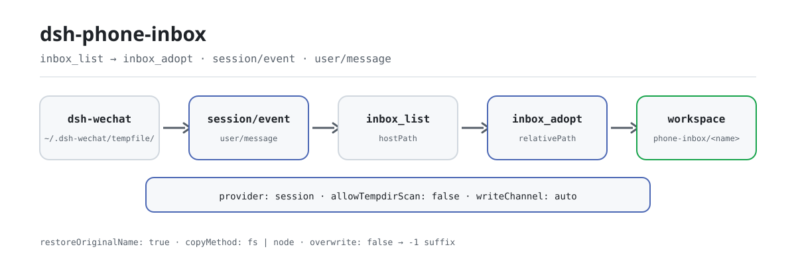

<div align="center">

<picture>
  <source media="(prefers-color-scheme: dark)" srcset="docs/assets/dsh-phone-inbox-flow-dark.svg">
  
</picture>

# dsh-phone-inbox

**Convierte un adjunto del teléfono en un archivo direccionable del espacio de trabajo: sin abrir un canal nuevo y sin copiar de más.**

La bandeja de entrada de adjuntos de la sesión para DeepSeek Harness: enumera los adjuntos del teléfono (puente de WeChat) que **esta conversación** recibió realmente, adopta uno en el espacio de trabajo cuando se pida y recupera el nombre de archivo que el puente destrozó.

[Instalar](#instalación-en-tres-pasos) · [Configuración](#configuración) · [FAQ](#faq) · [简体中文](README.md) · [English](README.en.md) · [Español](README.es.md) · [Português](README.pt.md) · [हिन्दी](README.hi.md)

[](LICENSE)
[](#compatibilidad)
[](https://www.npmjs.com/package/dsh-phone-inbox)
[](https://github.com/PerryLink/dsh-phone-inbox/actions/workflows/ci.yml)
[](#compatibilidad)

[](https://github.com/PerryLink/dsh-phone-inbox/stargazers)
[](https://www.npmjs.com/package/dsh-phone-inbox)
[](https://dshfind.com/plugins/PerryLink/dsh-phone-inbox?ref=badge)
[](https://gitee.com/perrylink/dsh-phone-inbox)

```sh
dsh plugin --profile <name> add dsh-phone-inbox
```

</div>

<sub>Plugin de la comunidad, no afiliado a DeepSeek. Repositorio canónico: <https://github.com/PerryLink/dsh-phone-inbox> (Gitee es un espejo).</sub>

## Qué es

`dsh-wechat` guarda los medios entrantes del teléfono en `~/.dsh-wechat/tempfile/` — fuera del espacio de trabajo de la sesión — y escribe la ruta absoluta en un mensaje de texto plano. `dsh-phone-inbox` recupera la lista de adjuntos que esta conversación recibió realmente (`inbox_list`), copia uno al espacio de trabajo cuando se pide (`inbox_adopt`) y, de paso, restaura el nombre que el puente destrozó. Cierra dos huecos que el usuario nunca ve: las herramientas confinadas al espacio de trabajo, como `dsh-data-quality`, rechazan cualquier ruta que escape de la sesión (`path-escape`), y el puente sustituye cada carácter no ASCII del nombre por `_`, así que un nombre chino acaba en disco como `__.csv`. No añade ningún canal nuevo ni cambia el puente: por defecto solo lee los mensajes de esta sesión y nunca escanea el directorio compartido. La fuente está desacoplada del provider: el adaptador por defecto lee el directorio temporal de `dsh-wechat`, un provider personalizado puede aportar otra fuente, y `dsh-wechat` es opcional, no una dependencia del paquete.

## Instalación en tres pasos

1. **Instalar** (elige un canal):

   ```sh
   # canal npm (versiones publicadas)
   dsh plugin --profile web add dsh-phone-inbox
   # canal tarball: pnpm pack en este repositorio y luego
   dsh plugin --profile web add ./dsh-phone-inbox-<version>.tgz
   ```

   El plugin **no tiene dependencias en tiempo de ejecución** (`dependencies` está vacío). Sus únicas dependencias entre pares son los paquetes anfitriones contra los que se compila; véase el bloque `peerDependencies` en `package.json`.

2. **Configuración mínima** (todos los campos son opcionales; estos son los valores por defecto):

   ```yaml
   - insert:
       - id: dsh-phone-inbox
         name: dsh-phone-inbox
         config:
           provider: session
           maxItems: 5
   ```

   Un `inboxDir` vacío deriva el `~/.dsh-wechat/tempfile` del propio puente; fíjalo explícitamente cuando se haya movido su `storageDir`.

3. **Verificar que se montó**:

   ```sh
   dsh --profile web --dump-config | grep -A2 'id: dsh-phone-inbox'
   ```

   ```
   > inbox_list
   ```

   En una sesión que recibió un adjunto del teléfono, `inbox_list` devuelve las rutas que recibió esta sesión; pasa una de ellas a `inbox_adopt`.

**Desinstalar**: `dsh plugin --profile web remove dsh-phone-inbox` (o elimina la fila del patch del perfil).

## Capacidades clave

Ambas herramientas las registra el plugin funcional, así que aparecen en la lista de herramientas del modelo en cuanto se monta la fila del bundle:

- **Lista de la sesión** — `inbox_list` toma la lectura del historial de la sesión como fuente autoritativa y enumera solo los adjuntos que esta conversación recibió realmente; vuelve a leer en cada llamada en vez de depender de una caché.
- **Adopción bajo demanda** — `inbox_adopt` copia un adjunto al espacio de trabajo de la sesión (subdirectorio `phone-inbox/` por defecto) y devuelve `relativePath` para herramientas confinadas al espacio de trabajo como `dsh-data-quality`.
- **Recuperación del nombre original** — el puente sustituye cada carácter no ASCII por `_` (un nombre chino acaba destrozado en disco); `inbox_adopt` usa el nombre original que lleva el marcador del puente como nombre del archivo adoptado.
- **Dos providers** — `provider: session` (por defecto, los mensajes de esta sesión) o `tempdir` (`session` más un escaneo de `inboxDir`); el escaneo está desactivado por defecto porque `inboxDir` es global y compartido.
- **Canal de escritura explícito** — `writeChannel` es `auto`, `fs` o `node`, y el `copyMethod` del resultado siempre nombra el canal que se ejecutó; `fs` pasa por la política de sandbox de la sesión.
- **Fallos distinguibles** — una bandeja inalcanzable devuelve `{ ok: false, reason, detail }` en lugar de una lista vacía; un resultado vacío lleva su propio `emptyReason`, así el modelo nunca confunde «no llegó nada» con «se rompió».
- **Sección de prompt y evento** — el plugin añade una sección al prompt del sistema (`phone-inbox`, orden 320) para que el modelo sepa que la capacidad existe, y se suscribe a `session/event` para observar `user/message`; ninguna de las dos es necesaria para la corrección.

### Superficie de herramientas

```ts
inbox_list({
  limit?: number,            // por defecto: config.maxItems
  includeTempdir?: boolean,  // solo se honra cuando allowTempdirScan es true
})
```

Devuelve `{ ok: true, source, inboxDir, items[], attachments, deriveMessages, emptyReason?, emptyDetail?, tempdirScan, unresolvedAttachmentBlocks }`, o `{ ok: false, reason, detail }`.

```ts
inbox_adopt({
  path: string,              // obligatorio: exactamente lo que informó inbox_list
  name?: string,             // por defecto: el nombre original recuperado
  subdir?: string,           // por defecto: config.defaultSubdir
  channel?: 'auto' | 'fs' | 'node',
  overwrite?: boolean,       // por defecto false: un duplicado recibe sufijo -1
  register?: boolean,        // por defecto: config.registerAttachment
})
```

Devuelve `{ ok: true, item }` con `hostPath`, `workspacePath`, `relativePath`, `bytes`, `sha256`, `copyMethod`, `nameRestored`, `sourceLeafName`, y `attachmentId`/`attachmentHostPath` cuando se registra; o `{ ok: false, reason, detail }`.

### Ejemplos

Son los puntos de entrada reales; instala y llama a uno.

**Ejemplo detallado** — comando `inbox_adopt`, entrada:

```json
{
  "path": "/tmp/dsh-test-phone-inbox-acceptance-5AoMHy/.dsh-wechat/tempfile/1792414010975-0a67121b-__.csv"
}
```

Salida:

```text
{
  "relativePath": "phone-inbox/材料.csv",
  "copyMethod": "node-fs"
}
```

*Observado en `plugins/dsh-phone-inbox/scripts/acceptance.mjs:134-147`*

**Rama de fallo** — entrada:

```text
{"path":"/tmp/dsh-phone-inbox-example/workspace/local.csv"}
```

Salida:

```text
phone-inbox could not adopt that attachment.
reason: not-in-inbox
/tmp/dsh-phone-inbox-example/workspace/local.csv is not inside the inbox directory /tmp/dsh-phone-inbox-example/inbox; this plugin only adopts files the bridge saved there
```

*Observado en `plugins/dsh-phone-inbox/src/provider-base.ts:443-449; plugins/dsh-phone-inbox/src/render.ts:108-115; plugins/dsh-phone-inbox/tests/integration.test.ts:359-368`*

**Ejemplo breve**: `inbox_adopt`

## Configuración

Todos los campos son opcionales; la tabla indica el valor por defecto. `cordis.patch.yml` contiene los mismos valores con comentarios en línea.

Claves más usadas:

| Clave | Por defecto | Significado |
|---|---|---|
| `enabled` | `true` | Interruptor maestro; `false` no monta servicio ni herramientas. |
| `inboxDir` | `""` → `~/.dsh-wechat/tempfile` | Directorio donde el puente deja los medios entrantes. Vacío deriva el valor por defecto del puente; se fija cuando se movió su `storageDir`. |
| `maxItems` | `5` | Tope de entradas que devuelve `inbox_list`. El contrato del MVP es «los últimos adjuntos de la sesión». |
| `provider` | `session` | Qué proveedor registrado responde: `session` (los mensajes de esta conversación) o `tempdir` (`session` más un escaneo de `inboxDir`). |
| `allowTempdirScan` | `false` | Habilita el escaneo del directorio. Desactivado porque `inboxDir` es global. |
| `defaultSubdir` | `phone-inbox` | Subdirectorio del espacio de trabajo donde escribe `inbox_adopt`. |
| `writeChannel` | `auto` | `auto` (servicio fs para texto, node:fs en caso contrario) · `fs` (solo el servicio fs del anfitrión) · `node` (bytes directamente). |

<details>
<summary>Tabla de configuración completa (12 claves)</summary>

| Clave | Por defecto | Significado |
|---|---|---|
| `enabled` | `true` | Interruptor maestro; `false` no monta servicio ni herramientas. |
| `inboxDir` | `""` → `~/.dsh-wechat/tempfile` | Directorio donde el puente deja los medios entrantes. Vacío deriva el valor por defecto del puente; se fija cuando se movió su `storageDir`. |
| `maxItems` | `5` | Tope de entradas que devuelve `inbox_list`. El contrato del MVP es «los últimos adjuntos de la sesión». |
| `provider` | `session` | Qué proveedor registrado responde: `session` (los mensajes de esta conversación) o `tempdir` (`session` más un escaneo de `inboxDir`). |
| `allowTempdirScan` | `false` | Habilita el escaneo del directorio. Desactivado porque `inboxDir` es global. |
| `tempdirScanMaxItems` | `5` | Tope de entradas que puede aportar un escaneo. |
| `tempdirScanMaxAgeMs` | `3600000` | Límite de antigüedad de un archivo escaneado; `0` desactiva el filtro. |
| `markers` | véase abajo | Redacción del marcador por tipo de medio, como fuentes `RegExp`. |
| `defaultSubdir` | `phone-inbox` | Subdirectorio del espacio de trabajo donde escribe `inbox_adopt`. |
| `restoreOriginalName` | `true` | Usar el nombre original recuperado del remitente como nombre adoptado. |
| `writeChannel` | `auto` | `auto` (servicio fs para texto, node:fs en caso contrario) · `fs` (solo el servicio fs del anfitrión) · `node` (bytes directamente). |
| `registerAttachment` | `false` | Registrar también los bytes adoptados como adjunto duradero del anfitrión. Los objetos de adjunto nunca se recolectan. |

</details>

La redacción por defecto de `markers`, por tipo de medio — cada valor es una fuente `RegExp` cuyo **primer grupo de captura es la ruta**:

```yaml
markers:
  image:
    path: "文件已保存到:\\s*(\\S+)"
  file:
    path: "(?:文件已保存到|文件路径):\\s*(\\S+)"
    name: "\\[收到文件:\\s*([^\\]\\r\\n]+)\\]"
  video:
    path: "文件已保存到:\\s*(\\S+)"
```

La redacción del marcador es un **contrato blando** con el puente: escribe la ruta en prosa y la prosa puede cambiar entre versiones del puente sin aviso. Los patrones son configuración precisamente para que un cambio de redacción sea una edición de configuración y no una publicación del plugin.

Ejemplo de override en el patch del perfil:

```yaml
- insert:
    - id: dsh-phone-inbox
      name: dsh-phone-inbox
      config:
        provider: tempdir
        allowTempdirScan: true
        writeChannel: fs
```

## FAQ

<details>
<summary>¿Los adjuntos se copian a otro sitio o se suben?</summary>

No. Solo se copia al llamar a `inbox_adopt`, y el destino queda confinado al espacio de trabajo de la sesión; el plugin no hace peticiones de red y no tiene dependencias en tiempo de ejecución. `inbox_list` solo lee los mensajes de esta sesión y `inboxDir`.

</details>

<details>
<summary>¿Dónde viven los archivos y las rutas?</summary>

El plugin no mantiene almacenamiento persistente: la lista se recalcula del historial de la sesión en cada llamada; la copia adoptada vive en el subdirectorio `phone-inbox/` del espacio de trabajo, y el archivo de origen sigue en el `tempfile/` del puente.

</details>

<details>
<summary>¿Puede mostrar adjuntos de otra sesión o de otra persona?</summary>

Por defecto no: `provider: session` lee solo los mensajes de esta sesión. El escaneo `tempdir` puede ver archivos del directorio global que ningún mensaje reclamó y no puede demostrar la propiedad, así que está desactivado por defecto; cuando se habilita, cada entrada escaneada lleva `source: "tempdir"`.

</details>

<details>
<summary>¿Sobrescribirá un archivo existente en mi espacio de trabajo?</summary>

Por defecto no: un destino duplicado recibe un sufijo `-1`, `-2`, …; solo un `overwrite: true` explícito sobrescribe.

</details>

<details>
<summary>¿Depende de dsh-wechat? ¿Y si el puente cambia la redacción?</summary>

No: `dsh-wechat` es una fuente opcional, no una dependencia del paquete. El plugin solo depende de la redacción del marcador, y `markers` es configurable: un cambio de redacción es una edición de configuración, no una publicación del plugin.

</details>

## Límites de seguridad

- Las lecturas no están cercadas por el sandbox fs del anfitrión (la cerca solo envuelve `writeText`/`editText`), así que este plugin aplica su propia contención en **ambos** extremos de la copia.
- El canal de escritura `fs` pasa por `ctx.fs.writeText` con la política de sandbox del ámbito de sesión, así que un backend restrictivo lo cerca exactamente igual que cerca la herramienta `write`. `node` omite esa cerca por construcción; existe porque `ctx.fs` no tiene API de escritura de bytes. El `copyMethod` devuelto siempre dice cuál se ejecutó.
- `auto` prefiere el servicio fs para texto y recurre a `node:fs`; el motivo del repliegue se registra y el canal se informa, nunca se insinúa.
- El escaneo del directorio temporal no puede demostrar a qué conversación pertenece un archivo. Por eso está desactivado por defecto y por eso sus entradas llevan su propio `source`.
- No se garantiza que el directorio de bandeja del puente sea privado (una refactorización del puente eliminó el manejo explícito de `0o700`/`0o600`). Este plugin no supone lo contrario.
- La validación en carga falla en voz alta: un `writeChannel` inválido, números fuera de rango y regex de marcador mal formadas lanzan al montar en lugar de convertirse en una bandeja vacía en silencio.

## Permisos y datos

- **Lee** `inboxDir` y los mensajes de la propia sesión llamante. Nada más.
- **Escribe** solo dentro del espacio de trabajo de la sesión (`path.resolve` más una comprobación de contención consciente del separador), y solo cuando se llama a `inbox_adopt`.
- **Rechaza** una ruta de origen que no esté bajo `inboxDir`, un `subdir` que escape del espacio de trabajo y un nombre que pudiera atravesar directorios. El argumento `path` viene del modelo y nunca se confía en él.
- **No escanea** el directorio de bandeja compartido salvo que `allowTempdirScan` esté habilitado explícitamente; cuando lo hace, cada entrada que aporta lleva `source: "tempdir"`.
- **Nunca sobrescribe** en silencio. Un destino duplicado recibe un sufijo `-1`, `-2`, … salvo `overwrite: true`.
- **No registra nada** como adjunto duradero salvo que se pida; el registro copia bytes al almacén de adjuntos del anfitrión, que no tiene recolección de basura.

## Limitaciones conocidas

- **Una ruta con un espacio literal se trunca** en el espacio. La captura es `(\S+)` porque eso es lo que impide que se trague la frase que el puente escribe tras la ruta; los nombres temporales del propio puente nunca contienen un espacio.
- **Los tipos imagen y vídeo se informan como `file`.** El puente usa la misma redacción para ambos, así que el tipo no es recuperable del texto; el nombre de hoja (`image.png`, `video.mp4`) los distingue.
- **Una imagen o un vídeo no tienen nombre original recuperable.** El puente los guarda como `image.<ext>` / `video.mp4` y la redacción no lleva nombre original. El plugin informa el nombre en disco y lo dice, en lugar de inventarlo.
- **Una ruta de Windows solo es utilizable en Windows** (y una de POSIX solo en POSIX). El plugin normaliza los separadores como lo hace la plataforma en ejecución.
- **`inbox_adopt` necesita que el archivo siga existiendo.** El puente nunca limpia `tempfile/`, pero nada garantiza que permanezca.
- **No se ha ejercitado tráfico real de WeChat.** El script de aceptación muestra qué *sí* está verificado, y su salida indica la frontera entre lo scriptado y lo real.

## Interoperabilidad con otros plugins DSH

- **Sin listeners de waterfall.** El plugin solo se suscribe a `session/event` para observar `user/message`; no reescribe mensajes ni cortocircuita ninguna cadena.
- **Una sola clave de servicio.** Solo la facade `src/service-local.ts` registra `phoneInbox`; los dos providers nunca registran el nombre del servicio por su cuenta, así que un mismo contexto no puede ver un registro duplicado.
- **Una superficie de herramientas estrecha.** Registra solo `inbox_list` e `inbox_adopt`: sin comandos, sin slots de cliente, sin prefijo `webServer`.
- **Solo inserta su propia fila.** `cordis.patch.yml` nunca sobrescribe el `config` de una fila integrada.
- **Contrato blando con `dsh-wechat`.** No hay dependencia de paquete; el plugin solo lee la ruta y el nombre que el puente escribe en el mensaje, y absorbe los cambios de redacción mediante `markers`.
- **Componible con `dsh-data-quality`.** El `relativePath` que devuelve `inbox_adopt` es exactamente la forma que acepta una herramienta confinada al espacio de trabajo; `scripts/acceptance.mjs` ejecuta probe → list → adopt → `dsh-data-quality` de extremo a extremo.

## Compatibilidad

| Dimensión | Estado |
|---|---|
| Harness | `engines.dsh` declara el rango OR canónico de seis cláusulas del ecosistema: `>=0.1.2-rc.1 <0.2.0 \|\| >=0.1.5-alpha.1 <0.2.0 \|\| >=0.1.6-0 <0.2.0 \|\| >=0.1.7-0 <0.2.0 \|\| >=0.2.0-0 <0.3.0 \|\| >=0.2.1-0 <0.3.0`; este README usa `>=0.2.1-alpha.1` como piso de ejecución. El anfitrión evalúa `peerDependencies` en el preflight y desactiva silenciosamente una fila de plugin cuyo rango no admita la versión en ejecución. |
| Node | `^22.19.0 \|\| >=24.0.0` |
| Plataforma | Dondequiera que corra DSH (host puro, cero dependencias de ejecución; sin mitad de navegador, sin UI) |
| Modelo | Los modelos de texto son totalmente compatibles; los adjuntos se manejan como rutas y marcadores de texto, sin requisito de visión |

## Ecosistema y calidad

- [Espejo en Gitee](https://gitee.com/perrylink/dsh-phone-inbox) (espejo sincronizado; GitHub es el canónico)
- [Página de dshfind](https://dshfind.com/plugins/PerryLink/dsh-phone-inbox) (instalaciones y ranking)
- [Base de conocimiento de notas de campo](https://perrylink.github.io/dsh-plugin-guide/): guía de desarrollo de plugins · datos de selección medidos · criterios de mantenimiento

## Desarrollo

```sh
pnpm install
pnpm run typecheck && pnpm test && pnpm run build \
  && pnpm run verify:self-contained && pnpm run verify:artifacts \
  && pnpm run check:readmes && pnpm run check:lockfile
pnpm run acceptance          # de extremo a extremo: sonda -> lista -> adopción -> dsh-data-quality
```

`prepublishOnly` vuelve a ejecutar la compuerta, así que una publicación no puede enviar un árbol sin construir o desviado.

| Ruta | Propósito |
|---|---|
| `src/index.ts` | Contrato de plugin funcional: resuelve configuración, registra providers, publica `ctx.phoneInbox`, registra las dos herramientas, añade la sección de prompt y se suscribe a `session/event` |
| `src/service-local.ts` | La facade que registra `phoneInbox` (exactamente un objeto puede registrar ese nombre en un contexto) |
| `src/provider-base.ts` | Pipeline compartido: lectura del historial, fusión, stat, contención, planificación del destino, los dos canales de escritura y el registro de adjuntos |
| `src/provider-session.ts` / `src/provider-tempdir.ts` | Los dos providers |
| `src/markers.ts` / `src/config.ts` | El contrato de marcadores (puro) y su configuración validada |
| `src/tools/*.ts` | Los dos consumidores `defineTool`, `inbox_list` / `inbox_adopt` |
| `scripts/acceptance.mjs` | Aceptación de extremo a extremo: probe → list → adopt → `dsh-data-quality` |
| `tests/` | vitest, con un directorio de bandeja por prueba |
| `docs/assets/` | Los diagramas de flujo claro/oscuro que usa este README |
| `scripts/gen-readme-assets.py` | Genera programáticamente `docs/assets/dsh-phone-inbox-flow-{light,dark}.svg` |

Los diagramas los genera [`scripts/gen-readme-assets.py`](scripts/gen-readme-assets.py) (Python + sonda de fuente Pillow) y se pueden volver a ejecutar: `python scripts/gen-readme-assets.py`.

Topics: `dsh` · `dsh-plugin` · `deepseek-harness` · `cordis` · `wechat` · `inbox` · `attachment` · `phone`

## Familia y agradecimientos

Este proyecto forma parte de la familia de plugins de DeepSeek Harness mantenida por [PerryLink](https://github.com/PerryLink) (todos Apache-2.0). Si este plugin te ayuda, **dale una estrella**: no desbloquea nada, pero hace que la siguiente persona lo encuentre antes.

- [@PerryLink](https://github.com/PerryLink) — creador y mantenedor: recuperación de marcadores de adjuntos entrantes de la sesión, los dos providers, el pipeline de adopción en el espacio de trabajo y la documentación en cinco idiomas.

<details>
<summary>Expandir todos los plugins</summary>

| Plugin | Estado |
|---|---|
| **[dsh-aqua-input-check](https://github.com/PerryLink/dsh-aqua-input-check)** |  |
| **[dsh-archive-check](https://github.com/PerryLink/dsh-archive-check)** |  |
| **[dsh-auto-review](https://github.com/PerryLink/dsh-auto-review)** |  |
| **[dsh-autotier](https://github.com/PerryLink/dsh-autotier)** | 🧊 CONGELADO — ver el README del repo |
| **[dsh-bid-ca-precheck](https://github.com/PerryLink/dsh-bid-ca-precheck)** |  |
| **[dsh-bid-qual-check](https://github.com/PerryLink/dsh-bid-qual-check)** |  |
| **[dsh-cert-mcp](https://github.com/PerryLink/dsh-cert-mcp)** | 🧊 CONGELADO — ver el README del repo |
| **[dsh-checkpoint-rewind](https://github.com/PerryLink/dsh-checkpoint-rewind)** |  |
| **[dsh-click](https://github.com/PerryLink/dsh-click)** |  |
| **[dsh-composer-history](https://github.com/PerryLink/dsh-composer-history)** |  |
| **[dsh-contract-stance](https://github.com/PerryLink/dsh-contract-stance)** |  |
| **[dsh-customs-doc-check](https://github.com/PerryLink/dsh-customs-doc-check)** |  |
| **[dsh-data-quality](https://github.com/PerryLink/dsh-data-quality)** | 🧊 CONGELADO — ver el README del repo |
| **[dsh-demurrage-ledger](https://github.com/PerryLink/dsh-demurrage-ledger)** |  |
| **[dsh-doublecheck](https://github.com/PerryLink/dsh-doublecheck)** |  |
| **[dsh-drill-script-check](https://github.com/PerryLink/dsh-drill-script-check)** |  |
| **[dsh-eia-guide-check](https://github.com/PerryLink/dsh-eia-guide-check)** |  |
| **[dsh-emergency-plan](https://github.com/PerryLink/dsh-emergency-plan)** |  |
| **[dsh-essay-rubric-check](https://github.com/PerryLink/dsh-essay-rubric-check)** |  |
| **[dsh-evidence-check](https://github.com/PerryLink/dsh-evidence-check)** |  |
| **[dsh-export-ctl-check](https://github.com/PerryLink/dsh-export-ctl-check)** |  |
| **[dsh-fast](https://github.com/PerryLink/dsh-fast)** |  |
| **[dsh-fmea-table-check](https://github.com/PerryLink/dsh-fmea-table-check)** |  |
| **[dsh-forecast-penalty](https://github.com/PerryLink/dsh-forecast-penalty)** |  |
| **[dsh-fund-research](https://github.com/PerryLink/dsh-fund-research)** |  |
| **[dsh-github](https://github.com/PerryLink/dsh-github)** |  |
| **[dsh-gongwen-flow-check](https://github.com/PerryLink/dsh-gongwen-flow-check)** |  |
| **[dsh-gongwen-word-check](https://github.com/PerryLink/dsh-gongwen-word-check)** |  |
| **[dsh-guard-plan-qc](https://github.com/PerryLink/dsh-guard-plan-qc)** |  |
| **[dsh-hazchem-check](https://github.com/PerryLink/dsh-hazchem-check)** |  |
| **[dsh-hazplan-check](https://github.com/PerryLink/dsh-hazplan-check)** |  |
| **[dsh-hidden-risk-map](https://github.com/PerryLink/dsh-hidden-risk-map)** |  |
| **[dsh-hs-classify](https://github.com/PerryLink/dsh-hs-classify)** |  |
| **[dsh-icd-rule-check](https://github.com/PerryLink/dsh-icd-rule-check)** |  |
| **[dsh-industry-research](https://github.com/PerryLink/dsh-industry-research)** |  |
| **[dsh-lawcite-adapter](https://github.com/PerryLink/dsh-lawcite-adapter)** |  |
| **[dsh-laya](https://github.com/PerryLink/dsh-laya)** |  |
| **[dsh-lc-doc-check](https://github.com/PerryLink/dsh-lc-doc-check)** |  |
| **[dsh-learning-gap-check](https://github.com/PerryLink/dsh-learning-gap-check)** |  |
| **[dsh-library](https://github.com/PerryLink/dsh-library)** |  |
| **[dsh-local-ai](https://github.com/PerryLink/dsh-local-ai)** |  |
| **[dsh-lsp-actions](https://github.com/PerryLink/dsh-lsp-actions)** |  |
| **[dsh-mask](https://github.com/PerryLink/dsh-mask)** |  |
| **[dsh-mcp-panel](https://github.com/PerryLink/dsh-mcp-panel)** |  |
| **[dsh-medrec-qc](https://github.com/PerryLink/dsh-medrec-qc)** |  |
| **[dsh-memento](https://github.com/PerryLink/dsh-memento)** | 🧊 CONGELADO — ver el README del repo |
| **[dsh-nsfc-form-check](https://github.com/PerryLink/dsh-nsfc-form-check)** |  |
| **[dsh-nurse-record-check](https://github.com/PerryLink/dsh-nurse-record-check)** |  |
| **[dsh-observe](https://github.com/PerryLink/dsh-observe)** |  |
| **[dsh-origin-rvc-check](https://github.com/PerryLink/dsh-origin-rvc-check)** |  |
| **[dsh-ota-review-check](https://github.com/PerryLink/dsh-ota-review-check)** |  |
| **[dsh-output-styles](https://github.com/PerryLink/dsh-output-styles)** |  |
| **[dsh-paper-doc-adapter](https://github.com/PerryLink/dsh-paper-doc-adapter)** |  |
| **[dsh-permission-rules](https://github.com/PerryLink/dsh-permission-rules)** |  |
| **[dsh-permit-report-check](https://github.com/PerryLink/dsh-permit-report-check)** |  |
| **[dsh-pipeline-check](https://github.com/PerryLink/dsh-pipeline-check)** |  |
| **[dsh-pleading-draft](https://github.com/PerryLink/dsh-pleading-draft)** |  |
| **[dsh-plugin-doctor](https://github.com/PerryLink/dsh-plugin-doctor)** | 🚫 RETIRADO (repo archivado) |
| **[dsh-plugin-guide](https://github.com/PerryLink/dsh-plugin-guide)** |  |
| **[dsh-plugin-kit](https://github.com/PerryLink/dsh-plugin-kit)** | 🚫 RETIRADO (repo archivado) |
| **[dsh-plugin-upgrade](https://github.com/PerryLink/dsh-plugin-upgrade)** | 🚫 RETIRADO (repo archivado) |
| **[dsh-policy-brief-draft](https://github.com/PerryLink/dsh-policy-brief-draft)** |  |
| **[dsh-power-loss-split](https://github.com/PerryLink/dsh-power-loss-split)** |  |
| **[dsh-power-ticket-check](https://github.com/PerryLink/dsh-power-ticket-check)** |  |
| **[dsh-ppap-check](https://github.com/PerryLink/dsh-ppap-check)** |  |
| **[dsh-protest-deadline](https://github.com/PerryLink/dsh-protest-deadline)** |  |
| **[dsh-railway-window](https://github.com/PerryLink/dsh-railway-window)** |  |
| **[dsh-repair-order-qc](https://github.com/PerryLink/dsh-repair-order-qc)** |  |
| **[dsh-research-report](https://github.com/PerryLink/dsh-research-report)** |  |
| **[dsh-review-reply-check](https://github.com/PerryLink/dsh-review-reply-check)** |  |
| **[dsh-rulefile-check](https://github.com/PerryLink/dsh-rulefile-check)** |  |
| **[dsh-safety-brief-check](https://github.com/PerryLink/dsh-safety-brief-check)** |  |
| **[dsh-score](https://github.com/PerryLink/dsh-score)** | 🧊 CONGELADO — ver el README del repo |
| **[dsh-session-sync](https://github.com/PerryLink/dsh-session-sync)** |  |
| **[dsh-site-log-check](https://github.com/PerryLink/dsh-site-log-check)** |  |
| **[dsh-skill-pack-security](https://github.com/PerryLink/dsh-skill-pack-security)** |  |
| **[dsh-soe-decision-check](https://github.com/PerryLink/dsh-soe-decision-check)** |  |
| **[dsh-soilwater-check](https://github.com/PerryLink/dsh-soilwater-check)** |  |
| **[dsh-sop-sync-check](https://github.com/PerryLink/dsh-sop-sync-check)** |  |
| **[dsh-spc-gbt-adapter](https://github.com/PerryLink/dsh-spc-gbt-adapter)** |  |
| **[dsh-talk](https://github.com/PerryLink/dsh-talk)** |  |
| **[dsh-tender-extract](https://github.com/PerryLink/dsh-tender-extract)** |  |
| **[dsh-tender-matrix](https://github.com/PerryLink/dsh-tender-matrix)** |  |
| **[dsh-test-drive](https://github.com/PerryLink/dsh-test-drive)** |  |
| **[dsh-ticktick](https://github.com/PerryLink/dsh-ticktick)** | 🚫 RETIRADO (repo archivado) |
| **[dsh-translate](https://github.com/PerryLink/dsh-translate)** |  |
| **[dsh-warranty-calc](https://github.com/PerryLink/dsh-warranty-calc)** |  |
| **[dsh-budget](https://github.com/PerryLink/dsh-budget)** |  |
| **[dsh-claude-move](https://github.com/PerryLink/dsh-claude-move)** |  |
| **[dsh-defend](https://github.com/PerryLink/dsh-defend)** |  |
| **[dsh-draw](https://github.com/PerryLink/dsh-draw)** | 🧊 CONGELADO — ver el README del repo |
| **[dsh-reach](https://github.com/PerryLink/dsh-reach)** |  |
| **[dsh-background-agents](https://github.com/PerryLink/dsh-background-agents)** | 🚫 RETIRADO (repo archivado) |
| **[dsh-session-pin](https://github.com/PerryLink/dsh-session-pin)** | 🚫 RETIRADO (repo archivado) |
| **[dsh-team-rooms](https://github.com/PerryLink/dsh-team-rooms)** | 🚫 RETIRADO (repo archivado) |

</details>

## Licencia

[LICENSE](LICENSE) (Apache License 2.0) © 2026 dsh-phone-inbox contributors

<p align="center"><sub>Apache-2.0 · Plugin de la comunidad, no afiliado a DeepSeek.</sub></p>
