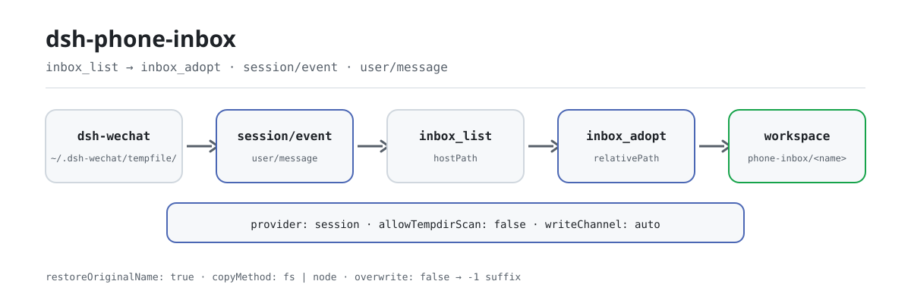

<div align="center">

<picture>
  <source media="(prefers-color-scheme: dark)" srcset="docs/assets/dsh-phone-inbox-flow-dark.svg">
  
</picture>

# dsh-phone-inbox

**फ़ोन से आए अटैचमेंट को कार्यक्षेत्र की पता-योग्य फ़ाइल बनाएँ — नया चैनल नहीं, फ़ालतू प्रतिलिपि नहीं।**

DeepSeek Harness के लिए सत्र का इनबाउंड अटैचमेंट इनबॉक्स: इस बातचीत को वास्तव में मिले फ़ोन (WeChat ब्रिज) अटैचमेंट की सूची दें, माँगे जाने पर एक को कार्यक्षेत्र में ले आएँ, और ब्रिज द्वारा बिगाड़ा गया फ़ाइल नाम बहाल करें।

[इंस्टॉल](#तीन-चरणों-में-शुरुआत) · [कॉन्फ़िगरेशन](#कॉन्फ़िगरेशन) · [FAQ](#faq) · [简体中文](README.md) · [English](README.en.md) · [Español](README.es.md) · [Português](README.pt.md) · [हिन्दी](README.hi.md)

[](LICENSE)
[](#संगतता)
[](https://www.npmjs.com/package/dsh-phone-inbox)
[](https://github.com/PerryLink/dsh-phone-inbox/actions/workflows/ci.yml)
[](#संगतता)

[](https://github.com/PerryLink/dsh-phone-inbox/stargazers)
[](https://www.npmjs.com/package/dsh-phone-inbox)
[](https://dshfind.com/plugins/PerryLink/dsh-phone-inbox?ref=badge)
[](https://gitee.com/perrylink/dsh-phone-inbox)

```sh
dsh plugin --profile <name> add dsh-phone-inbox
```

</div>

<sub>सामुदायिक प्लगइन, DeepSeek से असंबद्ध। कैनोनिकल रिपॉज़िटरी: <https://github.com/PerryLink/dsh-phone-inbox> (Gitee एक मिरर है)।</sub>

## यह क्या है

`dsh-wechat` फ़ोन से आए मीडिया को `~/.dsh-wechat/tempfile/` में रखता है — सत्र के कार्यक्षेत्र के **बाहर** — और निरपेक्ष पथ को एक सादे टेक्स्ट संदेश में लिख देता है। `dsh-phone-inbox` उस संदेश से इस बातचीत को वास्तव में मिले अटैचमेंट की सूची निकालता है (`inbox_list`), माँगे जाने पर एक को कार्यक्षेत्र में कॉपी करता है (`inbox_adopt`), और रास्ते में ब्रिज द्वारा बिगाड़ा गया फ़ाइल नाम बहाल करता है। यह दो ऐसी कमियाँ भरता है जो उपयोगकर्ता को दिखती नहीं: `dsh-data-quality` जैसे कार्यक्षेत्र-सीमित उपकरण सत्र से बाहर जाने वाले हर पथ को अस्वीकार करते हैं (`path-escape`), और ब्रिज फ़ाइल नाम के हर गैर-ASCII अक्षर को `_` से बदल देता है, इसलिए चीनी नाम डिस्क पर `__.csv` बन जाता है। यह कोई नया चैनल नहीं जोड़ता और ब्रिज को नहीं बदलता: डिफ़ॉल्ट रूप से केवल इस सत्र के अपने संदेश पढ़ता है और साझा डिरेक्टरी कभी स्कैन नहीं करता। स्रोत provider से अलग है: डिफ़ॉल्ट adapter `dsh-wechat` की temp directory पढ़ता है, custom provider दूसरा स्रोत दे सकता है, और `dsh-wechat` वैकल्पिक है, package dependency नहीं।

## तीन चरणों में शुरुआत

1. **इंस्टॉल करें** (एक चैनल चुनें):

   ```sh
   # npm चैनल (प्रकाशित संस्करण)
   dsh plugin --profile web add dsh-phone-inbox
   # tarball चैनल: इस रेपो में pnpm pack के बाद
   dsh plugin --profile web add ./dsh-phone-inbox-<version>.tgz
   ```

   इस प्लगइन की **कोई रनटाइम निर्भरता नहीं है** (`dependencies` खाली है)। इसके एकमात्र पीयर वे होस्ट पैकेज हैं जिनके विरुद्ध यह बनता है; `package.json` का `peerDependencies` ब्लॉक देखें।

2. **न्यूनतम कॉन्फ़िगरेशन** (हर फ़ील्ड वैकल्पिक है; ये डिफ़ॉल्ट हैं):

   ```yaml
   - insert:
       - id: dsh-phone-inbox
         name: dsh-phone-inbox
         config:
           provider: session
           maxItems: 5
   ```

   खाली `inboxDir` ब्रिज के अपने `~/.dsh-wechat/tempfile` को निकालता है; जब ब्रिज का `storageDir` हटाया गया हो तो इसे स्पष्ट रूप से सेट करें।

3. **जाँचें कि माउंट हुआ**:

   ```sh
   dsh --profile web --dump-config | grep -A2 'id: dsh-phone-inbox'
   ```

   ```
   > inbox_list
   ```

   जिस सत्र को फ़ोन से अटैचमेंट मिला था, उसमें `inbox_list` इस सत्र को मिले पथ लौटाता है; उनमें से एक `inbox_adopt` को दें।

**अनइंस्टॉल**: `dsh plugin --profile web remove dsh-phone-inbox` (या प्रोफ़ाइल patch से वह पंक्ति हटा दें)।

## मुख्य क्षमताएँ

दोनों उपकरण फ़ंक्शन प्लगइन द्वारा पंजीकृत होते हैं, इसलिए बंडल पंक्ति माउंट होते ही वे मॉडल की उपकरण सूची में आ जाते हैं:

- **सत्र सूची** — `inbox_list` सत्र-इतिहास पठन को प्रामाणिक स्रोत मानता है और केवल इस बातचीत को मिले अटैचमेंट गिनाता है; हर कॉल पर फिर पढ़ता है, कैश पर निर्भर नहीं करता।
- **माँग पर अंगीकरण** — `inbox_adopt` एक अटैचमेंट को सत्र के कार्यक्षेत्र (डिफ़ॉल्ट `phone-inbox/` उपडिरेक्टरी) में कॉपी करता है और `dsh-data-quality` जैसे कार्यक्षेत्र-सीमित उपकरणों के लिए `relativePath` लौटाता है।
- **मूल नाम की बहाली** — ब्रिज हर गैर-ASCII अक्षर को `_` से बदल देता है (चीनी फ़ाइल नाम डिस्क पर बिगड़ जाता है); `inbox_adopt` ब्रिज के मार्कर में आए मूल नाम को अंगीकृत फ़ाइल नाम बनाता है।
- **दो provider** — `provider: session` (डिफ़ॉल्ट, इस सत्र के अपने संदेश) या `tempdir` (`session` के साथ `inboxDir` का स्कैन); स्कैन डिफ़ॉल्ट रूप से बंद है क्योंकि `inboxDir` वैश्विक और साझा है।
- **स्पष्ट लेखन चैनल** — `writeChannel` `auto`, `fs` या `node` है, और परिणाम का `copyMethod` हमेशा बताता है कि वास्तव में कौन-सा चला; `fs` सत्र की सैंडबॉक्स नीति से जाता है।
- **अलग पहचानने योग्य विफलताएँ** — अगम्य इनबॉक्स खाली सूची के बजाय `{ ok: false, reason, detail }` लौटाता है; खाली परिणाम अपना `emptyReason` साथ रखता है, इसलिए मॉडल «कुछ नहीं आया» और «टूट गया» में कभी भ्रम नहीं करता।
- **प्रॉम्प्ट अनुभाग और इवेंट** — प्लगइन एक सिस्टम-प्रॉम्प्ट अनुभाग (`phone-inbox`, क्रम 320) जोड़ता है ताकि मॉडल को क्षमता का पता रहे, और `user/message` देखने के लिए `session/event` की सदस्यता लेता है; शुद्धता के लिए दोनों में से कोई आवश्यक नहीं।

### उपकरण सतह

```ts
inbox_list({
  limit?: number,            // डिफ़ॉल्ट: config.maxItems
  includeTempdir?: boolean,  // केवल तब माना जाता है जब allowTempdirScan true हो
})
```

लौटाता है `{ ok: true, source, inboxDir, items[], attachments, deriveMessages, emptyReason?, emptyDetail?, tempdirScan, unresolvedAttachmentBlocks }`, या `{ ok: false, reason, detail }`।

```ts
inbox_adopt({
  path: string,              // अनिवार्य: ठीक वही जो inbox_list ने बताया
  name?: string,             // डिफ़ॉल्ट: बहाल किया गया मूल नाम
  subdir?: string,           // डिफ़ॉल्ट: config.defaultSubdir
  channel?: 'auto' | 'fs' | 'node',
  overwrite?: boolean,       // डिफ़ॉल्ट false: डुप्लिकेट को -1 प्रत्यय मिलता है
  register?: boolean,        // डिफ़ॉल्ट: config.registerAttachment
})
```

लौटाता है `{ ok: true, item }` जिसमें `hostPath`, `workspacePath`, `relativePath`, `bytes`, `sha256`, `copyMethod`, `nameRestored`, `sourceLeafName` हैं, और पंजीकरण पर `attachmentId`/`attachmentHostPath`; या `{ ok: false, reason, detail }`।

### उदाहरण

ये वास्तविक प्रवेश बिंदु हैं; इंस्टॉल के बाद एक चलाएँ।

**विस्तृत उदाहरण** — कमांड `inbox_adopt`, इनपुट:

```json
{
  "path": "/tmp/dsh-test-phone-inbox-acceptance-5AoMHy/.dsh-wechat/tempfile/1792414010975-0a67121b-__.csv"
}
```

आउटपुट:

```text
{
  "relativePath": "phone-inbox/材料.csv",
  "copyMethod": "node-fs"
}
```

*स्रोत `plugins/dsh-phone-inbox/scripts/acceptance.mjs:134-147`*

**विफलता शाखा** — इनपुट:

```text
{"path":"/tmp/dsh-phone-inbox-example/workspace/local.csv"}
```

आउटपुट:

```text
phone-inbox could not adopt that attachment.
reason: not-in-inbox
/tmp/dsh-phone-inbox-example/workspace/local.csv is not inside the inbox directory /tmp/dsh-phone-inbox-example/inbox; this plugin only adopts files the bridge saved there
```

*स्रोत `plugins/dsh-phone-inbox/src/provider-base.ts:443-449; plugins/dsh-phone-inbox/src/render.ts:108-115; plugins/dsh-phone-inbox/tests/integration.test.ts:359-368`*

**संक्षिप्त उदाहरण**: `inbox_adopt`

## कॉन्फ़िगरेशन

हर फ़ील्ड वैकल्पिक है; तालिका डिफ़ॉल्ट दिखाती है। `cordis.patch.yml` में वही मान इनलाइन टिप्पणियों के साथ हैं।

सबसे अधिक उपयोग होने वाली कुंजियाँ:

| कुंजी | डिफ़ॉल्ट | अर्थ |
|---|---|---|
| `enabled` | `true` | मास्टर स्विच; `false` पर न सेवा माउंट होती है न उपकरण। |
| `inboxDir` | `""` → `~/.dsh-wechat/tempfile` | वह डिरेक्टरी जहाँ ब्रिज इनबाउंड मीडिया रखता है। खाली छोड़ने पर ब्रिज का अपना डिफ़ॉल्ट निकाला जाता है; ब्रिज का `storageDir` हटा हो तो इसे सेट करें। |
| `maxItems` | `5` | `inbox_list` द्वारा लौटाई गई प्रविष्टियों की सीमा। MVP अनुबंध «सत्र के हाल के कुछ अटैचमेंट» है। |
| `provider` | `session` | कौन-सा पंजीकृत प्रोवाइडर उत्तर देता है: `session` (इस बातचीत के संदेश) या `tempdir` (`session` के साथ `inboxDir` का स्कैन)। |
| `allowTempdirScan` | `false` | डिरेक्टरी स्कैन को सक्षम करता है। बंद है क्योंकि `inboxDir` वैश्विक है। |
| `defaultSubdir` | `phone-inbox` | `inbox_adopt` जिस कार्यक्षेत्र उपडिरेक्टरी में लिखता है। |
| `writeChannel` | `auto` | `auto` (टेक्स्ट के लिए fs सेवा, अन्यथा node:fs) · `fs` (केवल होस्ट fs सेवा) · `node` (सीधे बाइट्स)। |

<details>
<summary>पूरी कॉन्फ़िगरेशन तालिका (12 कुंजियाँ)</summary>

| कुंजी | डिफ़ॉल्ट | अर्थ |
|---|---|---|
| `enabled` | `true` | मास्टर स्विच; `false` पर न सेवा माउंट होती है न उपकरण। |
| `inboxDir` | `""` → `~/.dsh-wechat/tempfile` | वह डिरेक्टरी जहाँ ब्रिज इनबाउंड मीडिया रखता है। खाली छोड़ने पर ब्रिज का अपना डिफ़ॉल्ट निकाला जाता है; ब्रिज का `storageDir` हटा हो तो इसे सेट करें। |
| `maxItems` | `5` | `inbox_list` द्वारा लौटाई गई प्रविष्टियों की सीमा। MVP अनुबंध «सत्र के हाल के कुछ अटैचमेंट» है। |
| `provider` | `session` | कौन-सा पंजीकृत प्रोवाइडर उत्तर देता है: `session` (इस बातचीत के संदेश) या `tempdir` (`session` के साथ `inboxDir` का स्कैन)। |
| `allowTempdirScan` | `false` | डिरेक्टरी स्कैन को सक्षम करता है। बंद है क्योंकि `inboxDir` वैश्विक है। |
| `tempdirScanMaxItems` | `5` | एक स्कैन अधिकतम कितनी प्रविष्टियाँ जोड़ सकता है। |
| `tempdirScanMaxAgeMs` | `3600000` | स्कैन की गई फ़ाइल की आयु-सीमा; `0` फ़िल्टर बंद कर देता है। |
| `markers` | नीचे देखें | प्रत्येक मीडिया प्रकार के लिए मार्कर शब्दावली, `RegExp` स्रोत के रूप में। |
| `defaultSubdir` | `phone-inbox` | `inbox_adopt` जिस कार्यक्षेत्र उपडिरेक्टरी में लिखता है। |
| `restoreOriginalName` | `true` | बहाल किए गए मूल भेजने वाले नाम को अंगीकृत फ़ाइल नाम बनाना। |
| `writeChannel` | `auto` | `auto` (टेक्स्ट के लिए fs सेवा, अन्यथा node:fs) · `fs` (केवल होस्ट fs सेवा) · `node` (सीधे बाइट्स)। |
| `registerAttachment` | `false` | अंगीकृत बाइट्स को होस्ट के टिकाऊ अटैचमेंट के रूप में भी पंजीकृत करना। अटैचमेंट ऑब्जेक्ट कभी GC नहीं होते। |

</details>

`markers` की डिफ़ॉल्ट शब्दावली, प्रत्येक मीडिया प्रकार के लिए — हर मान एक `RegExp` स्रोत है जिसका **पहला कैप्चर समूह पथ है**:

```yaml
markers:
  image:
    path: "文件已保存到:\\s*(\\S+)"
  file:
    path: "(?:文件已保存到|文件路径):\\s*(\\S+)"
    name: "\\[收到文件:\\s*([^\\]\\r\\n]+)\\]"
  video:
    path: "文件已保存到:\\s*(\\S+)"
```

मार्कर शब्दावली ब्रिज के साथ एक **कोमल अनुबंध** है: ब्रिज पथ को गद्य में लिखता है, और गद्य ब्रिज के संस्करणों के बीच बिना सूचना बदल सकता है। पैटर्न इसीलिए कॉन्फ़िगरेशन हैं ताकि शब्दावली बदलना एक कॉन्फ़िगरेशन संपादन हो, प्लगइन रिलीज़ नहीं।

प्रोफ़ाइल patch में override का उदाहरण:

```yaml
- insert:
    - id: dsh-phone-inbox
      name: dsh-phone-inbox
      config:
        provider: tempdir
        allowTempdirScan: true
        writeChannel: fs
```

## FAQ

<details>
<summary>क्या अटैचमेंट कहीं और कॉपी होते हैं या अपलोड होते हैं?</summary>

नहीं। प्रतिलिपि केवल `inbox_adopt` कहने पर होती है, और गंतव्य सत्र के कार्यक्षेत्र तक सीमित है; प्लगइन कोई नेटवर्क अनुरोध नहीं करता और उसकी कोई रनटाइम निर्भरता नहीं है। `inbox_list` केवल इस सत्र के संदेश और `inboxDir` पढ़ता है।

</details>

<details>
<summary>फ़ाइलें और पथ कहाँ रहते हैं?</summary>

प्लगइन कोई स्थायी भंडार नहीं रखता: सूची हर कॉल पर सत्र-इतिहास से फिर बनती है; अंगीकृत प्रतिलिपि कार्यक्षेत्र की `phone-inbox/` उपडिरेक्टरी में रहती है, और मूल फ़ाइल ब्रिज के `tempfile/` में बनी रहती है।

</details>

<details>
<summary>क्या यह किसी दूसरे सत्र या दूसरे व्यक्ति के अटैचमेंट दिखा सकता है?</summary>

डिफ़ॉल्ट रूप से नहीं: `provider: session` केवल इस सत्र के अपने संदेश पढ़ता है। `tempdir` स्कैन वैश्विक डिरेक्टरी की उन फ़ाइलों को देख सकता है जिन्हें किसी संदेश ने दावा नहीं किया, और स्वामित्व सिद्ध नहीं कर सकता, इसीलिए यह डिफ़ॉल्ट रूप से बंद है; सक्षम होने पर हर स्कैन प्रविष्टि `source: "tempdir"` लेकर आती है।

</details>

<details>
<summary>क्या यह मेरे कार्यक्षेत्र की मौजूदा फ़ाइल को अधिलेखित करेगा?</summary>

डिफ़ॉल्ट रूप से नहीं: डुप्लिकेट गंतव्य को `-1`, `-2`, … प्रत्यय मिलता है; केवल स्पष्ट `overwrite: true` अधिलेखित करता है।

</details>

<details>
<summary>क्या यह dsh-wechat पर निर्भर है? ब्रिज शब्दावली बदले तो?</summary>

नहीं: `dsh-wechat` एक वैकल्पिक स्रोत है, पैकेज निर्भरता नहीं। प्लगइन केवल मार्कर शब्दावली पर निर्भर है, और `markers` कॉन्फ़िगर करने योग्य है — शब्दावली बदलना एक कॉन्फ़िगरेशन संपादन है, प्लगइन रिलीज़ नहीं।

</details>

## सुरक्षा सीमाएँ

- पठन होस्ट के fs सैंडबॉक्स से घिरा नहीं है (बाड़ केवल `writeText`/`editText` को लपेटती है), इसलिए यह प्लगइन प्रतिलिपि के **दोनों** सिरों पर अपनी containment लागू करता है।
- `fs` लेखन चैनल `ctx.fs.writeText` से जाता है और सत्र-क्षेत्र की सैंडबॉक्स नीति साथ लाता है, इसलिए सीमित करने वाला बैकएंड उसे ठीक वैसे ही घेरता है जैसे `write` उपकरण को। `node` चैनल रचना से उस बाड़ को छोड़ देता है; यह इसलिए है क्योंकि `ctx.fs` में बाइट-लेखन API नहीं है। लौटाया गया `copyMethod` हमेशा बताता है कि कौन चला।
- `auto` टेक्स्ट के लिए fs सेवा को प्राथमिकता देता है और अन्यथा `node:fs` पर लौटता है; पतन का कारण दर्ज होता है और चैनल बताया जाता है, कभी इशारे से नहीं।
- डिरेक्टरी स्कैन यह सिद्ध नहीं कर सकता कि कोई फ़ाइल किस बातचीत की है। इसीलिए यह डिफ़ॉल्ट रूप से बंद है और इसीलिए इसकी प्रविष्टियाँ अपना `source` साथ रखती हैं।
- ब्रिज की inbox डिरेक्टरी के निजी होने की कोई गारंटी नहीं है (ब्रिज के एक पुनर्गठन ने स्पष्ट `0o700`/`0o600` व्यवहार हटा दिया)। यह प्लगइन ऐसा नहीं मानता।
- लोड-समय सत्यापन ज़ोर से विफल होता है: अमान्य `writeChannel`, सीमा से बाहर की संख्याएँ और खराब मार्कर regex माउंट पर त्रुटि देते हैं, चुपचाप खाली इनबॉक्स नहीं बनते।

## अनुमतियाँ और डेटा

- **पढ़ता है** `inboxDir` और कॉल करने वाले सत्र के अपने संदेश। और कुछ नहीं।
- **लिखता है** केवल सत्र के कार्यक्षेत्र के भीतर (`path.resolve` और विभाजक-सजग containment जाँच), और केवल जब `inbox_adopt` कहा जाए।
- **अस्वीकार करता है** `inboxDir` के बाहर का स्रोत पथ, कार्यक्षेत्र से भागने वाला `subdir`, और ऐसा नाम जो पथ-भेद कर सके। `path` तर्क मॉडल से आता है और उस पर कभी भरोसा नहीं किया जाता।
- **स्कैन नहीं करता** साझा inbox डिरेक्टरी, जब तक `allowTempdirScan` स्पष्ट रूप से सक्षम न हो; सक्षम होने पर वह जोड़ी गई हर प्रविष्टि `source: "tempdir"` लेकर आती है।
- **कभी चुपचाप अधिलेखन नहीं** करता। डुप्लिकेट गंतव्य को `-1`, `-2`, … प्रत्यय मिलता है, जब तक `overwrite: true` न हो।
- **कुछ भी पंजीकृत नहीं** करता टिकाऊ अटैचमेंट के रूप में, जब तक माँगा न जाए; पंजीकरण बाइट्स को होस्ट के अटैचमेंट स्टोर में कॉपी करता है, जहाँ कोई कचरा-संग्रह नहीं है।

## ज्ञात सीमाएँ

- **शाब्दिक स्पेस वाला पथ** स्पेस पर काट दिया जाता है। कैप्चर `(\S+)` है क्योंकि यही उसे ब्रिज द्वारा पथ के बाद लिखे गए वाक्य को निगलने से रोकता है; ब्रिज के अपने अस्थायी नामों में कभी स्पेस नहीं होता।
- **छवि और वीडियो प्रकार `file` के रूप में बताए जाते हैं।** ब्रिज दोनों के लिए एक ही शब्दावली रखता है, इसलिए प्रकार टेक्स्ट से पुनर्प्राप्त नहीं हो सकता; लीफ़ नाम (`image.png`, `video.mp4`) इन्हें अलग करता है।
- **छवि या वीडियो का कोई बहाल-योग्य मूल नाम नहीं होता।** ब्रिज उन्हें `image.<ext>` / `video.mp4` के रूप में सहेजता है और शब्दावली में मूल नाम नहीं होता। प्लगइन डिस्क का नाम बताता है और यह कह देता है, बनाता नहीं।
- **Windows पथ केवल Windows पर उपयोगी है** (और POSIX पथ केवल POSIX पर)। प्लगइन विभाजकों को चल रहे प्लेटफ़ॉर्म के अनुसार सामान्य करता है।
- **`inbox_adopt` को फ़ाइल का अब भी मौजूद होना चाहिए।** ब्रिज `tempfile/` कभी साफ़ नहीं करता, पर उसके बने रहने की कोई गारंटी नहीं।
- **कोई वास्तविक WeChat ट्रैफ़िक नहीं चलाया गया।** स्वीकृति स्क्रिप्ट दिखाती है कि क्या *सत्यापित* है, और उसका आउटपुट स्क्रिप्टेड बनाम वास्तविक की सीमा बताता है।

## अन्य DSH प्लगइनों के साथ इंटरऑपरेबिलिटी

- **कोई waterfall listener नहीं।** प्लगइन केवल `user/message` देखने के लिए `session/event` की सदस्यता लेता है; यह संदेश नहीं बदलता और किसी श्रृंखला को शॉर्ट-सर्किट नहीं करता।
- **एक ही सेवा कुंजी।** केवल `src/service-local.ts` facade `phoneInbox` पंजीकृत करता है; दोनों provider स्वयं सेवा नाम पंजीकृत नहीं करते, इसलिए एक ही context में डुप्लिकेट पंजीकरण नहीं दिख सकता।
- **सीमित उपकरण सतह।** केवल `inbox_list` और `inbox_adopt` पंजीकृत करता है — कोई कमांड नहीं, कोई क्लाइंट slot नहीं, कोई `webServer` उपसर्ग नहीं।
- **केवल अपनी पंक्ति insert करता है।** `cordis.patch.yml` कभी किसी अंतर्निहित पंक्ति का `config` अधिलेखित नहीं करता।
- **`dsh-wechat` के साथ कोमल अनुबंध।** कोई पैकेज निर्भरता नहीं; प्लगइन केवल वह पथ और फ़ाइल नाम पढ़ता है जो ब्रिज संदेश में लिखता है, और शब्दावली परिवर्तन `markers` से सोख लेता है।
- **`dsh-data-quality` के साथ संयोज्य।** `inbox_adopt` जो `relativePath` लौटाता है वही रूप है जो कार्यक्षेत्र-सीमित उपकरण स्वीकारता है; `scripts/acceptance.mjs` probe → list → adopt → `dsh-data-quality` को शुरू से अंत तक चलाता है।

## संगतता

| आयाम | स्थिति |
|---|---|
| Harness | `engines.dsh` पारिस्थितिकी तंत्र की मानक छह-खंड OR रेंज घोषित करता है: `>=0.1.2-rc.1 <0.2.0 \|\| >=0.1.5-alpha.1 <0.2.0 \|\| >=0.1.6-0 <0.2.0 \|\| >=0.1.7-0 <0.2.0 \|\| >=0.2.0-0 <0.3.0 \|\| >=0.2.1-0 <0.3.0`; यह README `>=0.2.1-alpha.1` को रनटाइम निचली सीमा मानता है। होस्ट preflight पर `peerDependencies` का मूल्यांकन करता है और ऐसी प्लगइन पंक्ति को चुपचाप disabled कर देता है जिसकी रेंज चल रहे संस्करण को स्वीकार न करे। |
| Node | `^22.19.0 \|\| >=24.0.0` |
| प्लेटफ़ॉर्म | जहाँ भी DSH चले (शुद्ध host, शून्य रनटाइम निर्भरता; कोई ब्राउज़र आधा नहीं, कोई UI नहीं) |
| मॉडल | टेक्स्ट मॉडल पूरी तरह समर्थित; अटैचमेंट पथ और टेक्स्ट मार्कर के रूप में संभाले जाते हैं, दृष्टि क्षमता आवश्यक नहीं |

## इकोसिस्टम और गुणवत्ता

- [Gitee मिरर](https://gitee.com/perrylink/dsh-phone-inbox) (समन्वित मिरर; GitHub कैनोनिकल है)
- [dshfind प्लगइन पेज](https://dshfind.com/plugins/PerryLink/dsh-phone-inbox) (इंस्टॉल और रैंकिंग)
- [इकोसिस्टम फ़ील्ड-नोट्स ज्ञानकोश](https://perrylink.github.io/dsh-plugin-guide/): प्लगइन विकास गाइड · मापे गए चयन आँकड़े · रखरखाव के व्यापार-समझौते

## डेवलपमेंट

```sh
pnpm install
pnpm run typecheck && pnpm test && pnpm run build \
  && pnpm run verify:self-contained && pnpm run verify:artifacts \
  && pnpm run check:readmes && pnpm run check:lockfile
pnpm run acceptance          # शुरू से अंत तक: प्रोब -> सूची -> अंगीकरण -> dsh-data-quality
```

`prepublishOnly` गेट दोबारा चलाता है, इसलिए कोई रिलीज़ अनिर्मित या विचलित ट्री नहीं भेज सकती।

| पथ | उद्देश्य |
|---|---|
| `src/index.ts` | फ़ंक्शन-प्लगइन अनुबंध: कॉन्फ़िगरेशन हल करना, provider पंजीकृत करना, `ctx.phoneInbox` प्रकाशित करना, दोनों उपकरण पंजीकृत करना, प्रॉम्प्ट अनुभाग जोड़ना, `session/event` की सदस्यता लेना |
| `src/service-local.ts` | वह facade जो `phoneInbox` पंजीकृत करता है (एक context पर ठीक एक ऑब्जेक्ट ही वह नाम पंजीकृत कर सकता है) |
| `src/provider-base.ts` | साझा पाइपलाइन: इतिहास-पठन, विलय, stat, containment, गंतव्य योजना, दोनों लेखन चैनल, अटैचमेंट पंजीकरण |
| `src/provider-session.ts` / `src/provider-tempdir.ts` | दोनों provider |
| `src/markers.ts` / `src/config.ts` | मार्कर अनुबंध (शुद्ध) और उसका सत्यापित कॉन्फ़िगरेशन |
| `src/tools/*.ts` | दोनों `defineTool` उपभोक्ता, `inbox_list` / `inbox_adopt` |
| `scripts/acceptance.mjs` | शुरू से अंत तक स्वीकृति: probe → list → adopt → `dsh-data-quality` |
| `tests/` | vitest, प्रति-परीक्षण inbox डिरेक्टरी के साथ |
| `docs/assets/` | इस README में प्रयुक्त प्रकाश/गहरे फ़्लो आरेख |
| `scripts/gen-readme-assets.py` | `docs/assets/dsh-phone-inbox-flow-{light,dark}.svg` प्रोग्रामेटिक रूप से बनाता है |

आरेख [`scripts/gen-readme-assets.py`](scripts/gen-readme-assets.py) से बनते हैं (Python + Pillow फ़ॉन्ट प्रोब) और दोबारा चलाए जा सकते हैं: `python scripts/gen-readme-assets.py`।

Topics: `dsh` · `dsh-plugin` · `deepseek-harness` · `cordis` · `wechat` · `inbox` · `attachment` · `phone`

## परिवार और आभार

यह परियोजना [PerryLink](https://github.com/PerryLink) द्वारा संचालित DeepSeek Harness प्लगइन परिवार का हिस्सा है (सभी Apache-2.0)। अगर यह प्लगइन आपकी मदद करे, तो **एक star दें** — इससे कोई सुविधा नहीं खुलती, पर अगला व्यक्ति इसे जल्दी खोज लेता है।

- [@PerryLink](https://github.com/PerryLink) — निर्माता और अनुरक्षक: सत्र के इनबाउंड अटैचमेंट मार्कर की बहाली, दोनों provider, कार्यक्षेत्र अंगीकरण पाइपलाइन और पाँच-भाषा दस्तावेज़।

<details>
<summary>सभी प्लगइन विस्तारित करें</summary>

| प्लगइन | स्थिति |
|---|---|
| **[dsh-aqua-input-check](https://github.com/PerryLink/dsh-aqua-input-check)** |  |
| **[dsh-archive-check](https://github.com/PerryLink/dsh-archive-check)** |  |
| **[dsh-auto-review](https://github.com/PerryLink/dsh-auto-review)** |  |
| **[dsh-autotier](https://github.com/PerryLink/dsh-autotier)** | 🧊 फ़्रोज़न — रेपो README देखें |
| **[dsh-bid-ca-precheck](https://github.com/PerryLink/dsh-bid-ca-precheck)** |  |
| **[dsh-bid-qual-check](https://github.com/PerryLink/dsh-bid-qual-check)** |  |
| **[dsh-cert-mcp](https://github.com/PerryLink/dsh-cert-mcp)** | 🧊 फ़्रोज़न — रेपो README देखें |
| **[dsh-checkpoint-rewind](https://github.com/PerryLink/dsh-checkpoint-rewind)** |  |
| **[dsh-click](https://github.com/PerryLink/dsh-click)** |  |
| **[dsh-composer-history](https://github.com/PerryLink/dsh-composer-history)** |  |
| **[dsh-contract-stance](https://github.com/PerryLink/dsh-contract-stance)** |  |
| **[dsh-customs-doc-check](https://github.com/PerryLink/dsh-customs-doc-check)** |  |
| **[dsh-data-quality](https://github.com/PerryLink/dsh-data-quality)** | 🧊 फ़्रोज़न — रेपो README देखें |
| **[dsh-demurrage-ledger](https://github.com/PerryLink/dsh-demurrage-ledger)** |  |
| **[dsh-doublecheck](https://github.com/PerryLink/dsh-doublecheck)** |  |
| **[dsh-drill-script-check](https://github.com/PerryLink/dsh-drill-script-check)** |  |
| **[dsh-eia-guide-check](https://github.com/PerryLink/dsh-eia-guide-check)** |  |
| **[dsh-emergency-plan](https://github.com/PerryLink/dsh-emergency-plan)** |  |
| **[dsh-essay-rubric-check](https://github.com/PerryLink/dsh-essay-rubric-check)** |  |
| **[dsh-evidence-check](https://github.com/PerryLink/dsh-evidence-check)** |  |
| **[dsh-export-ctl-check](https://github.com/PerryLink/dsh-export-ctl-check)** |  |
| **[dsh-fast](https://github.com/PerryLink/dsh-fast)** |  |
| **[dsh-fmea-table-check](https://github.com/PerryLink/dsh-fmea-table-check)** |  |
| **[dsh-forecast-penalty](https://github.com/PerryLink/dsh-forecast-penalty)** |  |
| **[dsh-fund-research](https://github.com/PerryLink/dsh-fund-research)** |  |
| **[dsh-github](https://github.com/PerryLink/dsh-github)** |  |
| **[dsh-gongwen-flow-check](https://github.com/PerryLink/dsh-gongwen-flow-check)** |  |
| **[dsh-gongwen-word-check](https://github.com/PerryLink/dsh-gongwen-word-check)** |  |
| **[dsh-guard-plan-qc](https://github.com/PerryLink/dsh-guard-plan-qc)** |  |
| **[dsh-hazchem-check](https://github.com/PerryLink/dsh-hazchem-check)** |  |
| **[dsh-hazplan-check](https://github.com/PerryLink/dsh-hazplan-check)** |  |
| **[dsh-hidden-risk-map](https://github.com/PerryLink/dsh-hidden-risk-map)** |  |
| **[dsh-hs-classify](https://github.com/PerryLink/dsh-hs-classify)** |  |
| **[dsh-icd-rule-check](https://github.com/PerryLink/dsh-icd-rule-check)** |  |
| **[dsh-industry-research](https://github.com/PerryLink/dsh-industry-research)** |  |
| **[dsh-lawcite-adapter](https://github.com/PerryLink/dsh-lawcite-adapter)** |  |
| **[dsh-laya](https://github.com/PerryLink/dsh-laya)** |  |
| **[dsh-lc-doc-check](https://github.com/PerryLink/dsh-lc-doc-check)** |  |
| **[dsh-learning-gap-check](https://github.com/PerryLink/dsh-learning-gap-check)** |  |
| **[dsh-library](https://github.com/PerryLink/dsh-library)** |  |
| **[dsh-local-ai](https://github.com/PerryLink/dsh-local-ai)** |  |
| **[dsh-lsp-actions](https://github.com/PerryLink/dsh-lsp-actions)** |  |
| **[dsh-mask](https://github.com/PerryLink/dsh-mask)** |  |
| **[dsh-mcp-panel](https://github.com/PerryLink/dsh-mcp-panel)** |  |
| **[dsh-medrec-qc](https://github.com/PerryLink/dsh-medrec-qc)** |  |
| **[dsh-memento](https://github.com/PerryLink/dsh-memento)** | 🧊 फ़्रोज़न — रेपो README देखें |
| **[dsh-nsfc-form-check](https://github.com/PerryLink/dsh-nsfc-form-check)** |  |
| **[dsh-nurse-record-check](https://github.com/PerryLink/dsh-nurse-record-check)** |  |
| **[dsh-observe](https://github.com/PerryLink/dsh-observe)** |  |
| **[dsh-origin-rvc-check](https://github.com/PerryLink/dsh-origin-rvc-check)** |  |
| **[dsh-ota-review-check](https://github.com/PerryLink/dsh-ota-review-check)** |  |
| **[dsh-output-styles](https://github.com/PerryLink/dsh-output-styles)** |  |
| **[dsh-paper-doc-adapter](https://github.com/PerryLink/dsh-paper-doc-adapter)** |  |
| **[dsh-permission-rules](https://github.com/PerryLink/dsh-permission-rules)** |  |
| **[dsh-permit-report-check](https://github.com/PerryLink/dsh-permit-report-check)** |  |
| **[dsh-pipeline-check](https://github.com/PerryLink/dsh-pipeline-check)** |  |
| **[dsh-pleading-draft](https://github.com/PerryLink/dsh-pleading-draft)** |  |
| **[dsh-plugin-doctor](https://github.com/PerryLink/dsh-plugin-doctor)** | 🚫 रिटायर्ड (रेपो संग्रहीत) |
| **[dsh-plugin-guide](https://github.com/PerryLink/dsh-plugin-guide)** |  |
| **[dsh-plugin-kit](https://github.com/PerryLink/dsh-plugin-kit)** | 🚫 रिटायर्ड (रेपो संग्रहीत) |
| **[dsh-plugin-upgrade](https://github.com/PerryLink/dsh-plugin-upgrade)** | 🚫 रिटायर्ड (रेपो संग्रहीत) |
| **[dsh-policy-brief-draft](https://github.com/PerryLink/dsh-policy-brief-draft)** |  |
| **[dsh-power-loss-split](https://github.com/PerryLink/dsh-power-loss-split)** |  |
| **[dsh-power-ticket-check](https://github.com/PerryLink/dsh-power-ticket-check)** |  |
| **[dsh-ppap-check](https://github.com/PerryLink/dsh-ppap-check)** |  |
| **[dsh-protest-deadline](https://github.com/PerryLink/dsh-protest-deadline)** |  |
| **[dsh-railway-window](https://github.com/PerryLink/dsh-railway-window)** |  |
| **[dsh-repair-order-qc](https://github.com/PerryLink/dsh-repair-order-qc)** |  |
| **[dsh-research-report](https://github.com/PerryLink/dsh-research-report)** |  |
| **[dsh-review-reply-check](https://github.com/PerryLink/dsh-review-reply-check)** |  |
| **[dsh-rulefile-check](https://github.com/PerryLink/dsh-rulefile-check)** |  |
| **[dsh-safety-brief-check](https://github.com/PerryLink/dsh-safety-brief-check)** |  |
| **[dsh-score](https://github.com/PerryLink/dsh-score)** | 🧊 फ़्रोज़न — रेपो README देखें |
| **[dsh-session-sync](https://github.com/PerryLink/dsh-session-sync)** |  |
| **[dsh-site-log-check](https://github.com/PerryLink/dsh-site-log-check)** |  |
| **[dsh-skill-pack-security](https://github.com/PerryLink/dsh-skill-pack-security)** |  |
| **[dsh-soe-decision-check](https://github.com/PerryLink/dsh-soe-decision-check)** |  |
| **[dsh-soilwater-check](https://github.com/PerryLink/dsh-soilwater-check)** |  |
| **[dsh-sop-sync-check](https://github.com/PerryLink/dsh-sop-sync-check)** |  |
| **[dsh-spc-gbt-adapter](https://github.com/PerryLink/dsh-spc-gbt-adapter)** |  |
| **[dsh-talk](https://github.com/PerryLink/dsh-talk)** |  |
| **[dsh-tender-extract](https://github.com/PerryLink/dsh-tender-extract)** |  |
| **[dsh-tender-matrix](https://github.com/PerryLink/dsh-tender-matrix)** |  |
| **[dsh-test-drive](https://github.com/PerryLink/dsh-test-drive)** |  |
| **[dsh-ticktick](https://github.com/PerryLink/dsh-ticktick)** | 🚫 रिटायर्ड (रेपो संग्रहीत) |
| **[dsh-translate](https://github.com/PerryLink/dsh-translate)** |  |
| **[dsh-warranty-calc](https://github.com/PerryLink/dsh-warranty-calc)** |  |
| **[dsh-budget](https://github.com/PerryLink/dsh-budget)** |  |
| **[dsh-claude-move](https://github.com/PerryLink/dsh-claude-move)** |  |
| **[dsh-defend](https://github.com/PerryLink/dsh-defend)** |  |
| **[dsh-draw](https://github.com/PerryLink/dsh-draw)** | 🧊 फ़्रोज़न — रेपो README देखें |
| **[dsh-reach](https://github.com/PerryLink/dsh-reach)** |  |
| **[dsh-background-agents](https://github.com/PerryLink/dsh-background-agents)** | 🚫 रिटायर्ड (रेपो संग्रहीत) |
| **[dsh-session-pin](https://github.com/PerryLink/dsh-session-pin)** | 🚫 रिटायर्ड (रेपो संग्रहीत) |
| **[dsh-team-rooms](https://github.com/PerryLink/dsh-team-rooms)** | 🚫 रिटायर्ड (रेपो संग्रहीत) |

</details>

## लाइसेंस

[LICENSE](LICENSE) (Apache License 2.0) © 2026 dsh-phone-inbox contributors

<p align="center"><sub>Apache-2.0 · सामुदायिक प्लगइन, DeepSeek से असंबद्ध।</sub></p>
