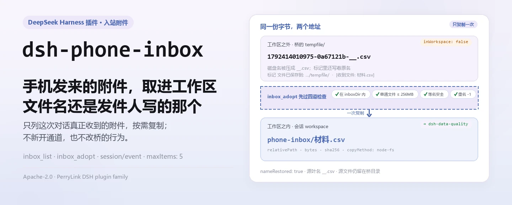
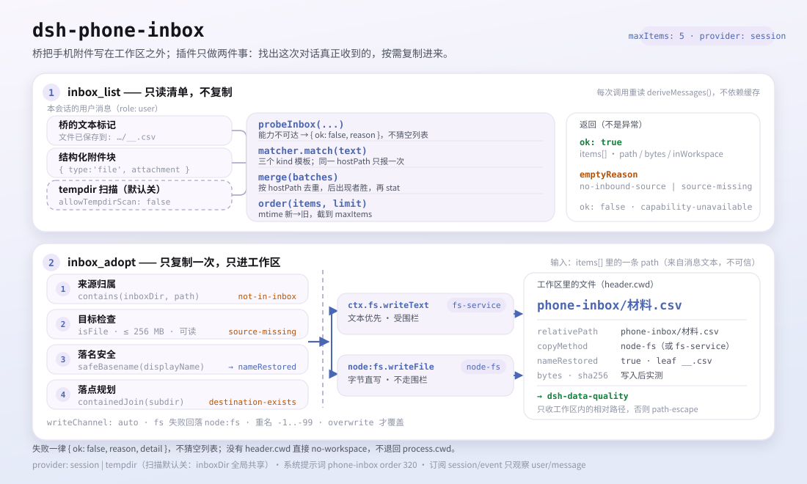

<div align="center">

<picture>
  <source media="(prefers-color-scheme: dark)" srcset="docs/assets/dsh-phone-inbox-hero-zh-dark.webp">
  
</picture>

# dsh-phone-inbox

**把手机发来的附件变成工作区里的可寻址文件——不新开通道，也不复制多余的东西。**

面向 DeepSeek Harness 的会话入站附件收件箱：列出这次对话真正收到的手机（微信桥）附件，按需取进工作区，并把桥压坏的文件名恢复回来。

[安装](#三步上手) · [配置](#配置) · [FAQ](#faq) · [简体中文](README.md) · [English](README.en.md) · [Español](README.es.md) · [Português](README.pt.md) · [हिन्दी](README.hi.md)

[](LICENSE)
[](#兼容性)
[](https://www.npmjs.com/package/dsh-phone-inbox)
[](https://github.com/PerryLink/dsh-phone-inbox/actions/workflows/ci.yml)
[](#兼容性)

[](https://github.com/PerryLink/dsh-phone-inbox/stargazers)
[](https://www.npmjs.com/package/dsh-phone-inbox)
[](https://dshfind.com/plugins/PerryLink/dsh-phone-inbox?ref=badge)
[](https://gitee.com/perrylink/dsh-phone-inbox)

```sh
dsh plugin --profile <name> add dsh-phone-inbox
```

</div>

<sub>社区插件，与 DeepSeek 官方无关。唯一仓库：<https://github.com/PerryLink/dsh-phone-inbox>（Gitee 为镜像）。</sub>

## 它是什么

`dsh-wechat` 把手机发来的媒体存到 `~/.dsh-wechat/tempfile/` —— 在会话工作区**之外** —— 并把绝对路径写进一条纯文本消息。`dsh-phone-inbox` 从这条消息里恢复出这次对话真正收到的附件清单（`inbox_list`），需要时把其中一条复制进工作区（`inbox_adopt`），沿途把桥压坏的文件名恢复回来。这补上两个用户看不见的缺口：强制工作区的工具（如 `dsh-data-quality`）会拒绝任何逃出会话工作区的路径（`path-escape`）；桥又把文件名里的非 ASCII 字符压成 `_`，`材料.csv` 落盘就成了 `__.csv`。它不新开通道，也不改变桥的行为：默认只认本会话自己的消息，不扫描共享目录。来源与 provider 解耦：默认适配器读 `dsh-wechat` 的临时目录，自定义 provider 也可以接别的来源，`dsh-wechat` 是可选来源、不是包依赖。

<picture>
  <source media="(prefers-color-scheme: dark)" srcset="docs/assets/dsh-phone-inbox-flow-v5-dark.svg">
  
</picture>

## 三步上手

1. **安装**（二选一）：

   ```sh
   # npm 通道（已发布版本）
   dsh plugin --profile web add dsh-phone-inbox
   # tarball 通道：本仓库 pnpm pack 后
   dsh plugin --profile web add ./dsh-phone-inbox-<version>.tgz
   ```

   本插件**没有任何运行时依赖**（`dependencies` 为空）。它唯一的 peer 是编译所依赖的宿主包，见 `package.json` 的 `peerDependencies`。

2. **最小配置**（全部字段可选；不写就是这套默认值）：

   ```yaml
   - insert:
       - id: dsh-phone-inbox
         name: dsh-phone-inbox
         config:
           provider: session
           maxItems: 5
   ```

   `inboxDir` 留空时推导桥自己的 `~/.dsh-wechat/tempfile`；桥的 `storageDir` 被挪动时再显式设置。

3. **验证已生效**：

   ```sh
   dsh --profile web --dump-config | grep -A2 'id: dsh-phone-inbox'
   ```

   ```
   > inbox_list
   ```

   在收到过手机附件的会话里，`inbox_list` 返回本会话收到的路径；拿其中一条调用 `inbox_adopt` 即可取进工作区。

**卸载**：`dsh plugin --profile web remove dsh-phone-inbox`（或从 profile patch 删掉该行）。

## 核心能力

两个工具都由函数式插件注册，bundle 行一挂载就出现在模型的工具列表里：

- **本会话清单** —— `inbox_list` 以会话历史读取为权威来源，只列这次对话真正收到的附件；每次调用重新读，不依赖缓存。
- **按需取用** —— `inbox_adopt` 把一条附件复制进会话工作区（默认 `phone-inbox/` 子目录），返回 `relativePath`，交给 `dsh-data-quality` 这类强制工作区的工具。
- **原名恢复** —— 桥把非 ASCII 字符替换成 `_`（`材料.csv` 落盘成 `__.csv`）；`inbox_adopt` 用桥写在标记里的原名作为落盘名。
- **双 Provider** —— `provider: session`（默认，只看本会话消息）或 `tempdir`（`session` 加对 `inboxDir` 的扫描）；扫描默认关闭，因为 `inboxDir` 是全局共享的。
- **写通道显式** —— `writeChannel` 的 `auto`/`fs`/`node` 三选一，结果里的 `copyMethod` 永远说明实际走了哪条通道；`fs` 走会话沙箱策略。
- **失败可辨** —— 不可达时返回 `{ ok: false, reason, detail }` 而不是空列表；空结果另有 `emptyReason`，模型不会把「没有」和「坏了」混为一谈。
- **提示词与事件** —— 追加一段系统提示词小节（`phone-inbox`，order 320）让模型知道能力存在，并订阅 `session/event` 观察 `user/message`；两者都不是正确性的前提。

### 工具面

```ts
inbox_list({
  limit?: number,            // 默认：config.maxItems
  includeTempdir?: boolean,  // 仅当 allowTempdirScan 为 true 才生效
})
```

返回 `{ ok: true, source, inboxDir, items[], attachments, deriveMessages, emptyReason?, emptyDetail?, tempdirScan, unresolvedAttachmentBlocks }`，或 `{ ok: false, reason, detail }`。

```ts
inbox_adopt({
  path: string,              // 必填：原样使用 inbox_list 给出的值
  name?: string,             // 默认：恢复出的原始文件名
  subdir?: string,           // 默认：config.defaultSubdir
  channel?: 'auto' | 'fs' | 'node',
  overwrite?: boolean,       // 默认 false：重名会加 -1 后缀
  register?: boolean,        // 默认：config.registerAttachment
})
```

成功返回 `{ ok: true, item }`，含 `hostPath`、`workspacePath`、`relativePath`、`bytes`、`sha256`、`copyMethod`、`nameRestored`、`sourceLeafName`，登记时另有 `attachmentId`/`attachmentHostPath`；失败返回 `{ ok: false, reason, detail }`。

### 示例

以下为插件真实入口；安装后调用一个即可。

**详细示例** —— 命令 `inbox_adopt`，输入：

```json
{
  "path": "/tmp/dsh-test-phone-inbox-acceptance-5AoMHy/.dsh-wechat/tempfile/1792414010975-0a67121b-__.csv"
}
```

输出：

```text
{
  "relativePath": "phone-inbox/材料.csv",
  "copyMethod": "node-fs"
}
```

*Observed from `plugins/dsh-phone-inbox/scripts/acceptance.mjs:134-147`*

**失败分支** —— 输入：

```text
{"path":"/tmp/dsh-phone-inbox-example/workspace/local.csv"}
```

输出：

```text
phone-inbox could not adopt that attachment.
reason: not-in-inbox
/tmp/dsh-phone-inbox-example/workspace/local.csv is not inside the inbox directory /tmp/dsh-phone-inbox-example/inbox; this plugin only adopts files the bridge saved there
```

*Observed from `plugins/dsh-phone-inbox/src/provider-base.ts:443-449; plugins/dsh-phone-inbox/src/render.ts:108-115; plugins/dsh-phone-inbox/tests/integration.test.ts:359-368`*

**简短示例**：`inbox_adopt`

## 配置

所有字段可选，表里给的是默认值；`cordis.patch.yml` 有同样取值并带行内注释。

最常用键：

| 键 | 默认值 | 含义 |
|---|---|---|
| `enabled` | `true` | 总开关；`false` 时不挂服务、不注册工具。 |
| `inboxDir` | `""` → `~/.dsh-wechat/tempfile` | 桥落入站媒体的目录。留空则推导桥自己的默认值；桥的 `storageDir` 被挪动时显式设置。 |
| `maxItems` | `5` | `inbox_list` 返回条数上限。MVP 约定是「本会话最近几条」。 |
| `provider` | `session` | 由哪个已注册 provider 回答：`session`（本对话自己的消息）或 `tempdir`（`session` 加对 `inboxDir` 的扫描）。 |
| `allowTempdirScan` | `false` | 是否启用目录扫描。默认关，因为 `inboxDir` 是全局的。 |
| `defaultSubdir` | `phone-inbox` | `inbox_adopt` 写入的工作区子目录。 |
| `writeChannel` | `auto` | `auto`（文本走 fs 服务，其余走 node:fs）· `fs`（只走宿主 fs 服务）· `node`（直接写字节）。 |

<details>
<summary>完整配置表（12 个键）</summary>

| 键 | 默认值 | 含义 |
|---|---|---|
| `enabled` | `true` | 总开关；`false` 时不挂服务、不注册工具。 |
| `inboxDir` | `""` → `~/.dsh-wechat/tempfile` | 桥落入站媒体的目录。留空则推导桥自己的默认值；桥的 `storageDir` 被挪动时显式设置。 |
| `maxItems` | `5` | `inbox_list` 返回条数上限。MVP 约定是「本会话最近几条」。 |
| `provider` | `session` | 由哪个已注册 provider 回答：`session`（本对话自己的消息）或 `tempdir`（`session` 加对 `inboxDir` 的扫描）。 |
| `allowTempdirScan` | `false` | 是否启用目录扫描。默认关，因为 `inboxDir` 是全局的。 |
| `tempdirScanMaxItems` | `5` | 扫描最多贡献的条数。 |
| `tempdirScanMaxAgeMs` | `3600000` | 扫描文件的年龄上限；`0` 表示不过滤。 |
| `markers` | 见下 | 各媒体类型的标记文案，取值为 `RegExp` source。 |
| `defaultSubdir` | `phone-inbox` | `inbox_adopt` 写入的工作区子目录。 |
| `restoreOriginalName` | `true` | 用恢复出的发件人原始名作为取用后的文件名。 |
| `writeChannel` | `auto` | `auto`（文本走 fs 服务，其余走 node:fs）· `fs`（只走宿主 fs 服务）· `node`（直接写字节）。 |
| `registerAttachment` | `false` | 同时把取用的字节登记为宿主持久附件。附件对象永不被 GC。 |

</details>

`markers` 的默认文案，按媒体类型 —— 每个值都是 `RegExp` source，其**第一个捕获组是路径**：

```yaml
markers:
  image:
    path: "文件已保存到:\\s*(\\S+)"
  file:
    path: "(?:文件已保存到|文件路径):\\s*(\\S+)"
    name: "\\[收到文件:\\s*([^\\]\\r\\n]+)\\]"
  video:
    path: "文件已保存到:\\s*(\\S+)"
```

标记文案是与桥的**软契约**：桥把路径写进散文，而散文可能随桥的版本无声变化。这些模式做成配置项，正是为了让文案变化成为一次配置修改，而不是一次插件发版。

profile patch 覆盖示例：

```yaml
- insert:
    - id: dsh-phone-inbox
      name: dsh-phone-inbox
      config:
        provider: tempdir
        allowTempdirScan: true
        writeChannel: fs
```

## FAQ

<details>
<summary>附件会被复制到别处或上传吗？</summary>

不会。只有调用 `inbox_adopt` 才会复制，且目标被限制在会话工作区内；插件没有任何网络请求，也没有运行时依赖。`inbox_list` 只读本会话消息与 `inboxDir`。

</details>

<details>
<summary>文件与路径存在哪？</summary>

插件不维护持久存储：清单每次从会话历史重算；取用后的副本在会话工作区的 `phone-inbox/` 子目录，源文件仍在桥的 `tempfile/` 里。

</details>

<details>
<summary>会看到别的会话、甚至别人的附件吗？</summary>

默认不会：`provider: session` 只读本会话自己的消息。`tempdir` 扫描能看到全局目录里未被消息认领的文件，且无法证明归属，所以默认关闭；开启后每一条扫描结果都带 `source: "tempdir"`。

</details>

<details>
<summary>会把工作区里已有的同名文件覆盖吗？</summary>

默认不会：重名目标会得到 `-1`、`-2`…… 后缀，只有显式 `overwrite: true` 才覆盖。

</details>

<details>
<summary>依赖 dsh-wechat 吗？桥的文案变了怎么办？</summary>

不依赖：`dsh-wechat` 是可选来源，不是包依赖。插件只依赖标记文案，而 `markers` 可配置——文案变化是一次配置修改，不是一次插件发版。

</details>

## 安全边界

- 读不受宿主 fs 沙箱围栏（围栏只包 `writeText`/`editText`），因此本插件在复制的**两端**都自己做包含判定。
- `fs` 写通道走 `ctx.fs.writeText` 并带会话作用域的沙箱策略，所以限制型后端会像围栏 `write` 工具一样围栏它。`node` 通道按构造绕过该围栏；它存在的原因是 `ctx.fs` 没有字节写 API。返回的 `copyMethod` 永远说明到底哪条通道写了。
- `auto` 对文本优先走 fs 服务、失败回退 `node:fs`；回退原因被记录、通道被上报，绝不靠暗示。
- 目录扫描无法证明某个文件属于哪次对话。这正是它默认关闭、且其条目自带 `source` 的原因。
- 桥的 inbox 目录不保证是私有的（一次桥重构移除了显式的 `0o700`/`0o600` 处理）。本插件不假设它私有。
- 加载期校验响亮失败：非法 `writeChannel`、越界数值、非法 marker 正则都在挂载时抛错，不会变成静默的空收件箱。

## 权限与数据

- **读** `inboxDir` 与调用会话自己的消息，别的都不读。
- **只在会话工作区内写**（`path.resolve` + 分隔符感知的包含判定），且只在调用 `inbox_adopt` 时写。
- **拒绝**不在 `inboxDir` 下的源路径、逃出工作区的 `subdir`、以及可能穿越的文件名。`path` 参数来自模型，永不被信任。
- **默认不扫描**共享的 inbox 目录，除非显式打开 `allowTempdirScan`；开启后它贡献的每一条都带 `source: "tempdir"`。
- **永不静默覆盖**。重名目标会得到 `-1`、`-2`…… 后缀，除非 `overwrite: true`。
- **默认不登记**持久附件；登记会把字节复制进宿主的附件库，而那里没有垃圾回收。

## 已知限制

- **路径里含字面空格会被截断**在空格处。捕获用 `(\S+)`，因为正是它阻止捕获吞掉桥写在路径后面的那句话；桥自己的临时文件名从不含空格。
- **图片与视频的 kind 都报成 `file`。** 桥对两者用同一句文案，kind 无法从文本恢复；靠叶名（`image.png`、`video.mp4`）区分。
- **图片/视频没有可恢复的原始名。** 桥把它们存成 `image.<ext>` / `video.mp4`，文案里不带原始名。插件如实报告磁盘名并说明，而不是编一个。
- **Windows 路径只在 Windows 上可用**（POSIX 路径同理）。插件按运行平台归一化分隔符。
- **`inbox_adopt` 要求文件仍然存在。** 桥从不清理 `tempfile/`，但没有任何东西保证它留着。
- **没有跑过真实微信流量。** 验收脚本说明了什么是被脚本化验证的，其输出说明了脚本化与真机的边界。

## 与其他 DSH 插件的互操作性

- **不注册 waterfall 监听器。** 当前只订阅 `session/event` 观察 `user/message`，不改写消息、不短路任何链条。
- **服务键唯一。** 只有 `src/service-local.ts` 这个 facade 注册 `phoneInbox`；两个 Provider 不各自注册服务名，因此同一上下文里不会出现重复注册。
- **工具名收敛。** 只注册 `inbox_list` 与 `inbox_adopt` 两个工具，不注册命令、客户端 slot 或 `webServer` 前缀。
- **组合包只 insert 自己一行。** `cordis.patch.yml` 不覆写内置行的 `config`。
- **与 `dsh-wechat` 是软契约。** 无包依赖，只读桥写在消息里的路径与文件名；文案变化用 `markers` 配置吸收。
- **与 `dsh-data-quality` 可组合。** `inbox_adopt` 返回的 `relativePath` 正是强制工作区工具接受的形态；`scripts/acceptance.mjs` 端到端跑 probe → list → adopt → `dsh-data-quality`。

## 兼容性

| 维度 | 状态 |
|---|---|
| Harness | `engines.dsh` 声明生态的六段 OR 区间：`>=0.1.2-rc.1 <0.2.0 \|\| >=0.1.5-alpha.1 <0.2.0 \|\| >=0.1.6-0 <0.2.0 \|\| >=0.1.7-0 <0.2.0 \|\| >=0.2.0-0 <0.3.0 \|\| >=0.2.1-0 <0.3.0`；本 README 以 `>=0.2.1-alpha.1` 为运行时下限。宿主在 preflight 评估 `peerDependencies`，区间不匹配的插件行会被静默禁用。 |
| Node | `^22.19.0 \|\| >=24.0.0` |
| 平台 | 任何 DSH 可运行处（纯 host、零运行时依赖；无浏览器半、无 UI） |
| 模型 | 文本模型完全支持；附件以路径与文本标记处理，不要求视觉能力 |

## 生态与质量

- [Gitee 镜像](https://gitee.com/perrylink/dsh-phone-inbox)（同步镜像，以 GitHub 为准）
- [dshfind 插件页](https://dshfind.com/plugins/PerryLink/dsh-phone-inbox)（安装量与排名）
- [生态实测知识库](https://perrylink.github.io/dsh-plugin-guide/)：插件开发指南 · 选型实测数据 · 维护取舍判据

## 开发

```sh
pnpm install
pnpm run typecheck && pnpm test && pnpm run build \
  && pnpm run verify:self-contained && pnpm run verify:artifacts \
  && pnpm run check:readmes && pnpm run check:lockfile
pnpm run acceptance          # 端到端：探测 -> 列表 -> 取用 -> dsh-data-quality
```

`prepublishOnly` 会重跑整条闸门链，所以发布不可能发出未构建或已漂移的树。

| 路径 | 作用 |
|---|---|
| `src/index.ts` | 函数式插件契约：解析配置、注册 Provider、发布 `ctx.phoneInbox`、注册两个工具、追加提示词小节、订阅 `session/event` |
| `src/service-local.ts` | 唯一注册 `phoneInbox` 的 facade（一个上下文只能有一个对象注册该名字） |
| `src/provider-base.ts` | 共享管线：历史读取、合并、stat、包含判定、目标规划、两条写通道、附件登记 |
| `src/provider-session.ts` / `src/provider-tempdir.ts` | 两个 Provider |
| `src/markers.ts` / `src/config.ts` | 标记契约（纯函数）与带校验的配置 |
| `src/tools/*.ts` | `inbox_list` / `inbox_adopt` 两个 Consumer |
| `scripts/acceptance.mjs` | 端到端验收：probe → list → adopt → `dsh-data-quality` |
| `tests/` | vitest，按用例建独立的 inbox 目录 |
| `docs/assets/` | 本 README 的 hero 横幅与深浅双版结构图 |
| `scripts/gen-readme-assets.py` | 程序化生成 `docs/assets/dsh-phone-inbox-hero-{zh,en}-{light,dark}.webp` 与 `docs/assets/dsh-phone-inbox-flow-v5-{light,dark}.svg` |

配图由 [`scripts/gen-readme-assets.py`](scripts/gen-readme-assets.py) 程序化生成（Python + Pillow 字体探测），可重复执行：`python scripts/gen-readme-assets.py`。

Topics：`dsh` · `dsh-plugin` · `deepseek-harness` · `cordis` · `wechat` · `inbox` · `attachment` · `phone`

## 家族与致谢

本项目是 [PerryLink](https://github.com/PerryLink) 维护的 DeepSeek Harness 插件家族成员（全部 Apache-2.0）。如果这个插件帮到了你，**给个 star**——它不解锁任何功能，但会让下一个人更容易找到它。

- [@PerryLink](https://github.com/PerryLink) —— 创建者与维护者：会话入站附件的标记恢复、双 Provider、工作区取用管线与五语文档。

<details>
<summary>展开全部插件</summary>

| 插件 | 状态 |
|---|---|
| **[dsh-aqua-input-check](https://github.com/PerryLink/dsh-aqua-input-check)** |  |
| **[dsh-archive-check](https://github.com/PerryLink/dsh-archive-check)** |  |
| **[dsh-auto-review](https://github.com/PerryLink/dsh-auto-review)** |  |
| **[dsh-autotier](https://github.com/PerryLink/dsh-autotier)** | 🧊 已冻结 — 见仓库 README |
| **[dsh-bid-ca-precheck](https://github.com/PerryLink/dsh-bid-ca-precheck)** |  |
| **[dsh-bid-qual-check](https://github.com/PerryLink/dsh-bid-qual-check)** |  |
| **[dsh-cert-mcp](https://github.com/PerryLink/dsh-cert-mcp)** | 🧊 已冻结 — 见仓库 README |
| **[dsh-checkpoint-rewind](https://github.com/PerryLink/dsh-checkpoint-rewind)** |  |
| **[dsh-click](https://github.com/PerryLink/dsh-click)** |  |
| **[dsh-composer-history](https://github.com/PerryLink/dsh-composer-history)** |  |
| **[dsh-contract-stance](https://github.com/PerryLink/dsh-contract-stance)** |  |
| **[dsh-customs-doc-check](https://github.com/PerryLink/dsh-customs-doc-check)** |  |
| **[dsh-data-quality](https://github.com/PerryLink/dsh-data-quality)** | 🧊 已冻结 — 见仓库 README |
| **[dsh-demurrage-ledger](https://github.com/PerryLink/dsh-demurrage-ledger)** |  |
| **[dsh-doublecheck](https://github.com/PerryLink/dsh-doublecheck)** |  |
| **[dsh-drill-script-check](https://github.com/PerryLink/dsh-drill-script-check)** |  |
| **[dsh-eia-guide-check](https://github.com/PerryLink/dsh-eia-guide-check)** |  |
| **[dsh-emergency-plan](https://github.com/PerryLink/dsh-emergency-plan)** |  |
| **[dsh-essay-rubric-check](https://github.com/PerryLink/dsh-essay-rubric-check)** |  |
| **[dsh-evidence-check](https://github.com/PerryLink/dsh-evidence-check)** |  |
| **[dsh-export-ctl-check](https://github.com/PerryLink/dsh-export-ctl-check)** |  |
| **[dsh-fast](https://github.com/PerryLink/dsh-fast)** |  |
| **[dsh-fmea-table-check](https://github.com/PerryLink/dsh-fmea-table-check)** |  |
| **[dsh-forecast-penalty](https://github.com/PerryLink/dsh-forecast-penalty)** |  |
| **[dsh-fund-research](https://github.com/PerryLink/dsh-fund-research)** |  |
| **[dsh-github](https://github.com/PerryLink/dsh-github)** |  |
| **[dsh-gongwen-flow-check](https://github.com/PerryLink/dsh-gongwen-flow-check)** |  |
| **[dsh-gongwen-word-check](https://github.com/PerryLink/dsh-gongwen-word-check)** |  |
| **[dsh-guard-plan-qc](https://github.com/PerryLink/dsh-guard-plan-qc)** |  |
| **[dsh-hazchem-check](https://github.com/PerryLink/dsh-hazchem-check)** |  |
| **[dsh-hazplan-check](https://github.com/PerryLink/dsh-hazplan-check)** |  |
| **[dsh-hidden-risk-map](https://github.com/PerryLink/dsh-hidden-risk-map)** |  |
| **[dsh-hs-classify](https://github.com/PerryLink/dsh-hs-classify)** |  |
| **[dsh-icd-rule-check](https://github.com/PerryLink/dsh-icd-rule-check)** |  |
| **[dsh-industry-research](https://github.com/PerryLink/dsh-industry-research)** |  |
| **[dsh-lawcite-adapter](https://github.com/PerryLink/dsh-lawcite-adapter)** |  |
| **[dsh-laya](https://github.com/PerryLink/dsh-laya)** |  |
| **[dsh-lc-doc-check](https://github.com/PerryLink/dsh-lc-doc-check)** |  |
| **[dsh-learning-gap-check](https://github.com/PerryLink/dsh-learning-gap-check)** |  |
| **[dsh-library](https://github.com/PerryLink/dsh-library)** |  |
| **[dsh-local-ai](https://github.com/PerryLink/dsh-local-ai)** |  |
| **[dsh-lsp-actions](https://github.com/PerryLink/dsh-lsp-actions)** |  |
| **[dsh-mask](https://github.com/PerryLink/dsh-mask)** |  |
| **[dsh-mcp-panel](https://github.com/PerryLink/dsh-mcp-panel)** |  |
| **[dsh-medrec-qc](https://github.com/PerryLink/dsh-medrec-qc)** |  |
| **[dsh-memento](https://github.com/PerryLink/dsh-memento)** | 🧊 已冻结 — 见仓库 README |
| **[dsh-nsfc-form-check](https://github.com/PerryLink/dsh-nsfc-form-check)** |  |
| **[dsh-nurse-record-check](https://github.com/PerryLink/dsh-nurse-record-check)** |  |
| **[dsh-observe](https://github.com/PerryLink/dsh-observe)** |  |
| **[dsh-origin-rvc-check](https://github.com/PerryLink/dsh-origin-rvc-check)** |  |
| **[dsh-ota-review-check](https://github.com/PerryLink/dsh-ota-review-check)** |  |
| **[dsh-output-styles](https://github.com/PerryLink/dsh-output-styles)** |  |
| **[dsh-paper-doc-adapter](https://github.com/PerryLink/dsh-paper-doc-adapter)** |  |
| **[dsh-permission-rules](https://github.com/PerryLink/dsh-permission-rules)** |  |
| **[dsh-permit-report-check](https://github.com/PerryLink/dsh-permit-report-check)** |  |
| **[dsh-pipeline-check](https://github.com/PerryLink/dsh-pipeline-check)** |  |
| **[dsh-pleading-draft](https://github.com/PerryLink/dsh-pleading-draft)** |  |
| **[dsh-plugin-doctor](https://github.com/PerryLink/dsh-plugin-doctor)** | 🚫 已退役（仓库已归档） |
| **[dsh-plugin-guide](https://github.com/PerryLink/dsh-plugin-guide)** |  |
| **[dsh-plugin-kit](https://github.com/PerryLink/dsh-plugin-kit)** | 🚫 已退役（仓库已归档） |
| **[dsh-plugin-upgrade](https://github.com/PerryLink/dsh-plugin-upgrade)** | 🚫 已退役（仓库已归档） |
| **[dsh-policy-brief-draft](https://github.com/PerryLink/dsh-policy-brief-draft)** |  |
| **[dsh-power-loss-split](https://github.com/PerryLink/dsh-power-loss-split)** |  |
| **[dsh-power-ticket-check](https://github.com/PerryLink/dsh-power-ticket-check)** |  |
| **[dsh-ppap-check](https://github.com/PerryLink/dsh-ppap-check)** |  |
| **[dsh-protest-deadline](https://github.com/PerryLink/dsh-protest-deadline)** |  |
| **[dsh-railway-window](https://github.com/PerryLink/dsh-railway-window)** |  |
| **[dsh-repair-order-qc](https://github.com/PerryLink/dsh-repair-order-qc)** |  |
| **[dsh-research-report](https://github.com/PerryLink/dsh-research-report)** |  |
| **[dsh-review-reply-check](https://github.com/PerryLink/dsh-review-reply-check)** |  |
| **[dsh-rulefile-check](https://github.com/PerryLink/dsh-rulefile-check)** |  |
| **[dsh-safety-brief-check](https://github.com/PerryLink/dsh-safety-brief-check)** |  |
| **[dsh-score](https://github.com/PerryLink/dsh-score)** | 🧊 已冻结 — 见仓库 README |
| **[dsh-session-sync](https://github.com/PerryLink/dsh-session-sync)** |  |
| **[dsh-site-log-check](https://github.com/PerryLink/dsh-site-log-check)** |  |
| **[dsh-skill-pack-security](https://github.com/PerryLink/dsh-skill-pack-security)** |  |
| **[dsh-soe-decision-check](https://github.com/PerryLink/dsh-soe-decision-check)** |  |
| **[dsh-soilwater-check](https://github.com/PerryLink/dsh-soilwater-check)** |  |
| **[dsh-sop-sync-check](https://github.com/PerryLink/dsh-sop-sync-check)** |  |
| **[dsh-spc-gbt-adapter](https://github.com/PerryLink/dsh-spc-gbt-adapter)** |  |
| **[dsh-talk](https://github.com/PerryLink/dsh-talk)** |  |
| **[dsh-tender-extract](https://github.com/PerryLink/dsh-tender-extract)** |  |
| **[dsh-tender-matrix](https://github.com/PerryLink/dsh-tender-matrix)** |  |
| **[dsh-test-drive](https://github.com/PerryLink/dsh-test-drive)** |  |
| **[dsh-ticktick](https://github.com/PerryLink/dsh-ticktick)** | 🚫 已退役（仓库已归档） |
| **[dsh-translate](https://github.com/PerryLink/dsh-translate)** |  |
| **[dsh-warranty-calc](https://github.com/PerryLink/dsh-warranty-calc)** |  |
| **[dsh-budget](https://github.com/PerryLink/dsh-budget)** |  |
| **[dsh-claude-move](https://github.com/PerryLink/dsh-claude-move)** |  |
| **[dsh-defend](https://github.com/PerryLink/dsh-defend)** |  |
| **[dsh-draw](https://github.com/PerryLink/dsh-draw)** | 🧊 已冻结 — 见仓库 README |
| **[dsh-reach](https://github.com/PerryLink/dsh-reach)** |  |
| **[dsh-background-agents](https://github.com/PerryLink/dsh-background-agents)** | 🚫 已退役（仓库已归档） |
| **[dsh-session-pin](https://github.com/PerryLink/dsh-session-pin)** | 🚫 已退役（仓库已归档） |
| **[dsh-team-rooms](https://github.com/PerryLink/dsh-team-rooms)** | 🚫 已退役（仓库已归档） |

</details>

## License

[LICENSE](LICENSE)（Apache License 2.0）© 2026 dsh-phone-inbox contributors

<p align="center"><sub>Apache-2.0 · 社区插件，与 DeepSeek 无关。</sub></p>
