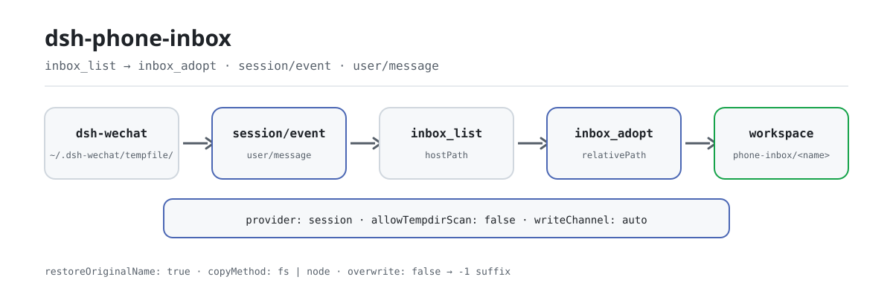

<div align="center">

<picture>
  <source media="(prefers-color-scheme: dark)" srcset="docs/assets/dsh-phone-inbox-flow-dark.svg">
  
</picture>

# dsh-phone-inbox

**Transforme um anexo do telefone em um arquivo endereçável do espaço de trabalho — sem abrir canal novo e sem copiar demais.**

A caixa de entrada de anexos da sessão para o DeepSeek Harness: liste os anexos do telefone (ponte do WeChat) que **esta conversa** realmente recebeu, adote um no espaço de trabalho quando pedido e recupere o nome de arquivo que a ponte mutilou.

[Instalar](#instalação-em-três-passos) · [Configuração](#configuração) · [FAQ](#faq) · [简体中文](README.md) · [English](README.en.md) · [Español](README.es.md) · [Português](README.pt.md) · [हिन्दी](README.hi.md)

[](LICENSE)
[](#compatibilidade)
[](https://www.npmjs.com/package/dsh-phone-inbox)
[](https://github.com/PerryLink/dsh-phone-inbox/actions/workflows/ci.yml)
[](#compatibilidade)

[](https://github.com/PerryLink/dsh-phone-inbox/stargazers)
[](https://www.npmjs.com/package/dsh-phone-inbox)
[](https://dshfind.com/plugins/PerryLink/dsh-phone-inbox?ref=badge)
[](https://gitee.com/perrylink/dsh-phone-inbox)

```sh
dsh plugin --profile <name> add dsh-phone-inbox
```

</div>

<sub>Plugin da comunidade, sem afiliação com a DeepSeek. Repositório canônico: <https://github.com/PerryLink/dsh-phone-inbox> (o Gitee é um espelho).</sub>

## O que é

O `dsh-wechat` grava as mídias recebidas do telefone em `~/.dsh-wechat/tempfile/` — fora do espaço de trabalho da sessão — e escreve o caminho absoluto numa mensagem de texto simples. O `dsh-phone-inbox` recupera a lista de anexos que esta conversa realmente recebeu (`inbox_list`), copia um para o espaço de trabalho quando pedido (`inbox_adopt`) e, no caminho, restaura o nome que a ponte mutilou. Ele fecha duas lacunas que o usuário nunca vê: ferramentas confinadas ao espaço de trabalho, como o `dsh-data-quality`, recusam qualquer caminho que escape da sessão (`path-escape`), e a ponte substitui cada caractere não ASCII do nome por `_`, então um nome chinês fica no disco como `__.csv`. Não adiciona canal novo nem muda a ponte: por padrão lê apenas as mensagens desta sessão e nunca varre o diretório compartilhado. A fonte é desacoplada do provider: o adaptador padrão lê o diretório temporário do `dsh-wechat`, um provider personalizado pode fornecer outra fonte, e `dsh-wechat` é opcional, não uma dependência do pacote.

## Instalação em três passos

1. **Instalar** (escolha um canal):

   ```sh
   # canal npm (versões publicadas)
   dsh plugin --profile web add dsh-phone-inbox
   # canal tarball: pnpm pack neste repositório e depois
   dsh plugin --profile web add ./dsh-phone-inbox-<version>.tgz
   ```

   O plugin **não tem dependências de runtime** (`dependencies` está vazio). Seus únicos pares são os pacotes hospedeiros contra os quais é compilado; veja o bloco `peerDependencies` em `package.json`.

2. **Configuração mínima** (todos os campos são opcionais; estes são os padrões):

   ```yaml
   - insert:
       - id: dsh-phone-inbox
         name: dsh-phone-inbox
         config:
           provider: session
           maxItems: 5
   ```

   Um `inboxDir` vazio deriva o `~/.dsh-wechat/tempfile` da própria ponte; defina-o explicitamente quando o `storageDir` da ponte foi movido.

3. **Verificar que montou**:

   ```sh
   dsh --profile web --dump-config | grep -A2 'id: dsh-phone-inbox'
   ```

   ```
   > inbox_list
   ```

   Numa sessão que recebeu um anexo do telefone, `inbox_list` devolve os caminhos que esta sessão recebeu; passe um deles a `inbox_adopt`.

**Desinstalar**: `dsh plugin --profile web remove dsh-phone-inbox` (ou remova a linha do patch do perfil).

## Capacidades principais

As duas ferramentas são registradas pelo plugin funcional, então aparecem na lista de ferramentas do modelo assim que a linha do bundle é montada:

- **Lista da sessão** — `inbox_list` usa a leitura do histórico da sessão como fonte autoritativa e lista apenas os anexos que esta conversa realmente recebeu; relê a cada chamada em vez de depender de cache.
- **Adoção sob demanda** — `inbox_adopt` copia um anexo para o espaço de trabalho da sessão (subdiretório `phone-inbox/` por padrão) e devolve `relativePath` para ferramentas confinadas ao espaço de trabalho, como `dsh-data-quality`.
- **Recuperação do nome original** — a ponte substitui cada caractere não ASCII por `_` (um nome chinês acaba mutilado no disco); `inbox_adopt` usa o nome original que o marcador da ponte carrega como nome do arquivo adotado.
- **Dois providers** — `provider: session` (padrão, as mensagens desta sessão) ou `tempdir` (`session` mais uma varredura de `inboxDir`); a varredura fica desligada por padrão porque `inboxDir` é global e compartilhado.
- **Canal de escrita explícito** — `writeChannel` é `auto`, `fs` ou `node`, e o `copyMethod` do resultado sempre nomeia o canal que de fato rodou; `fs` passa pela política de sandbox da sessão.
- **Falhas distinguíveis** — uma caixa inalcançável devolve `{ ok: false, reason, detail }` em vez de uma lista vazia; um resultado vazio carrega seu próprio `emptyReason`, então o modelo nunca confunde «nada chegou» com «quebrou».
- **Seção de prompt e evento** — o plugin acrescenta uma seção ao prompt do sistema (`phone-inbox`, ordem 320) para o modelo saber que a capacidade existe, e assina `session/event` para observar `user/message`; nenhuma das duas é necessária à correção.

### Superfície de ferramentas

```ts
inbox_list({
  limit?: number,            // padrão: config.maxItems
  includeTempdir?: boolean,  // só é honrado quando allowTempdirScan é true
})
```

Devolve `{ ok: true, source, inboxDir, items[], attachments, deriveMessages, emptyReason?, emptyDetail?, tempdirScan, unresolvedAttachmentBlocks }`, ou `{ ok: false, reason, detail }`.

```ts
inbox_adopt({
  path: string,              // obrigatório: exatamente o que inbox_list informou
  name?: string,             // padrão: o nome original recuperado
  subdir?: string,           // padrão: config.defaultSubdir
  channel?: 'auto' | 'fs' | 'node',
  overwrite?: boolean,       // padrão false: um duplicado recebe sufixo -1
  register?: boolean,        // padrão: config.registerAttachment
})
```

Devolve `{ ok: true, item }` com `hostPath`, `workspacePath`, `relativePath`, `bytes`, `sha256`, `copyMethod`, `nameRestored`, `sourceLeafName`, e `attachmentId`/`attachmentHostPath` quando registrado; ou `{ ok: false, reason, detail }`.

### Exemplos

São os pontos de entrada reais; instale e chame um.

**Exemplo detalhado** — comando `inbox_adopt`, entrada:

```json
{
  "path": "/tmp/dsh-test-phone-inbox-acceptance-5AoMHy/.dsh-wechat/tempfile/1792414010975-0a67121b-__.csv"
}
```

Saída:

```text
{
  "relativePath": "phone-inbox/材料.csv",
  "copyMethod": "node-fs"
}
```

*Observado em `plugins/dsh-phone-inbox/scripts/acceptance.mjs:134-147`*

**Ramo de falha** — entrada:

```text
{"path":"/tmp/dsh-phone-inbox-example/workspace/local.csv"}
```

Saída:

```text
phone-inbox could not adopt that attachment.
reason: not-in-inbox
/tmp/dsh-phone-inbox-example/workspace/local.csv is not inside the inbox directory /tmp/dsh-phone-inbox-example/inbox; this plugin only adopts files the bridge saved there
```

*Observado em `plugins/dsh-phone-inbox/src/provider-base.ts:443-449; plugins/dsh-phone-inbox/src/render.ts:108-115; plugins/dsh-phone-inbox/tests/integration.test.ts:359-368`*

**Exemplo breve**: `inbox_adopt`

## Configuração

Todos os campos são opcionais; a tabela traz o padrão. O `cordis.patch.yml` tem os mesmos valores com comentários em linha.

Chaves mais usadas:

| Chave | Padrão | Significado |
|---|---|---|
| `enabled` | `true` | Chave mestra; `false` não monta serviço nem ferramentas. |
| `inboxDir` | `""` → `~/.dsh-wechat/tempfile` | Diretório onde a ponte deposita mídias recebidas. Vazio deriva o padrão da ponte; defina-o quando o `storageDir` da ponte foi movido. |
| `maxItems` | `5` | Teto de entradas que `inbox_list` devolve. O contrato do MVP é «os últimos anexos da sessão». |
| `provider` | `session` | Qual provedor registrado responde: `session` (as mensagens desta conversa) ou `tempdir` (`session` mais uma varredura de `inboxDir`). |
| `allowTempdirScan` | `false` | Habilita a varredura do diretório. Desligada porque `inboxDir` é global. |
| `defaultSubdir` | `phone-inbox` | Subdiretório do espaço de trabalho onde `inbox_adopt` escreve. |
| `writeChannel` | `auto` | `auto` (serviço fs para texto, node:fs caso contrário) · `fs` (apenas o serviço fs do hospedeiro) · `node` (bytes diretamente). |

<details>
<summary>Tabela de configuração completa (12 chaves)</summary>

| Chave | Padrão | Significado |
|---|---|---|
| `enabled` | `true` | Chave mestra; `false` não monta serviço nem ferramentas. |
| `inboxDir` | `""` → `~/.dsh-wechat/tempfile` | Diretório onde a ponte deposita mídias recebidas. Vazio deriva o padrão da ponte; defina-o quando o `storageDir` da ponte foi movido. |
| `maxItems` | `5` | Teto de entradas que `inbox_list` devolve. O contrato do MVP é «os últimos anexos da sessão». |
| `provider` | `session` | Qual provedor registrado responde: `session` (as mensagens desta conversa) ou `tempdir` (`session` mais uma varredura de `inboxDir`). |
| `allowTempdirScan` | `false` | Habilita a varredura do diretório. Desligada porque `inboxDir` é global. |
| `tempdirScanMaxItems` | `5` | Teto de entradas que uma varredura pode contribuir. |
| `tempdirScanMaxAgeMs` | `3600000` | Limite de idade de um arquivo varrido; `0` desativa o filtro. |
| `markers` | veja abaixo | Redação do marcador por tipo de mídia, como fontes `RegExp`. |
| `defaultSubdir` | `phone-inbox` | Subdiretório do espaço de trabalho onde `inbox_adopt` escreve. |
| `restoreOriginalName` | `true` | Usar o nome original recuperado do remetente como nome adotado. |
| `writeChannel` | `auto` | `auto` (serviço fs para texto, node:fs caso contrário) · `fs` (apenas o serviço fs do hospedeiro) · `node` (bytes diretamente). |
| `registerAttachment` | `false` | Registrar também os bytes adotados como anexo durável do hospedeiro. Objetos de anexo nunca são coletados. |

</details>

A redação padrão de `markers`, por tipo de mídia — cada valor é uma fonte `RegExp` cujo **primeiro grupo de captura é o caminho**:

```yaml
markers:
  image:
    path: "文件已保存到:\\s*(\\S+)"
  file:
    path: "(?:文件已保存到|文件路径):\\s*(\\S+)"
    name: "\\[收到文件:\\s*([^\\]\\r\\n]+)\\]"
  video:
    path: "文件已保存到:\\s*(\\S+)"
```

A redação do marcador é um **contrato mole** com a ponte: ela escreve o caminho em prosa, e a prosa pode mudar entre versões da ponte sem aviso. Os padrões são configuração exatamente para que uma mudança de redação seja uma edição de configuração, não uma publicação do plugin.

Exemplo de override no patch do perfil:

```yaml
- insert:
    - id: dsh-phone-inbox
      name: dsh-phone-inbox
      config:
        provider: tempdir
        allowTempdirScan: true
        writeChannel: fs
```

## FAQ

<details>
<summary>Os anexos são copiados para outro lugar ou enviados para fora?</summary>

Não. Só há cópia ao chamar `inbox_adopt`, e o destino fica confinado ao espaço de trabalho da sessão; o plugin não faz requisições de rede e não tem dependências de runtime. `inbox_list` só lê as mensagens desta sessão e `inboxDir`.

</details>

<details>
<summary>Onde ficam os arquivos e os caminhos?</summary>

O plugin não mantém armazenamento persistente: a lista é recalculada do histórico da sessão a cada chamada; a cópia adotada fica no subdiretório `phone-inbox/` do espaço de trabalho, e o arquivo de origem continua no `tempfile/` da ponte.

</details>

<details>
<summary>Dá para ver anexos de outra sessão ou de outra pessoa?</summary>

Por padrão não: `provider: session` lê apenas as mensagens desta sessão. A varredura `tempdir` pode ver arquivos do diretório global que nenhuma mensagem reivindicou e não consegue provar a propriedade, por isso fica desligada por padrão; quando habilitada, cada entrada varrida carrega `source: "tempdir"`.

</details>

<details>
<summary>Vai sobrescrever um arquivo existente no meu espaço de trabalho?</summary>

Por padrão não: um destino duplicado recebe sufixo `-1`, `-2`, …; só um `overwrite: true` explícito sobrescreve.

</details>

<details>
<summary>Depende do dsh-wechat? E se a ponte mudar a redação?</summary>

Não: `dsh-wechat` é uma fonte opcional, não uma dependência do pacote. O plugin depende apenas da redação do marcador, e `markers` é configurável — uma mudança de redação é uma edição de configuração, não uma publicação do plugin.

</details>

## Limites de segurança

- As leituras não são cercadas pelo sandbox fs do hospedeiro (a cerca envolve apenas `writeText`/`editText`), então este plugin aplica sua própria contenção em **ambas** as pontas da cópia.
- O canal de escrita `fs` passa por `ctx.fs.writeText` com a política de sandbox do escopo da sessão, então um backend restritivo o cerca exatamente como cerca a ferramenta `write`. O canal `node` contorna essa cerca por construção; ele existe porque `ctx.fs` não tem API de escrita de bytes. O `copyMethod` devolvido sempre diz qual foi executado.
- `auto` prefere o serviço fs para texto e recorre a `node:fs`; o motivo do recuo é registrado e o canal é informado, nunca implícito.
- A varredura do diretório temporário não consegue provar a qual conversa um arquivo pertence. Por isso está desligada por padrão e por isso suas entradas carregam o próprio `source`.
- Não há garantia de que o diretório de caixa de entrada da ponte seja privado (uma refatoração da ponte removeu o tratamento explícito de `0o700`/`0o600`). Este plugin não assume o contrário.
- A validação em tempo de carga falha alto: `writeChannel` inválido, números fora dos limites e regex de marcador malformadas lançam na montagem em vez de virarem uma caixa de entrada vazia em silêncio.

## Permissões e dados

- **Lê** `inboxDir` e as mensagens da própria sessão chamadora. Nada mais.
- **Escreve** apenas dentro do espaço de trabalho da sessão (`path.resolve` mais uma verificação de contenção ciente do separador), e apenas quando `inbox_adopt` é chamado.
- **Recusa** um caminho de origem fora de `inboxDir`, um `subdir` que escape do espaço de trabalho e um nome que possa atravessar diretórios. O argumento `path` vem do modelo e nunca é confiado.
- **Não varre** o diretório de caixa de entrada compartilhado a menos que `allowTempdirScan` esteja explicitamente habilitado; quando varre, cada entrada que contribui leva `source: "tempdir"`.
- **Nunca sobrescreve** em silêncio. Um destino duplicado recebe sufixo `-1`, `-2`, … a menos que `overwrite: true`.
- **Não registra nada** como anexo durável a menos que pedido; o registro copia bytes para o armazenamento de anexos do hospedeiro, que não tem coleta de lixo.

## Limitações conhecidas

- **Um caminho com espaço literal é truncado** no espaço. A captura é `(\S+)` porque é isso que impede que ela engula a frase que a ponte escreve depois do caminho; os nomes temporários da própria ponte nunca contêm espaço.
- **Os tipos imagem e vídeo são informados como `file`.** A ponte usa a mesma redação para ambos, então o tipo não é recuperável do texto; o nome folha (`image.png`, `video.mp4`) os distingue.
- **Uma imagem ou um vídeo não têm nome original recuperável.** A ponte os salva como `image.<ext>` / `video.mp4` e a redação não traz nome original. O plugin informa o nome em disco e o diz, em vez de inventar um.
- **Um caminho Windows só é utilizável no Windows** (e um POSIX apenas no POSIX). O plugin normaliza os separadores conforme a plataforma em execução.
- **O `inbox_adopt` exige que o arquivo ainda exista.** A ponte nunca limpa `tempfile/`, mas nada garante que ele permaneça.
- **Nenhum tráfego real de WeChat foi exercitado.** O script de aceitação mostra o que *é* verificado, e sua saída indica a fronteira entre o scriptado e o real.

## Interoperabilidade com outros plugins DSH

- **Sem listeners de waterfall.** O plugin apenas assina `session/event` para observar `user/message`; não reescreve mensagens nem curto-circuita nenhuma cadeia.
- **Uma única chave de serviço.** Somente a facade `src/service-local.ts` registra `phoneInbox`; os dois providers nunca registram o nome do serviço por conta própria, então um mesmo contexto não vê registro duplicado.
- **Superfície de ferramentas estreita.** Registra apenas `inbox_list` e `inbox_adopt` — sem comandos, sem slots de cliente, sem prefixo `webServer`.
- **Insere apenas a própria linha.** O `cordis.patch.yml` nunca sobrescreve o `config` de uma linha embutida.
- **Contrato mole com o `dsh-wechat`.** Não há dependência de pacote; o plugin lê apenas o caminho e o nome que a ponte escreve na mensagem, e absorve mudanças de redação via `markers`.
- **Componível com o `dsh-data-quality`.** O `relativePath` que `inbox_adopt` devolve é exatamente a forma que uma ferramenta confinada ao espaço de trabalho aceita; `scripts/acceptance.mjs` roda probe → list → adopt → `dsh-data-quality` de ponta a ponta.

## Compatibilidade

| Dimensão | Estado |
|---|---|
| Harness | `engines.dsh` declara o intervalo OR canônico de seis cláusulas do ecossistema: `>=0.1.2-rc.1 <0.2.0 \|\| >=0.1.5-alpha.1 <0.2.0 \|\| >=0.1.6-0 <0.2.0 \|\| >=0.1.7-0 <0.2.0 \|\| >=0.2.0-0 <0.3.0 \|\| >=0.2.1-0 <0.3.0`; este README usa `>=0.2.1-alpha.1` como piso de execução. O hospedeiro avalia `peerDependencies` no preflight e desativa silenciosamente uma linha de plugin cujo intervalo não admita a versão em execução. |
| Node | `^22.19.0 \|\| >=24.0.0` |
| Plataforma | Onde o DSH rodar (host puro, zero dependências de runtime; sem metade de navegador, sem UI) |
| Modelo | Modelos de texto são totalmente suportados; anexos são tratados como caminhos e marcadores de texto, sem exigência de visão |

## Ecossistema e qualidade

- [Espelho no Gitee](https://gitee.com/perrylink/dsh-phone-inbox) (espelho sincronizado; o GitHub é o canônico)
- [Página no dshfind](https://dshfind.com/plugins/PerryLink/dsh-phone-inbox) (instalações e ranking)
- [Base de conhecimento de notas de campo](https://perrylink.github.io/dsh-plugin-guide/): guia de desenvolvimento de plugins · dados de seleção medidos · critérios de manutenção

## Desenvolvimento

```sh
pnpm install
pnpm run typecheck && pnpm test && pnpm run build \
  && pnpm run verify:self-contained && pnpm run verify:artifacts \
  && pnpm run check:readmes && pnpm run check:lockfile
pnpm run acceptance          # ponta a ponta: sondagem -> lista -> adoção -> dsh-data-quality
```

O `prepublishOnly` executa o portão novamente, então uma publicação não pode enviar uma árvore não construída ou desviada.

| Caminho | Propósito |
|---|---|
| `src/index.ts` | Contrato de plugin funcional: resolve configuração, registra providers, publica `ctx.phoneInbox`, registra as duas ferramentas, acrescenta a seção de prompt e assina `session/event` |
| `src/service-local.ts` | A facade que registra `phoneInbox` (exatamente um objeto pode registrar esse nome num contexto) |
| `src/provider-base.ts` | Pipeline compartilhado: leitura do histórico, fusão, stat, contenção, planejamento do destino, os dois canais de escrita e o registro de anexos |
| `src/provider-session.ts` / `src/provider-tempdir.ts` | Os dois providers |
| `src/markers.ts` / `src/config.ts` | O contrato de marcadores (puro) e sua configuração validada |
| `src/tools/*.ts` | Os dois consumidores `defineTool`, `inbox_list` / `inbox_adopt` |
| `scripts/acceptance.mjs` | Aceitação ponta a ponta: probe → list → adopt → `dsh-data-quality` |
| `tests/` | vitest, com um diretório de caixa de entrada por teste |
| `docs/assets/` | Os diagramas de fluxo claro/escuro usados por este README |
| `scripts/gen-readme-assets.py` | Gera programaticamente `docs/assets/dsh-phone-inbox-flow-{light,dark}.svg` |

Os diagramas são gerados por [`scripts/gen-readme-assets.py`](scripts/gen-readme-assets.py) (Python + sonda de fonte Pillow) e podem ser reexecutados: `python scripts/gen-readme-assets.py`.

Topics: `dsh` · `dsh-plugin` · `deepseek-harness` · `cordis` · `wechat` · `inbox` · `attachment` · `phone`

## Família e agradecimentos

Este projeto faz parte da família de plugins do DeepSeek Harness mantida pela [PerryLink](https://github.com/PerryLink) (todos Apache-2.0). Se este plugin ajudar você, **dê uma estrela** — não desbloqueia nada, mas faz a próxima pessoa encontrá-lo antes.

- [@PerryLink](https://github.com/PerryLink) — criador e mantenedor: recuperação de marcadores de anexos de entrada da sessão, os dois providers, o pipeline de adoção no espaço de trabalho e a documentação em cinco idiomas.

<details>
<summary>Expandir todos os plugins</summary>

| Plugin | Estado |
|---|---|
| **[dsh-aqua-input-check](https://github.com/PerryLink/dsh-aqua-input-check)** |  |
| **[dsh-archive-check](https://github.com/PerryLink/dsh-archive-check)** |  |
| **[dsh-auto-review](https://github.com/PerryLink/dsh-auto-review)** |  |
| **[dsh-autotier](https://github.com/PerryLink/dsh-autotier)** | 🧊 CONGELADO — ver o README do repo |
| **[dsh-bid-ca-precheck](https://github.com/PerryLink/dsh-bid-ca-precheck)** |  |
| **[dsh-bid-qual-check](https://github.com/PerryLink/dsh-bid-qual-check)** |  |
| **[dsh-cert-mcp](https://github.com/PerryLink/dsh-cert-mcp)** | 🧊 CONGELADO — ver o README do repo |
| **[dsh-checkpoint-rewind](https://github.com/PerryLink/dsh-checkpoint-rewind)** |  |
| **[dsh-click](https://github.com/PerryLink/dsh-click)** |  |
| **[dsh-composer-history](https://github.com/PerryLink/dsh-composer-history)** |  |
| **[dsh-contract-stance](https://github.com/PerryLink/dsh-contract-stance)** |  |
| **[dsh-customs-doc-check](https://github.com/PerryLink/dsh-customs-doc-check)** |  |
| **[dsh-data-quality](https://github.com/PerryLink/dsh-data-quality)** | 🧊 CONGELADO — ver o README do repo |
| **[dsh-demurrage-ledger](https://github.com/PerryLink/dsh-demurrage-ledger)** |  |
| **[dsh-doublecheck](https://github.com/PerryLink/dsh-doublecheck)** |  |
| **[dsh-drill-script-check](https://github.com/PerryLink/dsh-drill-script-check)** |  |
| **[dsh-eia-guide-check](https://github.com/PerryLink/dsh-eia-guide-check)** |  |
| **[dsh-emergency-plan](https://github.com/PerryLink/dsh-emergency-plan)** |  |
| **[dsh-essay-rubric-check](https://github.com/PerryLink/dsh-essay-rubric-check)** |  |
| **[dsh-evidence-check](https://github.com/PerryLink/dsh-evidence-check)** |  |
| **[dsh-export-ctl-check](https://github.com/PerryLink/dsh-export-ctl-check)** |  |
| **[dsh-fast](https://github.com/PerryLink/dsh-fast)** |  |
| **[dsh-fmea-table-check](https://github.com/PerryLink/dsh-fmea-table-check)** |  |
| **[dsh-forecast-penalty](https://github.com/PerryLink/dsh-forecast-penalty)** |  |
| **[dsh-fund-research](https://github.com/PerryLink/dsh-fund-research)** |  |
| **[dsh-github](https://github.com/PerryLink/dsh-github)** |  |
| **[dsh-gongwen-flow-check](https://github.com/PerryLink/dsh-gongwen-flow-check)** |  |
| **[dsh-gongwen-word-check](https://github.com/PerryLink/dsh-gongwen-word-check)** |  |
| **[dsh-guard-plan-qc](https://github.com/PerryLink/dsh-guard-plan-qc)** |  |
| **[dsh-hazchem-check](https://github.com/PerryLink/dsh-hazchem-check)** |  |
| **[dsh-hazplan-check](https://github.com/PerryLink/dsh-hazplan-check)** |  |
| **[dsh-hidden-risk-map](https://github.com/PerryLink/dsh-hidden-risk-map)** |  |
| **[dsh-hs-classify](https://github.com/PerryLink/dsh-hs-classify)** |  |
| **[dsh-icd-rule-check](https://github.com/PerryLink/dsh-icd-rule-check)** |  |
| **[dsh-industry-research](https://github.com/PerryLink/dsh-industry-research)** |  |
| **[dsh-lawcite-adapter](https://github.com/PerryLink/dsh-lawcite-adapter)** |  |
| **[dsh-laya](https://github.com/PerryLink/dsh-laya)** |  |
| **[dsh-lc-doc-check](https://github.com/PerryLink/dsh-lc-doc-check)** |  |
| **[dsh-learning-gap-check](https://github.com/PerryLink/dsh-learning-gap-check)** |  |
| **[dsh-library](https://github.com/PerryLink/dsh-library)** |  |
| **[dsh-local-ai](https://github.com/PerryLink/dsh-local-ai)** |  |
| **[dsh-lsp-actions](https://github.com/PerryLink/dsh-lsp-actions)** |  |
| **[dsh-mask](https://github.com/PerryLink/dsh-mask)** |  |
| **[dsh-mcp-panel](https://github.com/PerryLink/dsh-mcp-panel)** |  |
| **[dsh-medrec-qc](https://github.com/PerryLink/dsh-medrec-qc)** |  |
| **[dsh-memento](https://github.com/PerryLink/dsh-memento)** | 🧊 CONGELADO — ver o README do repo |
| **[dsh-nsfc-form-check](https://github.com/PerryLink/dsh-nsfc-form-check)** |  |
| **[dsh-nurse-record-check](https://github.com/PerryLink/dsh-nurse-record-check)** |  |
| **[dsh-observe](https://github.com/PerryLink/dsh-observe)** |  |
| **[dsh-origin-rvc-check](https://github.com/PerryLink/dsh-origin-rvc-check)** |  |
| **[dsh-ota-review-check](https://github.com/PerryLink/dsh-ota-review-check)** |  |
| **[dsh-output-styles](https://github.com/PerryLink/dsh-output-styles)** |  |
| **[dsh-paper-doc-adapter](https://github.com/PerryLink/dsh-paper-doc-adapter)** |  |
| **[dsh-permission-rules](https://github.com/PerryLink/dsh-permission-rules)** |  |
| **[dsh-permit-report-check](https://github.com/PerryLink/dsh-permit-report-check)** |  |
| **[dsh-pipeline-check](https://github.com/PerryLink/dsh-pipeline-check)** |  |
| **[dsh-pleading-draft](https://github.com/PerryLink/dsh-pleading-draft)** |  |
| **[dsh-plugin-doctor](https://github.com/PerryLink/dsh-plugin-doctor)** | 🚫 APOSENTADO (repo arquivado) |
| **[dsh-plugin-guide](https://github.com/PerryLink/dsh-plugin-guide)** |  |
| **[dsh-plugin-kit](https://github.com/PerryLink/dsh-plugin-kit)** | 🚫 APOSENTADO (repo arquivado) |
| **[dsh-plugin-upgrade](https://github.com/PerryLink/dsh-plugin-upgrade)** | 🚫 APOSENTADO (repo arquivado) |
| **[dsh-policy-brief-draft](https://github.com/PerryLink/dsh-policy-brief-draft)** |  |
| **[dsh-power-loss-split](https://github.com/PerryLink/dsh-power-loss-split)** |  |
| **[dsh-power-ticket-check](https://github.com/PerryLink/dsh-power-ticket-check)** |  |
| **[dsh-ppap-check](https://github.com/PerryLink/dsh-ppap-check)** |  |
| **[dsh-protest-deadline](https://github.com/PerryLink/dsh-protest-deadline)** |  |
| **[dsh-railway-window](https://github.com/PerryLink/dsh-railway-window)** |  |
| **[dsh-repair-order-qc](https://github.com/PerryLink/dsh-repair-order-qc)** |  |
| **[dsh-research-report](https://github.com/PerryLink/dsh-research-report)** |  |
| **[dsh-review-reply-check](https://github.com/PerryLink/dsh-review-reply-check)** |  |
| **[dsh-rulefile-check](https://github.com/PerryLink/dsh-rulefile-check)** |  |
| **[dsh-safety-brief-check](https://github.com/PerryLink/dsh-safety-brief-check)** |  |
| **[dsh-score](https://github.com/PerryLink/dsh-score)** | 🧊 CONGELADO — ver o README do repo |
| **[dsh-session-sync](https://github.com/PerryLink/dsh-session-sync)** |  |
| **[dsh-site-log-check](https://github.com/PerryLink/dsh-site-log-check)** |  |
| **[dsh-skill-pack-security](https://github.com/PerryLink/dsh-skill-pack-security)** |  |
| **[dsh-soe-decision-check](https://github.com/PerryLink/dsh-soe-decision-check)** |  |
| **[dsh-soilwater-check](https://github.com/PerryLink/dsh-soilwater-check)** |  |
| **[dsh-sop-sync-check](https://github.com/PerryLink/dsh-sop-sync-check)** |  |
| **[dsh-spc-gbt-adapter](https://github.com/PerryLink/dsh-spc-gbt-adapter)** |  |
| **[dsh-talk](https://github.com/PerryLink/dsh-talk)** |  |
| **[dsh-tender-extract](https://github.com/PerryLink/dsh-tender-extract)** |  |
| **[dsh-tender-matrix](https://github.com/PerryLink/dsh-tender-matrix)** |  |
| **[dsh-test-drive](https://github.com/PerryLink/dsh-test-drive)** |  |
| **[dsh-ticktick](https://github.com/PerryLink/dsh-ticktick)** | 🚫 APOSENTADO (repo arquivado) |
| **[dsh-translate](https://github.com/PerryLink/dsh-translate)** |  |
| **[dsh-warranty-calc](https://github.com/PerryLink/dsh-warranty-calc)** |  |
| **[dsh-budget](https://github.com/PerryLink/dsh-budget)** |  |
| **[dsh-claude-move](https://github.com/PerryLink/dsh-claude-move)** |  |
| **[dsh-defend](https://github.com/PerryLink/dsh-defend)** |  |
| **[dsh-draw](https://github.com/PerryLink/dsh-draw)** | 🧊 CONGELADO — ver o README do repo |
| **[dsh-reach](https://github.com/PerryLink/dsh-reach)** |  |
| **[dsh-background-agents](https://github.com/PerryLink/dsh-background-agents)** | 🚫 APOSENTADO (repo arquivado) |
| **[dsh-session-pin](https://github.com/PerryLink/dsh-session-pin)** | 🚫 APOSENTADO (repo arquivado) |
| **[dsh-team-rooms](https://github.com/PerryLink/dsh-team-rooms)** | 🚫 APOSENTADO (repo arquivado) |

</details>

## Licença

[LICENSE](LICENSE) (Apache License 2.0) © 2026 dsh-phone-inbox contributors

<p align="center"><sub>Apache-2.0 · Plugin da comunidade, sem afiliação com a DeepSeek.</sub></p>
